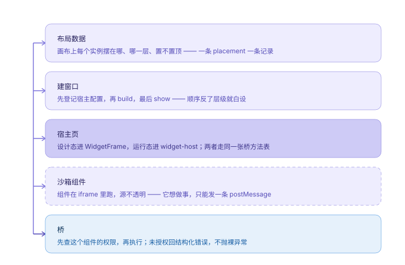

# AGENTS.md —— 接手这个仓库先读这一页

写给任何要在这个仓库里改代码的人或模型。目标：读完这一页，不用通读源码就能动手，且不会踩已经踩过的坑。

> 约定：这份文件只写**稳定事实**和**判断依据**。具体的坑与解法在 [docs/PITFALLS.md](./docs/PITFALLS.md)，组件协议在 [docs/WIDGET\_SPEC.md](./docs/WIDGET_SPEC.md)，取舍论证在 [docs/ARCHITECTURE.md](./docs/ARCHITECTURE.md)，代码签名的取舍在 [docs/CODE\_SIGNING.md](./docs/CODE_SIGNING.md)，agent 接入的协议与威胁模型在 [docs/AGENT\_ACCESS.md](./docs/AGENT_ACCESS.md)。它们与本文冲突时，以代码为准，并顺手修文档。
>
> **文档归改代码的这一方（模型）管，不归用户管。** 用户不读、也不写 `docs/`，不会替你判断一段推理该进 `design/` 还是 `ROADMAP` 的一行 —— 按 [docs/README.md](./docs/README.md) 的判据自己定，写完自己提交；别把“这要不要写文档 / 写成什么样”拿去问用户。
>
> **要写新文档先看 [docs/README.md](./docs/README.md)**：哪份该读、哪份该改、新内容该放哪（按你要做的事找 + 三问定归属 + "一份事实只有一个家"）。还没做的事在动手前的推理放 [docs/design/](./docs/design/README.md)，写完的结论要沉回 ROADMAP 一行。
>
> **这一页 600 多行，按这个顺序读**：第 4 节（二十条不变量，改任何代码之前）→ 第 8 节（已知缺口，别把缺口当 bug 修一半）→ 第 7 节（你要改的东西对应的配方）→ 第 11 节（怎么验证）。词不认识查 [GLOSSARY.md](./GLOSSARY.md)，剩下的按需查。

---

## 1. 这是什么

**棂 / Lattice** —— 可扩展的 Windows 桌面小组件平台。第三方用纯 HTML/CSS/JS 写组件，平台负责把它们安全地放到桌面上。

当前状态：**v0.12 已完成**（v0.11 的数据平面只剩「不唤醒窗口」这一处，见 §8；v0.13 的窗口层与八条命令已落地，只剩真机验收那几步，见 §8。安装包上的版本号是 `0.1.1` —— `v0.x` 是里程碑标签，不是发版号）。组件能装（拖文件夹 / 拖 `.lattice` 包 / 从商店装）、能变成真的桌面窗口、能拖能缩能锁，布局与组件数据重启不丢；商店是一份签名过的静态 JSON，带更新、回滚、举报、新权限复核；目录已经挂在公网上（GitHub Pages），默认读线上那份，带磁盘缓存和断网兜底；平台自己有 NSIS 安装包和自动更新；**agent 能调控桌面**（默认关的回环 HTTP 端点 + 8 个白名单动作 + 审计日志，`npm run agent -- state` 看它干了什么），数据平面（组件把能力声明成工具）也做了 —— 组件清单加一节 `agent.tools`，要一条独立的 `agent:tools` 权限；平台另外自带一个 **assistant**（桌面上一个独立小窗，`Ctrl+K` 开关；自备 OpenAI 兼容地址与 key，**模型档能存好几条**并存——DeepSeek 和本地 Ollama 各一条，key 只在 Rust 里，**回答是流式的**（SSE 逐字出来，按 Stop 当场断），工具调用走同一套 8 个动作，**外加六组"手"**（读文件 / 跑命令 / 取网页 / 看窗口 / 点键鼠 / MCP —— 默认**全关**，读自动放行、写与命令与点击先问一句，审计只记形状）；组件那侧只有 `llm:chat`，另有一条**借手**的 `assistant.ask` —— 桌宠这类组件说一句话，平台替它跑一整轮（工具表砍掉删除），要 `desktop:control`）。**对话在重启之后还在**：一轮一轮落在 `assistant-sessions/<id>.json`（一条会话一个文件），面板顶上那行能挑回来接着聊。没有服务端 —— 这是设计，不是还没做，见 [ROADMAP 的 v0.5 四个取舍](./docs/ROADMAP.md#v05-的四个取舍)。

想先知道"为什么现在是这样"，读 [ROADMAP 的「被推翻的九个决定」](./docs/ROADMAP.md#被推翻的九个决定)——每个决定都写着当初怎么选、被什么撞翻、现在怎么补。

技术栈：Tauri 2 + React 19 + TypeScript + Vite 8 + Zustand。Rust 侧只做窗口与文件，不碰 UI。

---

## 2. 三十秒上手

```bash
npm install
npm run dev          # 只跑前端（http://localhost:1420），不需要 Rust
npm run tauri:dev    # 完整桌面应用，改 Rust 会自动重编译重启
npm run tauri:build  # 出 NSIS 安装包
npm run typecheck    # tsc --noEmit，提交前跑一下
npm run store:index  # 打包 + 签名内置组件，写 public/store/（dev / build 会自动跑）
```

**浏览器里 `isTauri()` 为 false**，所以「投放到桌面」是灰的，其余（画布、组件沙箱、桥、权限）都能验。

工具链是 `windows-gnu`，缺 `windres` / `gcc`，`scripts/tauri.mjs` 会把 `../.toolchain/mingw64/bin` 和 `../.toolchain/gcc-shim` 塞进 PATH。**不要绕过这个包装脚本直接跑 `npx tauri`**，否则编译会在 `resource.rc` 上报错。

---


## 3. 目录地图

```
src/
  App.tsx                 平台外壳：顶栏、编排、桌面窗口回传事件的处理
  main.tsx                React 入口（平台外壳）
  assistantMain.tsx       React 入口（assistant 小窗）：只挂 `AssistantWindow`，**不加载 store**
  styles.css              平台样式层（CSS 变量 + 语义类，不引 Tailwind）
  widgetHost.ts           桌面窗口的宿主页：装 iframe、画窗饰、处理拖拽缩放
  widgetHost.css          窗饰与缩放手柄样式
  platform/
    store.ts              Zustand + 文件落盘适配器（Placement / 授权 / 主题 / desktopRects / 回收站）；`instanceIdFor` 是新实例 id 的唯一拼法
    Canvas.tsx            画布：放置、空态、缺失组件占位
    WidgetFrame.tsx       画布里的一个组件实例 = 一个沙箱 iframe + 拖拽缩放；**也是数据平面答话的那一份**（挂载时登记 `agent-call` 处理器，卸载按 handler 身份删）；`desktopMode` 下另有一份真窗口在跑时它退成静态卡（`poster`，判据 `canvasNeedsLiveFrame`），不挂 iframe
    LibraryPanel.tsx      组件库：已安装 / 可安装 / 加载失败 + 搜索过滤 + 评分与举报入口 + 回收站那一段（有内容才画）
    LibSection.tsx        可折叠的一段：标题行（开合 + 计数）+ 右侧动作位（组件库与属性面板共用）
    CatalogueSection.tsx  商店区：目录条目的一行（可展开：版本 / 权限差集 / 指纹）、安装 / 更新 / 换钥匙确认
    HelpContent.tsx       组件的"怎么用"：分节正文 + 可折叠变更记录；属性面板与卡片 `?` 共用这一份
    ReportDialog.tsx      举报与评分对话框（没有服务端，落成一份 JSON 文件）
    InspectorPanel.tsx    属性面板：三段折叠（层级与尺寸 / 外观 / 权限与选项）+ 底部移除区
    SettingsMenu.tsx      设置面板：左导航七区（Account / Appearance / Language / Desktop / Widgets / Assistant / About）+ 焦点陷阱（Ctrl+, 唤出）
    ProfilePanel.tsx      档案页：资料编辑 + 使用热力图（53 周）+ 清除记录 / Sign out（危险区沉底）
    Avatar.tsx            共用的首字母头像（顶栏齿轮、设置身份块、档案页）
    icons.tsx             16px 图标集（Glyph / ICON / ThemeGlyph / PanelGlyph / WidgetIconMark），顶栏、菜单、面板共用
    desktop.ts            Placement → WidgetWindowSpec，坐标换算，投放/收回命令
    autostart.ts          开机自启的读写与"路径漂移"判定（`Run` 注册表项）
    catalogue.ts          商店客户端：读目录（内置走 fetch / 远端走 IPC）、下载安装、备份与回滚、写举报
    DebugPanel.tsx        调试面板：桥调用与组件 console 的实时抽屉（Ctrl+Shift+D）
    assistant.ts          assistant 的 IPC 面：读写模型档（profiles）、列模型（测试连接）、跑一轮对话（工具循环 ≤24 步、审批、预算）、会话的读存删（`listSessions` / `loadSession` / `saveSession` / `deleteSession`，一条会话一个文件）；动作交给 surface（主窗口本地跑 / 小窗转给主窗口），新手交给 `platform/hands.ts`（走 Rust）—— `handGroup(name)` 非空就是后者（`AssistantSurface`）
    hands.ts              assistant 的手的 IPC 面：`assistant_tool` / `hands_cancel` / 开关读写（`assistant_hands*`）/ 模式（`assistant_mode*`）/ 技能包四条；参数序列化成字符串递过去，返回 `AgentReply` 形状
    agent.ts              agent 动作执行器：白名单动作走真 store，回快照（带每个组件的说明首句 `about`，没写说明就是空串）（`tests/agent.html` 70 条）
    widget-tools.ts       数据平面的执行面：画布实例的登记表（一个 instanceId 一个「能答话的 iframe」）+ `callWidgetTool`（8 秒超时、回话归一化、`not-running`）+ `listWidgetTools`（这一轮能调什么：清单 × 摆放，判据在 `runtime/widget-tools.ts`；小窗那份也是问它）；纯逻辑在 runtime/widget-tools.ts
    AssistantPanel.tsx    assistant 的面板：一列模型档 + 表单 + **常驻模式条**（内部 / 完全访问，0009；`mode` 的值仍叫 `internal` / `everything`；**只有状态，没有按钮**）+ **输入框左下那颗警示色药丸**（完全访问的入口/出口：`Enable Full access` ↔ `Turn off full access`，0009 §7）+ 六组能力开关（设置态那个入口是手那一段头上一颗「Enable Full access」，和药丸走同一个 `requestFullAccess` 的统一确认：勾「我明白风险」才能按、确认时顺手把六组拨开、只读档压住时按钮是灰的；完全访问期间六组画成勾且锁上）+ **审批档三选一**（Ask / Automatic / Read-only，`APPROVAL_LABELS`）+ 审批确认条 + 对话（顶上一行会话列表：挑回 / 新开 / 删），工具结果一行一个（抽屉与小窗共用这一个组件）
    AssistantWindow.tsx   assistant 小窗的壳：标题栏（底板 / 锁 / 藏 —— **没有"浮窗↔桌面"那颗**，它长得像最大化、2026-10-25 删了，见 0007；换层级现在走底板面板里那行 `On the desktop` 开关）+ 面板 + 底板三层（canvas 壁纸 / veil 底色 / 内容）+ 三个缩放手柄；底板面板是**一个明暗开关 + 浓度 + 模糊 + 一行层级开关**（`isDarkTint`，别改回三颗药丸）；标题栏图标一律 SVG + `currentColor`（emoji 是彩色的，一排里只有它不听话）；**没有 store**，动作走 `remoteSurface()`，窗口自己的状态走 `assistant-window.json` v2（0007）
  runtime/
    manifest.ts           清单校验与归一化；Permission 类型与中文标签（唯一真源）；`agent.tools`（组件声明的工具，规则在 runtime/widget-tools.ts）
    config.ts             每实例配置：清单 schema（5 类字段）、归一化、值合并
    help.ts               组件说明与变更记录：清单里的 `help` / `changelog`、上限、逐条丢弃（纯函数，`tests/help.html` 钉着）
    registry.ts           组件发现：bundled（public/widgets）+ user（%APPDATA%）；入口地址解析
    bridge.ts             RPC 桥：方法表、权限闸门、平台内置方法
    term.ts               终端的事件形状（`TermEvent` / `TermState`）：两个宿主只按 `instanceId` 转发，不解释正文
    appearance.ts         底板外观模型：归一化、合成色、亮度阈值
    diagnostics.ts        错误通道：认出组件报上来的错、去重指纹、挑主错误
    widget-reporter.js    注入进组件文档的上报脚本（**唯一真源**，两条发文档的路都读它）
    schedule.ts           心跳时间轴：可见性取"与"、不可见停摆、回来补一拍
    screen-fit.ts         纯几何：锚点选屏、夹紧（入参一律物理像素，`tests/screen-fit.html` 钉着）
    close-guard.ts        ✕ 该不该认这一下：指针序列 + 命中测试（纯函数，`tests/close-guard.html` 钉着）
    assistant.ts          assistant 的纯逻辑：8 个工具的函数表 + JSON Schema、工具表裁剪（`toolsFor`）与合表（`allTools` = 桌面动作 + 手 + MCP + **组件声明的工具**，四路都从这一个口进）、**三档审批的唯一判据 `approvalFor(name, mode, ctx)`**（`allow` / `ask` / `deny`，`ctx` 带 `everything` / `path` / `workspace`；`readonly` 排最前、平台自身配置在任何档任何模式下都要问，只读档连桌面表一起剪空）、system prompt（含手那一段、组件工具那一段与只读档的开口）、人设片段、历史裁剪（条数 + 字符数两道上限）、线上形状（`parseAskMessages` / `normalizeAskMessages`）、OpenAI 消息形状、快照压缩、商店里还没装的组件那一段（`CatalogueHint` / `aboutLine`，最多 8 条）（`tests/assistant.html` 188 条）
    skills.ts             assistant 的技能包（0005）的纯逻辑：`charCount`（按码点）、`normalizeTools` / `missingGroups`（"这个技能要用 Files，而它关着"）、`checkBudget`（4 份 / 4 000 / 8 000，返回原因与数字，话由界面说）、`promptsOf`（只挑启用了且没坏的）、`skillsPrompt`（"先照它，再照你自己的习惯" + 每份一节）（`tests/skills.html` 55 条）
    hands.ts              assistant 的手的纯逻辑（0004）：六个能力组、11 个工具的 JSON Schema、**两个模式的判据 `effectiveHands` / `modeIgnoresSwitches`**（0009：内部照存的开关、完全访问一律算开、不写盘）与 `grantAllHands`（**只写那六个开关**，由「Enable Full access」那道确认调用：先拨开六组、再写模式，所以你按完看到的六个勾就是它拿到的权力）、`HAND_READY`（拨得动 ≠ 接好了）、`handGroup` / `needsApproval` / `handsTools` / `handsPrompt` / 确认条那一行、MCP 发现结果合表（`mcpToolSpecs`）与命令行切词、一轮的预算（`tests/hands.html` 130 条）
    llm-models.ts         模型档的纯知识：按模型名前缀查能力（能不能调工具 / 能不能给 temperature / 上下文多大）、历史字符预算、三种鉴权形状（bearer / api-key-header / none）、七个服务商的预置填写（纯函数，`tests/llm-models.html` 42 条）
    llm-errors.ts         供应商失败的**前端那一半**（0014）：把 `@@llm:{…}` 抬头拆成「码 + 状态 + 供应商原话」，按码挑句子（`describeFailure`）；认不出就原样返回，所以每个错误位都能无脑套（`tests/llm-models.html` 钉着抬头字面量与 `llm_policy.rs` 一致）
    align-guides.ts       拖动时的对齐吸附：每条轴只挑一条获胜线，容器边界也是候选、且认原点；`guideLines` 再把获胜线变成一段局部虚线（以被拖的那张为中心、两端各伸出半个卡 + 48px，再夹进容器）（纯函数，画布与桌面共用，`tests/align-guides.html` 钉着）
    library-search.ts     组件库搜索：切词 + 命中判定 + 排序（档位 × 字段权重；`matchScore` 是唯一判据，`matchesWidget` 与 `rankWidgets` 都从它出去）（纯函数，`tests/library-search.html` 36 条钉着）
    trash.ts              组件回收站的纯逻辑（VELA §3.3）：留 20 条 / 7 天、同一实例一个坑、`canRestore`（组件还装着才让恢复）；条目就是 `ClosedPlacement`，不另存一份快照（纯函数，`tests/trash.html` 20 条）
    onboarding.ts         首次引导的纯逻辑（0011）：`firstRunVisible`（只在"没按过 `Got it` **且**一件都没装"时出卡 —— 少了后一条，老机器升级上来会被问一次"要开始吗"）、`catalogueDeadEnd`（源里没东西 / 全都装过早，两种"没得装"各说各的；搜索中闭嘴）（纯函数，`tests/onboarding.html` 22 条）
    i18n.ts               界面文案的中英切换：**key 就是英文原句**、缺翻译退化成英文、`useT()`（组件）/ `t()`（模块）/ `setLanguage()` / `languagePayload()`（给组件看的"现在是哪一门"，`tests/i18n.html` 钉着）
    i18n/*.ts             中文表按域分片（common / shell / library / panels / settings / assistant / misc）；**纯数据，一个 import 都不许有**
    widget-text.ts        组件**作者写的**文案：字符串或 `{ zh, en }`、`pickText` 按语言挑（缺一门退另一门）、`textVariants` 给搜索建两门索引、`normalizeLine` 管日期/单位（`tests/widget-text.html` 钉着）
    assistant-window.ts   assistant 窗口的**纯逻辑**（0007）：两个模式、尺寸上下限、`clampAssistantRect`、`defaultAssistantRect`、`migrateAssistantWindow`（v1 → v2、坏值逐项退回、坏文件坏 rect 都给一个能用的窗口）（`tests/assistant-window.html` 33 条）
    widget-tools.ts       数据平面的**纯逻辑**：清单 `agent.tools` 的归一化（坏条目逐条丢、最多 8 条 / 每条 6 个参数）、工具名 `widget.<组件 id>.<工具名>` 的拼与拆（**从右边切**）、给模型的 schema（同一组件的多份实例合成一条，`instanceId` 只在多于一份时必填）、谁能进表的唯一判据 `widgetToolSources`（装上了 + 授了 `agent:tools` + 真声明了）、回话归一化（超 4000 字符**拒绝不截断**）（`tests/widget-tools.html` 55 条）
    debug.ts              调试总线：环形缓冲 400 条、攒批镜像到主窗口、过滤 / 统计纯函数
    semver.ts             版本号与范围：解析 / 比较 / `^ ~ >= <= > < =` / 通配 / `||`（纯函数，`tests/semver.html` 钉着）
    usage.ts              使用记录与热力图：本地日键、固定阈值分档、53 周网格、连续天数、两种读回形状（纯函数，`tests/usage.html` 钉着）
    catalogue.ts          目录解析与安装计划：三道校验、挑版本、权限差集（纯函数，`tests/catalogue.html` 钉着）
assistant.html            assistant 小窗的宿主页（vite 第三个 input；独立入口 = 小窗不加载平台外壳与 store）
public/widgets/           官方组件包（未安装前只是"可发现"）
public/store/             内置商店目录（`npm run store:index` 生成：registry.json + packages/*.lattice，**不进仓库**）
examples/counter/         第三方组件的参考实现（用 SDK），拖进窗口即可安装
packages/sdk/             @lattice/sdk：零依赖 ES module + .d.ts + README（**唯一真源**）
scripts/
  widget-index.mjs        生成 public/widgets/index.json
  widget-diagnostics-plugin.mjs  给内置组件注入上报脚本（dev 中间件 + build 收尾）
  widget-diagnostics.test.mjs    注入规则的单测（`npm run test:injection`）
  create-widget.mjs       脚手架：`npm run create:widget -- <id>`
  pack-widget.mjs         目录 → .lattice（手写确定性 ZIP）
  sign-widget.mjs         ed25519 签名 / 验签 / 生成密钥（`npm run sign:widget`）
  store-index.mjs         打包 + 签名所有内置组件，写 public/store/registry.json（`npm run store:index`）
  winget-manifest.mjs     一个 NSIS 安装包 → winget 的三份 YAML（`npm run winget:manifest`）：直链与 SHA-256 都从那个 exe 现算，写 `dist-winget/`（不进仓库）
  winget-manifest.test.mjs  上面那道的形状：哈希大写、直链与附件名同源、Publisher 取 identifier 第二段、两次生成逐字节相同（`npm run test:winget`，11 条）
  dev-publisher.key       **开发用**签名种子（故意进仓库，见不变量 15）
  sdk-sync.mjs            把 packages/sdk 的两个文件刷进所有内嵌副本（`--check` 只查不改）
  sdk.test.mjs            副本一致性 + SUPPORTED_SDK 版本对齐（`npm run test:sdk`）
  check-tokens.mjs        三张表（字号 / 圆角 / 间距）的守门人，只读（`npm run check:tokens`）
  check-tokens.test.mjs   上面那道的测试：规则本身 + 仓库现状（`npm run test:tokens`）
  tauri.mjs               tauri CLI 包装（补工具链 PATH）
  lattice-agent.mjs       agent 客户端 CLI（`npm run agent -- state|act|ping`，零依赖）
  lattice-agent.test.mjs  上面那道的测试：起假端点，测请求形状与退出码（`npm run test:agent`）
  dev-llm-proxy.mjs       浏览器预览那条 `/api/llm` 中间件：`llm.rs` / `llm_policy.rs` 的替身（base URL、三种鉴权、失败码与那条 `@@llm:` 抬头、`assistant.json` 的读写）；**认得的归一化、不认识的顶层字段照抄回去**（0015）
  dev-llm-proxy.test.mjs  上面那道的测试：起假 provider，测请求形状、失败抬头与配置往返（`npm run test:llm-proxy`，28 条）
src-tauri/src/
  lib.rs                  命令注册、WebView2 启动参数、自定义协议注册、主窗口关闭守卫
  protocol.rs             lattice-widget:// 静态文件服务（用户组件的 HTML/CSS/JS）
  csp.rs                  组件文档的 CSP：一处生成策略，protocol.rs 只负责挂头
  egress.rs               出网闸门：WebView2 层拦帧导航，组件出不去
  guides.rs               桌面参考线：邻居窗口矩形 + 工作区交给前端算吸附，再把线交给叠层窗口
  guides_overlay.rs       参考线的两条 1px `WS_EX_LAYERED` 窗口 + 专用消息线程（不是透明 WebView2；每帧连尺寸一起改，所以线是局部短段）
  guide_policy.rs         上面那道的纯逻辑：虚线节拍、亮度、颜色解析（5 条 `rustc --test`）
  network.rs              出网代理（WinHTTP）：权限 → 白名单 → 形状，三道闸
  network_policy.rs       上面那道的纯逻辑：URL 解析 + 主机白名单匹配 + 白名单来源（12 条单测）
  crash.rs                ICoreWebView2::add_ProcessFailed 胶水：认崩溃类型、记账、重载
  crash_policy.rs         上面那道的纯逻辑：何时重载 / 何时放弃（9 条单测）
  diagnostics.rs          组件坏了给人看的东西：兜底页 + 注入的错误上报脚本
  runner.rs               Placement → 真实窗口的增量同步、宿主页配置、事件回传、暂停开关
  tray.rs                 托盘图标与菜单（打开主窗口 / 暂停全部 / 退出）
  watch.rs                组件目录监听（ReadDirectoryChangesW + 300ms 静默去抖）
  watch_policy.rs         上面那道的纯逻辑：读通知缓冲区（5 条单测）
  autostart.rs            HKCU Run 注册表项：开机自启的读写与修复
  autostart_policy.rs     上面那道的纯逻辑：命令行的拼 / 剥（5 条单测）
  desktop.rs              Win32：WorkerW 挂载、HWND_BOTTOM/TOPMOST、圆角裁剪、扩展样式、底层守卫
  visibility.rs           真实可见性：最小化 / 收起 / 被整个盖住，发 lattice:window-visible
  occlusion.rs            遮挡判定（Win32）：九点 WindowFromPoint + DWMWA_CLOAKED，点透窗口跳过
  occlusion_policy.rs     遮挡的纯逻辑：采样点怎么取、几个没命中算挡住（8 条 rustc --test）
  usage.rs                使用记录：按窗口焦点每分钟 +1，内存累加、每 5 分钟 / 退出落盘（usage.json）
  usage_policy.rs         上面那道的纯逻辑：日键校验、分钟累加、400 天裁剪（8 条 rustc --test）
  open.rs                 打开外链：把 shell.open 交给系统默认浏览器（协议由 open_policy 卡）
  open_policy.rs          上面那道的纯逻辑：只放 http/https、像地址栏一样补协议头（5 条 rustc --test）
  power.rs                电源读数（battery 组件用）：一次 `GetSystemPowerStatus` 拿交流 / 电池两态、百分比、剩余分钟与省电模式，直接调 Win32 不引 crate
  power_policy.rs         上面那道的纯逻辑：255 这类「不知道」的哨兵值、百分比上界、剩余时间只在放电时给（6 条 rustc --test）
  agent.rs                Agent 端点：只绑 127.0.0.1 的 HTTP、令牌、审计、转发给主窗口（默认关）；小窗要的 `assistant_snapshot` / `assistant_act` / `assistant_widget_tools` / `assistant_widget_call` 也复用这条转发（后两条是数据平面，见 0013）
  agent_policy.rs         上面那道的纯逻辑：HTTP 三态解析、Bearer 常量时间比对、动作白名单、`say` 的单行化与超长拒绝（26 条 rustc --test）
  llm.rs                  内置 assistant 的模型面：`assistant.json`（v4：`{version, mode, skills: {enabled}, activeId, hands, approvalMode, workspace, profiles[]}`）读写与 v1 就地升级、环境变量覆盖、十六个命令（llm_profiles / llm_profile_save / llm_profile_remove / llm_profile_activate / llm_set_key / llm_models / assistant_config_path / assistant_config_open / assistant_config_import / llm_chat / llm_chat_stream / llm_chat_cancel / assistant_hands / assistant_hands_save / assistant_mode / assistant_mode_set）、**模型档导入**（`assistant_config_import`：认三种形状 —— 裸数组 / `{profiles: […]}`（整份 `assistant.json`）/ v1 的平铺 `{baseUrl, model}`；同 id 先、其次同地址，空 key 不覆盖已有 key，手与工作区与审批一概不导 —— 语义写在 `merge_profiles` 上方）、**没带 key 的本机地址落成 `auth: none`**（空 Bearer 只会换来 401，和 `migrate_legacy` 同一句判断），**两个模式（0009）的存盘与切换也在这里**（`mode` 坏值一律落 `internal`，切换进审计）、**技能启用清单的存盘**（`skills_enabled` / `set_skills_enabled`，目录归 `skills.rs`）、出网走 `network::send` 或 `network::stream`、审计只记模型与字数
  llm_policy.rs           上面那道的纯逻辑：base URL 归一化与回环判定（`is_loopback` 判主机、`loopback_base` 判整个 base —— "没带 key 的本机地址"靠它认）、三种鉴权形状的请求头、档位 id 与显示名、请求体拼装（stream 只是多一个字段）、消息与工具校验、`/chat/completions` 与 `/models` 的应答解析、SSE 切帧与增量累加、401/404/429 的给人看的话（50 条 `rustc --test`，**不引 crate**）
  hands.rs                assistant 的手（0004）：`assistant_tool` 分发与 `hands_cancel`，文件（list/read/search/write）、命令（shell.run：PowerShell 子进程、25ms 轮询、超时/取消都真的 `kill()`）、网页（web.fetch：跟 ≤5 跳重定向、HTML 折成正文）、屏幕（screen.windows 列可见窗口 / screen.capture 拼 PNG）、键鼠（input.click/type/key 走 SendInput）、审计只记形状；**完全访问（`everything`）那两道闸在这里**（`mode_now` 每次调用现读配置、审计写不进去就不执行、行尾 ` · everything`）；`spawn_blocking` 里跑，别占异步运行时
  skills.rs               技能包（0005）的目录面：四条命令（assistant_skills / assistant_skills_save / assistant_skill_import / assistant_skill_remove）、扫 `skills/<id>/SKILL.md`（读不成的标 `damaged`，不拦列表）、导入（目录或一个 .md，撞名 `<id>-2`，200 KB / 2 MB / 200 个文件三道额度）、删目录并从启用清单里剔掉；**导入不启用**，正文随清单递给前端
  skills_policy.rs        上面那道的纯逻辑：front matter 三键解析（坏行逐条丢、BOM/CRLF 都认）、`id` 字母表与 `slug` / 撞名后缀、4 份 / 每份 4 000 字 / 合计 8 000 字三道上限（按码点算，超了**拒**不截断）（19 条 `rustc --test`，**不引 crate**）
  hands_policy.rs         上面那道的纯逻辑：工具名 → 能力组 / 审批档、`mcp.<server>.<tool>` 的形状、六个开关、**三档审批**（`APPROVAL_MODES` / `normalize_approval` / `readonly_blocks`：只读档拦的正是 `needs_approval` 为真的那些，和前端 `approvalFor` 同一句判据）、**两个模式**（`ASSISTANT_MODES` / `normalize_mode` / `effective_hands` / `everything_overrides`：坏值落 `internal`、`readonly` 优先，和前端 `runtime/hands.ts` 同一份判据）（21 条 `rustc --test`，**不引 crate**）
  fs_policy.rs            文件那几只手的额度：路径归一化、二进制判定、行/字数上限、搜索跳过表、子树判定（14 条 `rustc --test`，**不引 crate**）
  shell_policy.rs         命令那道的形状：超时夹紧、空命令/NUL/`\r` 拒绝、输出按行截断（9 条 `rustc --test`，**不引 crate**）
  web_policy.rs           网页那道的形状：`Location` 解析（绝对 / `//` / `/` / `?` / 相对 + `.`/`..` 折叠）、HTML 折正文（去 `script`/`style` 体、块级换行、实体表）、字符上限与截断（21 条 `rustc --test`，**不引 crate**）
  screen_policy.rs        屏幕那道的形状：窗口判据（不可见 / cloak / 无标题 / 零尺寸）、标题压平与按字符截断、截图落点、PNG 容器（签名 / IHDR / IDAT / IEND、CRC32、每行滤波字节、stored zlib）（21 条 `rustc --test`，**不引 crate**）
  input_policy.rs         键鼠那道的形状：键名 → 虚拟键码（含 F1–F24 与 OEM 标点）、`Ctrl+S` 解析、文字 → UTF-16 按键序列（中文 / emoji / 换行）、虚拟桌面归一化到 0..65535（23 条 `rustc --test`，**不引 crate**）
  term.rs                 终端组件（`lattice.term`）的那条常驻 shell：一实例一条 `powershell.exe`（`pwsh` 兜底）、哨兵切分、输出按 `lattice:term` 事件推、环形补发、两条收尸路（实例销毁 / 应用退出）；三只命令 `term_write` / `term_stop` / `term_state`，外加 `term_dispose`
  term_policy.rs          上面那道的纯逻辑：哨兵与命令脚本（UTF-8 → base64 那条通道）、preamble、安全前缀切分（**整段**哨兵也要留住，等换行）、`Done` 解析、退出码（cmdlet 失败不借上一条原生命令的旧码）、环形缓冲上限、单命令 64KB 夹紧（16 条 `rustc --test`，**不引 crate**）
  mcp.rs                  assistant 的第六只手（0004 的 P6）：`mcp.<server>.<tool>` 的发现与执行 —— `mcp.json`（`{version, servers: [{id, label, transport, command, args, url}]}`）读写、两种传输（stdio：`cmd /C` 起子进程 + 换行分隔的 JSON-RPC + `CREATE_NO_WINDOW`；http：streamable POST + SSE `data:` 帧 + 回 echo `Mcp-Session-Id`）、`initialize` → `notifications/initialized` 握手、`tools/list` 发现与 `tools/call`、三个命令（mcp_servers / mcp_servers_save / mcp_tools）；**一次调用一条连接，不复用**；`spawn_blocking` 里跑
  mcp_policy.rs          上面那道的纯逻辑：工具名三段形状（`mcp.<server>.<tool>`）、服务 id 的字母表与撞名去重（`_2`）、工具段压成 `[a-z0-9_-]`、`cmd /C` 的命令行拼装与引号、换行分隔 JSON 的切帧、三种请求体（initialize / tools-list / tools-call）（17 条 `rustc --test`，**不引 crate**）
  assistant_session.rs    assistant 的会话存档：`assistant-sessions/<id>.json` 的读写列删（四条命令 assistant_sessions / assistant_session_load / assistant_session_save / assistant_session_delete），保存时按 200 条 / 1 MB 两道预算裁最老的、`truncated` 写回文件让人知道"它掉过头"；标题取第一句用户的话前 12 个字（算不出来就存空串，界面自己翻）；坏文件不拦列表，标 `damaged: true`
  assistant_session_policy.rs  上面那道的纯逻辑：id 形状、标题截断（按码点不按字节）、留哪些行的三道筛（坏行丢 / 条数 / 字节）、熵源 → 4 位后缀（15 条 `rustc --test`，**不引 crate**）
  assistant_window.rs     assistant 的桌面小窗（0002 / 0007）：建 / 开关 / 藏、两种模式（浮窗 / 桌面，「桌面」走 `interactive` 那条路而**不是** WorkerW —— 挂了就拿不到键盘焦点）、底板、锁、缩放；状态 `assistant-window.json` v2（v1 的 `{x, y}` 就地升级）；八条命令全在册（`toggle` / `hide` / `save_pos` / `state` / `mode` / `appearance` / `locked` / `save_rect`，一律 `async fn` —— 同步命令会占着主线程去等主线程）
  wallpaper.rs            截壁纸（宿主页底板的第一层）
  metrics.rs              系统指标（sysmon 组件用）：整机 + 逐核 CPU、内存与提交量、磁盘、网络、开机时长 / 进程计数，直接调 Win32 不引 crate
  metrics_policy.rs       上面那道的纯逻辑：累计计数 → 占用率、核数变了返回空而不是错位（5 条 rustc --test）
  media.rs                SMTC 媒体会话：读当前播放 + playPause/next/previous/stop（WinRT）
  audio.rs                声音高低：默认输出设备的 WASAPI 回环采集，一个后台线程写、命令只读（只出一个 0..1）
  audio_policy.rs         上面那道的纯逻辑：RMS → 分贝 → 0..1、释放曲线、包络（6 条 rustc --test）
  package.rs              .lattice 解包：inflate + 核 CRC + 原子安装（先解到 .incoming 再换名）
  package_policy.rs       上面那道的纯逻辑：读中央目录、路径规则、体积上限（11 条单测）
  signature.rs            ed25519 验签 + sha256（三道校验的前两道，4 条单测含一条跨语言向量）
  signature_policy.rs     上面那道的纯逻辑：hex / base64 / 指纹 / id 规则（8 条单测）
  backup.rs               覆盖安装前的备份与回滚（回滚是**交换**，只留一代）
  store.rs                商店命令：取目录、下载包（带缓存）、验签安装、写举报
  instance.rs             单实例：命名互斥体 + 命名事件
  state.rs                平台状态落盘（state.json，原子替换）；**读的时候先剥 BOM** —— 这份文件可手改、可备份回去，而记事本 / `Set-Content -Encoding utf8` 会写 `EF BB BF`，前端 `JSON.parse` 一抛就落默认值、再整份写回去（布局静默归零，见 PITFALLS「状态落盘」那条）
  widget_store.rs         组件私有存储落盘（widget-data/<id>.json）
  widgets.rs              用户组件的扫描 / 安装 / 卸载
src-tauri/installer-hooks.nsh  NSIS 钩子：卸载时删掉 Run 注册表项（只此一处）
src-tauri/capabilities/
  default.json            主窗口权限
  widget.json             组件窗口权限（widget-* 标签）
  assistant.json          assistant 小窗权限（window "assistant"；含 `start-dragging`）
tests/                    纯逻辑与布局的浏览器断言（tests/*.html，跑在 dev server 上）
docs/                     架构、组件规范、路线图与踩坑、代码签名取舍
```

---


## 4. 二十条不变量（改代码前必读）

1. **零内置**。平台本身不含任何组件。随应用分发的包（`bundled`）必须显式"安装"（记进 `installedIds`）才可用；用户目录里的包（`user`）在磁盘上即已装。不要为了"体验好一点"让 bundled 自动可用，那会把扩展平台退化成桌面工具。
2. **两个宿主，一套桥**。画布里的 `WidgetFrame.tsx` 和桌面上的 `widgetHost.ts` 都必须走 `runtime/bridge.ts` 的同一张方法表。**任何"只在预览能用"或"只在桌面能用"的分叉都是 bug**，不是特性。画布在桌面模式下退成静态卡（`poster`）不算分叉：那一份根本没在跑，跑的是真窗口那一份，两条路仍是同一张方法表 —— 谁要"修"它，先看 `runtime/widget-tools.ts::canvasNeedsLiveFrame` 和 PITFALLS「可见性与调度」最后一条。
3. **鉴权靠窗口引用，不靠 origin**。沙箱 iframe 的 origin 是字符串 `"null"`，所有组件一样，`event.origin` 分不出实例。必须 `event.source === iframe.contentWindow`。
4. **权限按 `widgetId` 授予，不按实例**。语义是"你信不信任这段代码"，跟桌面上摆了几份无关。
5. **落盘不用 localStorage**。这台机器上 WebView2 把 localStorage 放内存里，进程一退就没了。所有持久化都走文件（`state.json` / `widget-data/*.json`），写入用"临时文件 + 原子替换"。
6. **底板是平台的，组件只读令牌**。颜色 / 浓度 / 磨砂由宿主页画（`wallpaper.rs` 截壁纸 + `widgetHost.ts` 三层叠），组件一行代码都不参与。所以：`html, body` 必须保持透明；组件里**不许写死颜色**，字色、强调色、描边全部取 `--lattice-text` / `--lattice-accent` / `--lattice-border` —— 底板一变浅，平台会把它们整体翻一遍，写死的值不会跟着翻。出厂外观（`auto / 1 / 0`）下平台**不覆盖任何令牌**，默认样子必须跟没有这个功能时一像素不差。
7. **错误通道不是桥**。`__lattice_diag`（组件报错）和 `__lattice`（桥请求/响应）是两条独立的消息，两个宿主都必须**先认错误、再认桥**，而且 `isWidgetErrorReport` 只认结构不认来源 —— 来源校验（`event.source === iframe.contentWindow`）在它之前做。混在一起的后果不是崩溃，是**组件能靠伪造一条"错误"骗到宿主的一次回话**，或者反过来每次加载都弹一张错误卡。改 `runtime/widget-reporter.js` 里的 `tag` 就要同步改 `runtime/diagnostics.ts` 的 `REPORT_TAG`，`tests/diagnostics.html` 钉住了这个字面量。
8. **权限是活的，不是启动快照**。用户在属性面板撤掉一项，**已经开着的窗口必须当场失去它**。两个宿主各存一份 `granted`（`widgetHost.ts` 的 `Set`、`WidgetFrame.tsx` 的 `grantedRef`），桥每次调用都读它；Rust 侧 `HostConfig.permissions` 由 `sync_widget_windows` 每轮比对，变了就 `emit_to("lattice:widget-permissions")`。四条约束：比对必须**先排序去重**（grants 数组换个顺序不等于权限变了，否则点一下开关就重载一次组件）；载荷必须带 `instanceId`（`emit_to` 是广播，见第 9 条）；宿主收到后既要换集合**也要** `reloadWidget()`（只换集合的话，组件在授权前写进界面的"权限被拒"不会自己回头）；`create()` 里登记 `HostConfig` 时也要用排好序的那份，否则新窗口第一轮同步就会误判成"变了"；画布卡片上那句 `Needs …`（`WidgetFrame` 的 `missing`）要按最新 `grants` 过滤，只在点 `Grant` 时清的话，用户改从属性面板勾回来就会一直挂着。
9. **`emit_to` 是广播，收件人自己认领**。`emit_to(label)` 听着像"只发给那个窗口"，其实不是：JS 侧 `listen()` 注册的监听器 target 是 `Any`，而 Tauri 的匹配规则是 `target == Any || filter(target)`（`event/listener.rs::match_any_or_filter`）—— **任何** emit 都会送到**每个**窗口的 `Any` 监听器上。所以凡是"发给某个窗口"的事件，载荷里都要带身份（`instanceId` 或窗口 `label`），由宿主页比一次再处理。不带的后果不是报错，是**串味**：拖 A 的底板滑杆四张卡片一起变色，撤 A 的一项权限四个组件一起重载、未落盘的草稿当场丢。`lattice:theme` 是唯一**故意**全局的（平台切明暗，所有窗口都该跟着换）。
10. **看不见就别跑**。组件的心跳一律挂在 `runtime/schedule.ts` 的时间轴上，不自己 `setInterval`。窗口不可见时整条时间轴停摆，回来只补一拍。**"不可见"有两个来源**：`document.visibilityState` 和 Rust 发来的 `lattice:window-visible` —— 前者对"窗口最小化"完全无感（实测最小化前后都是 `visible`），只盯它等于没停。加了新的"窗口状态"判断，先想清楚该不该停摆，别在组件里各写一套。
    - **`requestAnimationFrame` 不是例外，是另一件事**：它画的是"这一帧的读数"，正确性不依赖它跑多少拍 —— 秒表存的是按下去的那一刻，卡片藏起来时 rAF 自然停，回来按时间戳重算一次就是对的。需要**平台在不可见时也保持节奏**、或者要**多组件对齐同一拍**的，才必须走时间轴。另外时间轴的最小间隔是 250ms（`MIN_INTERVAL`），拿它刷百分秒会每帧跳 25 个数，看着像卡了而不是在计时。
    - **但它照样要有停的条件**："卡片藏起来时 rAF 自然停"只在**整个 webview 被藏起来**时成立，窗口被收起 / 最小化 / 盖住时它照跑。所以宿主把可见性当推送下发（`{ type: "visible" }`，`schedule.ts` 的 `subscribeWindowVisible` → 两个宿主 → SDK 的 `on("visible")`），自己开帧循环的组件**必须接**。还闲着的时候要降帧：桌宠每帧整屏重绘 25 个部件，60fps 空转实测 1 核，20fps 呼吸看不出区别（`dt` 夹在 0.05 正好对上 20fps 的步长，动画速度不变）。见 PITFALLS「可见性与调度」。
11. **关窗口 ≠ 删用户数据**。`widget_close` 收一个 `reason`，**只有 `reason == "user"`（宿主页 ✕ 按钮）才发 `lattice:widget-close` 让主窗口删 placement**；别的来路（组件自己调桥的 `window.close`、或将来任何新入口）只关窗口，实例记进 `Runner.suppressed`，本次运行不再重建。placement 是用户摆好的布局，属于用户数据；窗口只是它的一个渲染。一条命令兼两种语义的代价，是任何一次意外调用都会静默删掉用户的东西 —— 这条坑真实发生过三次。加新的"关闭"入口时，`reason` 必须显式传，不许省；`widget_close` 里那行 `eprintln!` 也不许删，它记录的正是"谁关的"。（`reason: user` 这一路仍然会真的删 —— 手滑的兜底不在这里，在 UI 侧：`removePlacement` 会把快照留在 `lastClosed` 里、主窗口底部弹 8 秒 `Undo`，**同时**塞进落盘的 `trash`（组件库底部的"最近删除"，留 20 条 / 7 天，判据在 `runtime/trash.ts`）。两条兜底答的是两个问题：撤销条救"手滑当场"，回收站救"当时没看着屏幕"。所以**别在 `removePlacement` 之外的地方直接 `filter` 掉 placement**，那等于两条兜底一起绕开；也别只塞其中一处 —— 只进 `lastClosed` 的话，8 秒之后那件东西再也没有去处。）
12. **组件的 CSP 只在 `csp.rs` 里改**。组件是不可信代码，沙箱挡"碰宿主"，CSP 挡"往外发"。四条必须记住的：
    - **`'self'` 在这里是废的**。组件跑在 `sandbox="allow-scripts"` 的 iframe 里，文档源是 opaque，`'self'` 匹配不到任何东西 —— 写上等于把组件自己的 `widget.js` 也拦了，组件白屏。协议源必须显式写出来。
    - **协议源跟平台走**：Windows 是 `http://lattice-widget.localhost`，别处是 `lattice-widget://localhost`，必须和 `runtime/registry.ts::widgetSchemeBase` 一字不差。两处对不上，症状是"组件坏了"，最难查。
    - **`connect-src` 收在组件自己的 origin 上，不是 `'none'`**。组件 `fetch("./data.json")` 是正当用法；而放行自己的 origin 不构成出网通道 —— `lattice-widget://` 是只读文件服务，GET 只回这个组件自己的文件。
    - **CSP 不等于堵死**。`location.href = "https://…/?d="` 这种自我导航它管不了（没有 `navigate-to` 指令）。这道缝由 `egress.rs` 补：每个组件窗口建完立刻挂 `FrameNavigationStarting`，在导航发生前取消。**别把这条当成"以后再说的加固"** —— 它和 CSP 是一套的两半，只有 CSP 的话，组件照样能把数据拼进 URL 送出去。
13. **配置按实例，权限按组件**。`grants` 的键是 `widgetId`（问的是"你信不信任这段代码"），`configs` 的键是 `instanceId`（问的是"这一份要怎么显示"）。两者别互相借：配置挪到 `widgetId`，两个时钟就共享 12/24 小时制；权限挪到 `instanceId`，用户要为同一个组件授权两遍。**值只在 `runtime/config.ts::resolveConfig` 里合并**（缺的键补出厂值、非法值退回出厂值），Rust 只透传 —— 规则散到两边，画布和桌面就会显示得不一样。配置变化**不重载**组件（推 `config-changed`），只有权限变化才重载。
14. **联网是"按组件的白名单"，不是"有权限就能连"**。`network.fetch` 过三道闸，顺序不能换：`permissions` 里有 `network` → 目标主机在 `manifest.network.hosts` 里 → 请求形状合法（方法 / 头数 / 体积）。四条别踩回去的：
    - **没有通配符，这是故意的**。`*.example.com` 写起来方便，但它把"我允许这一个接口"变成"我允许整个域"，而这个平台的权限面板只显示一行名字 —— 用户没法审阅到底放行了什么。要多个主机就列多个。
    - **端口算身份的一部分**。`127.0.0.1:8787` 不等于 `127.0.0.1`；不写端口就是默认的 80 / 443。少了这条，"允许本机调试端口"等于"允许本机全部端口"。
    - **重定向必须关掉**（`WINHTTP_OPTION_REDIRECT_POLICY_NEVER`）。跟随 302 等于白名单失效：放行 `a.com`，`a.com` 把组件 302 到 `evil.com`，数据就出去了。现在的行为是把 302 原样当响应交回组件，由组件自己决定要不要再发一次（那时又要过一遍白名单）。
    - **走 IPC，不搭本地 HTTP 代理**。开一个 `127.0.0.1:xxxx` 的代理端口就等于给组件留了一条绕过桥的路（它 `fetch` 那个端口没人拦），而 IPC 通道只有宿主页能说话。
    - **画布上的实例也要能出网**（`network_policy::egress_for`）。白名单在桌面窗口那条路上存在 Rust 的注册表里（建窗口时写进去的），而画布上的实例**不是窗口** —— 它跑在主窗口的 iframe 里，注册表里没有条目。第一版没做这条兜底，结果是同一个组件"桌面上能联网、设计器里不能"，而设计器恰好是用户第一次配置它的地方，症状是刚加进来就报"连不上服务"。现在未注册的窗口退回宿主页随请求带来的 `network.hosts`（`bridge.ts` 的 `egress`）。**在册的窗口一律用自己那份**：窗口已经注册了还去信请求里那份，等于让一个前端 bug 悄悄扩大出网范围。
        
      这条是**加了一扇门，不是拆了别的门**：CSP（不变量 12）和 `egress.rs` 的导航拦截照旧生效，组件仍然不能自我导航把数据拼进 URL 送走。
    **`shell.open` 是另一扇门，也只开一条缝。** 组件要把链接交给系统浏览器，只能走 `bridge.ts` 的 `shell.open`（权限 `shell:open`）→ `open.rs`。三条别踩回去：
    - **协议白名单只有 http/https，写在 `open_policy.rs` 里。** `tauri-plugin-opener` 把字符串原样丢给 `ShellExecuteW`，而它**不认协议** —— `file:` 会把本地文件交给默认程序打开，`ms-settings:` 能直接翻到系统隐私页，`search-ms:` / 任何注册过的自定义协议一样照办。少这一道，`file:///C:/…` 比联网彻底得多。
    - **别在组件里另写一套放行规则。** 组件侧只做"让存下来的东西是干净的"（`github.com` → `https://github.com/`、`example.com:8080/x` 认成主机加端口），边界上 `open_policy::normalize` 再判一次；两边的用例表在 `tests/bookmarks.html` 和 `open_policy.rs` 的 tests 里各钉一份。
    - **它不削弱 `egress.rs`。** 那条拦的是"组件自己的 frame 导航走"，这条是"把地址交给浏览器"，组件的文档仍然钉在自己的 origin 上。
15. **分发的信任锚点是包，不是目录**。装一个包要过三道，顺序不能换：`sha256(字节)` 等于目录里写的 → ed25519 签名能被 `publisher.key` 验过 → 这把钥匙等于**这个组件第一次安装时钉在本地的那把**（`store.trustedKeys`）。前两道挡传输损坏和伪造，第三道才挡得住"另起一把钥匙、连目录一起换掉"。五条别踩回去：
    - **目录本身不签名**，它只是索引。所以"目录能改"这件事必须由上面三道兜住 —— 谁想给目录加个新字段去驱动行为（自动安装、自动更新、静默授权），先想清楚这个字段被改坏之后会怎样。
    - **先验签名再看版本**。反过来的话，换了钥匙的包会被当成"一次普通更新"直接装进去，用户连提示都看不到（`planInstall` 里那两行的顺序就是这么定的）。
    - **换钥匙必须由用户点头**。`planInstall` 返回 `untrusted` 时界面要同时印出**两把**指纹，点一次确认才继续；不要"检测到新钥匙就自动信任"。
    - **覆盖安装之前必须备份，回滚是交换不是复制**。`backup.rs` 只留一代；用复制实现回滚的话，连点两次会回到同一个旧版本，用户会以为按钮坏了。三条安装路径（目录安装 / 拖文件夹 / `.lattice`）走同一条备份规则，否则"拖文件夹"会成为唯一一种没法回滚的安装方式。
    - **新版本多要的权限不自动授予，但也不禁用组件**。自动授予 = 把"更新"变成一次静默提权；禁用组件 = "更新完就不能用了"。正确形状是"照旧能用 + 一条不会自己消失的横幅，直到用户处理"。`flagPermissionReview` / `resolvePermissionReview` 是唯一入口，别在别处直接改 `grants`。
16. **平台更新和组件更新是两套东西，别混**。组件走目录 JSON + `.lattice` 包 + ed25519；平台走 `latest.json` + NSIS 安装包 + minisign。两条路径不共用代码，只共用"静态文件 + 签名 + 没有服务端"这个思路。四条别踩回去：
    - **两把钥匙，两个私钥位置**。组件发布者的 `scripts/dev-publisher.key` 是**故意公开**的（演示目录用）；平台更新的 `.keys/updater.key` 必须保密 —— 它泄露等于任何人都能给你所有用户推假更新。`.keys/` 在 `.gitignore` 里，公钥在 `tauri.conf.json` 的 `plugins.updater.pubkey`。
    - **只在用户点击时检查，没有后台轮询**。加了轮询就要回答"多久一次、失败重试几次、用户关了怎么办"，而收益只是"早几天知道"。
    - **装完 `restart()`，不是 `exit()`**。新二进制只有新进程才会跑；更新完应用自己消失，用户会当成更新失败。走自定义命令 `restart_app`，不引 `plugin-process`。
    - **release 先出草稿**。`/releases/latest` 只认已发布的 release，草稿期间更新器查不到东西（等于没发）。先发再验 = 拿全体用户当灰度。
    - **发布时别勾 "Set as a pre-release"**。`/releases/latest` 跳过的不只是草稿，还有**预发布**：勾上之后 release 页面正常、产物都在、`releases/download/v0.1.0/latest.json` 也 200，唯独 `releases/latest/download/latest.json` 是 404 —— 也就是更新器会去敲的那个地址。v0.1.0 就这么挂了一版。症状更坑：插件对**任何非 2xx** 都只记日志，最后统一抛 `Error::ReleaseNotFound`，跟真断网**是同一句话**，界面上于是显示"检查你的网络"。`describeUpdateError` 现在先认这一条再认网络（`tests/updater.html` 14 条断言钉着），但根治还是别勾那个框。
17. **说明写在清单里，改了行为就补一条 changelog**。组件的"怎么用"是 `manifest.json` 的 `help`，不是包里的 README —— 组件是纯静态目录，平台没有 Markdown 渲染器，写进清单才能跟着包走（同目录、同提交、同签名）、离线能看、第三方能用，还能被 `tests/help.html` 真的读出来对账。四条别踩回去：
    - **坏条目逐条丢**，和 `config` / `icon` 同一条规矩。一节没标题、一条是空串、版本号不合法 —— 丢那一条，包照常加载。说明是锦上添花，不该有"让组件打不开"的权力。
    - **上限不是建议**。6 节 × 6 条 × 160 字、变更 12 条 × 8 项，`runtime/help.ts` 里是真截断。放宽它之前先想清楚 320px 面板放不放得下。
    - **改了组件行为，同一次提交里把当前版本那一条 changelog 补上**。`tests/help.html` 会红：写了说明的组件，changelog 里必须有 `version === manifest.version` 的那一条。写用户能看懂的话（"拖动排序"），不写内部重构。
    - **每个 `config` 字段都得有交代**：要么字段自带 `help`，要么在说明正文里被提到。用户看见一个开关却不知道它干什么，等于没做这个开关。这条也是 `tests/help.html` 钉着的。
18. **先画第一帧，再等桥**。组件的 `config.get` / `storage.get` 都是往返，宿主慢一点（或者根本没宿主）就是几秒钟的空白卡片 —— 而第一帧要画的通常只是默认值（`00:00.00`、`m → ft`）。正确顺序是：同步按默认值渲染 → 发请求 → 回来再改。三条别踩回去：
    - **存档迟到时用 `touched` 闸门挡住**。桥回来之前用户完全可能已经点过分类、打过数字，这时候再把存档盖上去，等于把他刚做的选择撤销掉。宁可这次不恢复，也不能吃掉用户的操作。
    - **别把"等桥"写进首屏路径**，也别用"加载中"占位 —— 空白卡片和骨架屏只是把同一个等待画得更久。
    - 自检页顺带受益：DOM 同步就有了，`tests/convert.html` / `tests/stopwatch.html` 可以直接操作组件自己的按钮，不用先等桥超时（`config.get` + `storage.get` 各 3 秒，最坏 6 秒）。
19. **先定名，再写代码**。仓库里已经有名字的东西就用那个名字，没有就当场定一个写进 [`GLOSSARY.md`](./GLOSSARY.md) —— 别在代码、文档、对话里各叫一个。四条：
    - **撞名先裁再写**。一个词指两件事的时候（`目录` 曾同时指商店的清单和文件系统的文件夹；`store` 曾同时指 Zustand 容器、磁盘存储和商店），先定一个、把另一个改掉，再动手。留着"靠上下文能分清"的代价是：读的人（和模型）每次都要猜一次，而**猜错不会报错**——它会一路写下去，最后你在一个数据丢失的 bug 里才发现两边说的不是一个东西。
    - **术语表只收跨块共用的词**。边界是"组件作者能看见，且前端 / Rust / SDK 都会用到"。某个 slice 的内部字段、某条 Rust 命令名不进表——代码本身就是它的家。
    - **术语表定"是什么"，规范定"必须怎样"**。同一个词在 `WIDGET_SPEC` 里有行为约束时，`GLOSSARY` 只写一句话定义加一条指向，别把契约抄第二遍（`docs/README.md` 第四节）。
    - **改术语表用精确替换，不许整份重写**。它和第 12 节第 7 条那几个文件一样是冲突高发区：改完立刻 `git add GLOSSARY.md && git commit`。术语表被写歪不会报错，只会让后面每一份文档都跟着歪，所以**新增或改动条目后看一眼 `git diff`**，纯措辞微调可以跳过。
20. **流式的东西走事件，不走桥的返回值；活的东西要有两条收尸路**。终端组件（`lattice.term`）是第一个"一条命令的输出比一次调用活得久"的能力，四条别踩回去：
    - **桥是一问一答的，流只能走事件**。`term.write` 只回编号，正文从 `lattice:term` 一条条来（Rust `emit` → 宿主页按 `instanceId` 转发 → iframe）。把 `ping -n 10` 塞进一个 Promise 的后果不是"慢一点"，是"等十秒一次性出现"——而那正好是终端最不能忍的。任何新能力只要"边跑边有话说"，都按这个形状来（`llm_chat_stream` 同一条）。
    - **输出要留补发缓冲**。窗口藏起来回来、权限变更重载 iframe，中间那段事件会缺；`term.state { since }` 让平台把 `seq` 之后的缓冲重发一遍（环形缓冲，`term_policy::RING_EVENTS` / `RING_BYTES`）。只有 `seq` 没有正文的"对账"是假的 —— 组件缺的是那几行字。
    - **常驻进程要有两条收尸路，少一条就漏**。一条是实例销毁（画布：宿主页卸载时 `term_dispose`；桌面：`runner.rs` 的 `WindowEvent::Destroyed` → `term::kill_instance`），另一条是应用退出（`RunEvent::Exit` → `term::kill_all`）。只挂第一条，"组件早删了、进程还在"会一直留到重启；只挂第二条，用户关一张卡片就多一个 `powershell.exe`，而任务管理器里没人知道它是谁的。
    - **每个实例一条进程，别按命令起进程**。实测每条命令 480ms 起步（常驻之后约 40ms），而"每条命令起一个"还会顺手丢掉 `cd` 和变量 —— 于是"终端"就变成了"命令输入框"。代价要写在组件说明里：跑不了 `vim` / `ssh`，没有 `Ctrl+C`（停 = 杀 shell），没有 ANSI 颜色。

---

## 5. 一次组件渲染，链路上有谁



五跳在代码里的落点：`buildSpecs()` → `sync_widget_windows` → `runner.rs::create` → `widgetHost.ts::boot` → `handleBridgeRequest()` → `defineMethod` 的 handler。

几个容易搞错的地方：

- **建窗口必须 `show()` 在 `apply_to()` 之前**。`ShowWindow` 会把窗口提到最前，顺序反了层级就白设。
- **`sync_widget_windows` / `close_widget_windows` / `widget_close` 必须是 `async fn`**。同步命令跑在主线程，而 `build()` 要把建窗口的活投递回主线程再等结果——命令占着主线程等自己，直接死锁。
- **不要维护 `Mutex<窗口表>`**。窗口存在性交给 `app.get_webview_window`；Runner 只存极轻的 `HostConfig`，且必须在 `build()` **之前**写入，宿主页随时来问都能立刻拿到。
- **同步是增量的**。`Runner::diff` 只写变化的维度（pos / size / layer）。无条件 `set_position` 会把用户正在拖的窗口拽回去。
- **同一时刻只允许一条同步在飞**。`desktop.ts` 的 `serial()` 把 `syncDesktop` / `closeDesktop` 串成一条链。两条并发跑会各自查到 `get_webview_window(label) == None`，然后各 `build()` 一次 —— 同一个实例出现两个窗口，一个归 Tauri 管、一个是孤儿（位置尺寸完全一样，看着像只有一个，其实两份 WebView2）。并发建窗口还会把 IPC 拖到超时，界面上那颗按钮从此永久变灰。
- **关主窗口 ≠ 退出**。桌面上还有组件窗口时，`lib.rs::guard_main_close` 会 `prevent_close()` + `hide()`。真正的退出是设置菜单里的 `Quit Lattice`（`quit_app`）或托盘菜单的 `Quit`。别把 `hide()` 换成 `close()`：主窗口一旦销毁，唤回它的入口就只剩托盘和单实例事件（`Local\Lattice.Wake`），少一个就是"用户只能去任务管理器"。
- **单实例靠 Win32 命名对象**（`instance.rs`）：互斥体 `Local\Lattice.Instance` 判重，事件 `Local\Lattice.Wake` 唤回。互斥体句柄**不能** `CloseHandle` —— 关掉对象就消失，下一个进程会以为自己是第一个。
- **两套坐标**。`placement.x/y` 是画布坐标，`desktopRects[instanceId]` 是屏幕坐标。投放时优先用后者。主窗口最小化后 `screenX/screenY` 是 `-32000` 这类哨兵值，`desktop.ts` 里有缓存兜底，别删。
- **宿主页是三层，不是一层**。`canvas`（壁纸，`filter: blur`）在 z=0，`veil`（底色 rgba）在 z=1，`iframe`（组件）在 z=2，内描边在 `body::after`（z=5）。往宿主页加任何全屏元素之前先想清楚它该落在哪一层 —— 内描边当初就因为画在 `body` 上被壁纸层盖掉了。
- **外观变更走 `Appearance` 这一个字段**，有两条路，别再加第三条：`widget_set_appearance` 是拖滑杆时的即时通道（面板直接推给那个窗口），`sync_widget_windows` 是兜底（新窗口、重启、画布上还没投放的实例）。两者都经过 `Runner::set_appearance`，它只在真的变了才 `emit`，所以同一次改动被两条路各推一遍也不会把宿主页刷两遍。
- **入口地址是算好的绝对地址，下游不要再拼**。`registry.ts::resolveEntryUrl` 负责分流：`bundled` → `<应用源>/widgets/<id>/<entry>`，`user` → `http://lattice-widget.localhost/<id>/<entry>`。`buildSpecs` 原样塞进 spec，宿主页拿到什么就 `iframe.src` 什么。以前宿主页自己 `base + entry`，接上用户组件后必然拼错。
- **组件存储是"落盘 + 广播"两件事**。Rust 每次写完 `widget_store_*` 都 `emit("lattice:widget-store")`，两个宿主（`WidgetFrame.tsx` / `widgetHost.ts`）把它转成 `{ type: "store-changed", payload: { key } }` 推给 iframe，组件收到重读。少了广播，画布和桌面的两个实例就各持一份内存列表，谁后写谁把对方的新增整块抹掉 —— 用户看到的是"加了几条，回头只剩一条"。新增写存储的组件必须处理这条推送（写法见 WIDGET_SPEC）。**覆盖前一定经过 `write_atomic`**：它先留一代 `.bak` 再原子替换，所以别在别处直接 `fs::write` 这个文件 —— 绕过它就没有退路（这条是拿用户的便签和待办换来的）。

### 用户组件是怎么被加载的

```
registry.ts  entryUrl = http://lattice-widget.localhost/<id>/index.html
     │
     ├─ 画布：WidgetFrame 的 <iframe src>
     └─ 桌面：spec.entry → HostConfig.entry → widgetHost.ts 的 <iframe src>
                        │
                protocol.rs::handle()
                        │  uri.path() = "/<id>/<相对路径>"
                        ▼
        %APPDATA%\com.iron-tom.lattice\widgets\<id>\<相对路径>
```

三条硬约束：

- **Windows 上必须用 `http://<scheme>.localhost/`**，不是 `<scheme>://localhost/`。写错不会报错，只是白屏。
- **协议只认 `uri.path()`**，不看 host；`split_path` 的第一段就是组件 id，任何 `..` / 盘符 / 反斜杠都 404。别为了"支持绝对路径"放宽这条 —— 那等于让组件读整个磁盘。
- **响应带 `Access-Control-Allow-Origin: *`**。iframe 是 opaque 源，组件 `fetch` 自己的 json 在浏览器看来就是跨域，不带这个头会静默失败。

---

## 6. 状态都在哪

| 东西                                                  | 位置                                                                                                                                                                                                                                                                                                                                                                                                                                                                                                                                                                                                                                    | 谁写                                                                                     |
| --------------------------------------------------- | ------------------------------------------------------------------------------------------------------------------------------------------------------------------------------------------------------------------------------------------------------------------------------------------------------------------------------------------------------------------------------------------------------------------------------------------------------------------------------------------------------------------------------------------------------------------------------------------------------------------------------------- | -------------------------------------------------------------------------------------- |
| 摆放、已安装、授权、主题、网格吸附、本机档案、桌面矩形、**回收站（`trash`，最多 20 条）**、目录地址、钉住的发布者钥匙、评分、待复核的权限 | `%APPDATA%\com.iron-tom.lattice\state.json`                                                                                                                                                                                                                                                                                                                                                                                                                                                                                                                                                                                           | `store.ts` → `state_write`                                                             |
| 组件私有数据                                              | `%APPDATA%\com.iron-tom.lattice\widget-data\<widgetId>.json`                                                                                                                                                                                                                                                                                                                                                                                                                                                                                                                                                                          | `bridge.ts` → `widget_store_write`                                                     |
| assistant 的模型档、**API key** 与手的开关                    | `%APPDATA%\com.iron-tom.lattice\assistant.json`（**v4**：`{version: 4, mode, activeId, hands: {files, shell, web, screen, input, mcp}, approvalMode, workspace, profiles: [{id, label, baseUrl, auth, apiKey, model, temperature, models}]}`；**`approvalMode` 是三档审批（`ask` / `auto` / `readonly`，坏值与旧文件一律落回 `ask`）**；**`mode` 是两个模式（`internal` / `everything`，坏值一律落 `internal` —— 坏值不许放大权限）**；v1 的 `{baseUrl, model, temperature, apiKey}` 读到时就地升级成一条档、**手全关**、档位落回 `ask`，`skills.enabled` 是启用的技能 id（只存 id，正文在 `skills/<id>/SKILL.md`；升级与导入都不替用户勾上任何一份 —— 正文会常驻每一轮的提示词）；v3 升 v4 时 `mode` 落 `internal`、`skills` 落空（升级不替用户开门），临时文件 + 原子替换） | `llm.rs`（**只有 Rust 读得到明文 key**，前端只见 `keyHint` 掩码）                                      |
| assistant 连的 MCP 服务                                 | `%APPDATA%\com.iron-tom.lattice\mcp.json`（`{version, servers: [{id, label, transport, command, args, url}]}`；临时文件 + 原子替换；坏了当"没有服务"，不让它拦住启动）                                                                                                                                                                                                                                                                                                                                                                                                                                                                                           | `mcp.rs`（**`id` 由 Rust 生成并复用**，界面只读写其余字段 —— id 进了工具名，换一次等于工具换了名字，模型记着的老名字全部失效）         |
| assistant 小窗的位置 / 尺寸 / 模式 / 底板 / 锁                  | `%APPDATA%\com.iron-tom.lattice\assistant-window.json`（**v2**：`{version, mode, rect: {x, y, width, height}, appearance: {tint, alpha, blur}, locked}`，逻辑像素；v1 的 `{x, y}` 读到时就地升级；临时文件 + 原子替换）                                                                                                                                                                                                                                                                                                                                                                                                                                         | `assistant_window.rs`（**松手才写**，文件坏了退回右下角默认位；读与写都夹进当前屏，坏值不许把窗口变成看不见）                    |
| assistant 的对话记录（一条会话一个文件）                           | `%APPDATA%\com.iron-tom.lattice\assistant-sessions\<id>.json`（**明文**，id 形如 `s-<unix 秒>-<4 位随机>`；临时文件 + 原子替换；每轮保存按 200 条 / 1 MB 两道预算裁最老的，裁过就把 `truncated` 写回文件、界面据此提示"它掉过头了"）                                                                                                                                                                                                                                                                                                                                                                                                                                                          | `assistant_session.rs`（标题取第一句用户的话前 12 个字，算不出来就存空串让界面自己翻；坏文件**不拦列表**，标 `damaged: true`） |
| 用户安装的组件                                             | `%APPDATA%\com.iron-tom.lattice\widgets\<id>\`                                                                                                                                                                                                                                                                                                                                                                                                                                                                                                                                                                                        | `widgets.rs`                                                                           |
| 上一代的组件（回滚用）                                         | `%APPDATA%\com.iron-tom.lattice\widget-backups\<id>\`                                                                                                                                                                                                                                                                                                                                                                                                                                                                                                                                                                                 | `backup.rs`（只留一代，卸载时一起删）                                                               |
| 举报与评分                                               | `%APPDATA%\com.iron-tom.lattice\reports\<widgetId>-<unix>.json`                                                                                                                                                                                                                                                                                                                                                                                                                                                                                                                                                                       | `store.rs::store_report`（**不发送**，只是文件）                                                 |
| 下载过的包                                               | `%APPDATA%\com.iron-tom.lattice\store-cache\<sha256>.lattice`                                                                                                                                                                                                                                                                                                                                                                                                                                                                                                                                                                         | `store.rs::store_download`                                                             |
| 使用记录（每天多少分钟）                                        | `%APPDATA%\com.iron-tom.lattice\usage.json`（`{version, days}`，内存累加、每 5 分钟 / 退出落盘）                                                                                                                                                                                                                                                                                                                                                                                                                                                                                                                                                     | `usage.rs`（窗口焦点 + 分钟滴答；**前端不上报**，桥和权限都不动）                                              |
| 内置组件                                                | `public/widgets/<id>/` + 构建期生成的 `index.json`                                                                                                                                                                                                                                                                                                                                                                                                                                                                                                                                                                                          | `scripts/widget-index.mjs`                                                             |
| 内置商店目录                                              | `public/store/registry.json` + `packages/*.lattice`                                                                                                                                                                                                                                                                                                                                                                                                                                                                                                                                                                                   | `scripts/store-index.mjs`（gitignore，构建期生成）                                             |

`store.ts` 里有一个 `hydrated` 闸门：**水合完成前不许写盘**。读状态是异步的，中间任何一次 set 都会把默认空状态盖到磁盘上。加新的持久化字段时，记得同时改 `partialize`，否则重启就丢。

`profile`（本机档案）不是账号系统：平台没有服务端，登录只是把昵称/邮箱写进同一份 `state.json`，用于界面上的称呼。**不要**把它当成身份或权限依据 —— 组件授权看的是 `grants`，与是否登录无关。真要做多设备同步时，换掉 `store.ts` 里的 `signIn` / `signOut` 即可，`SettingsMenu.tsx` 不用动。使用记录也不归档案：它在 `usage.json`，Sign out 不清它，只有档案页底部的 `Clear usage history` 清。

---

## 7. 常见改动的配方

### 加一个桥方法

1. 需要新权限 → **五处一起改**：`runtime/manifest.ts` 的 `Permission` 联合类型、`PERMISSION_READY`（`normalizePermissions` 读它，别另抄名单）、`PERMISSION_LABELS`、`runtime/catalogue.ts` 的 `KNOWN_PERMISSIONS`、以及 `docs/WIDGET_SPEC.md` 的权限表
2. `runtime/bridge.ts` 里 `defineMethod("ns.method", "permission-or-null", handler)`；参数校验失败抛 `BridgeError("bad_params", ...)`
3. 要碰系统/文件 → 写 Rust 命令，注册进 `lib.rs` 的 `invoke_handler`
4. `docs/WIDGET_SPEC.md` 的方法表补一行（第三方只认这张表）
5. 权限未授予时**返回结构化错误**，不要抛异常——组件要能降级
6. 方法要"边跑边有话说"（流式输出、常驻进程、长任务）→ 先读不变量 20：桥只回编号，正文走事件，补发缓冲 + 两条收尸路，一个都不能省

### 加一项组件配置

1. 清单里写 `config`（`runtime/config.ts` 的 `ConfigField` 是唯一真源，5 类：`toggle` / `number` / `text` / `select` / `date`）。**不要**为它加平台状态字段，也别让组件自己画设置 UI
2. 组件里 `config.get` 读一次 + 处理 `config-changed` 推送（WIDGET_SPEC §2.3）。两件事都要做：只读一次的话，用户拨开关组件不会动
3. 要加新的**字段类型**才需要动三处：`ConfigField` 联合类型、`normalizeConfig` 的 `switch`、`InspectorPanel` 的 `ConfigControl`。顺手补 `tests/config.html` —— 它钉住"坏字段丢弃 / 非法值退回出厂 / 未知键不外泄"
4. 属性面板、画布、桌面三条路都读 `resolveConfig`，不要在别处自己补默认值

### 加一个平台状态字段

1. `store.ts`：interface + 初始值 + action
2. `partialize` 里加上（不加 = 不持久化）。**新字段不加 `STATE_VERSION`** —— 落盘合并会给老状态填上默认值，版本号只留给"旧字段的含义变了"（`migrateState`）
3. 会**过期**的字段（回收站那种"留 7 天"）还要在读回路径上裁一次：关机那几天照样算过期，只在写入时裁的话，一台两周没开的机器回来会看到一堆早就该没了的东西。位置是 `onRehydrateStorage`（那里也是 `hydrated = true` 的地方，写完盘之前的状态才有意义）
4. 运行态要用的话，一路加下去：`buildSpecs` → `WidgetWindowSpec`（TS）→ `WidgetWindowSpec`（Rust）→ `HostConfig` → **`Applied`**

第 4 步最后那个 `Applied` 最容易漏。`Applied` 是"已经写进 Win32 的状态"，不在里面的字段永远不会触发窗口更新——撤销权限对已打开的桌面窗口无效，就是这么来的。

### 加一句界面文案 / 改一句文案

**平台自己的界面文案只有一套来源**：英文原句写在代码里，中文写在 `runtime/i18n/*.ts`。不新增第二套 key，也不在别处硬编码中文。

```tsx
const t = useT();                      // 组件里：语言一变就重渲染
<span>{t("Snap to grid")}</span>
<span>{t("Install v{version}", { version })}</span>
```

- **key 就是英文原句**（不是 `settings.snap`）。表里没有的句子原样显示英文 —— 漏一条的代价是"这句还是英文"，不是界面上出现一串点分键名。
- **组件里必须用 `useT()`**，模块级（`platform/*.ts`、`widgetHost.ts`）用 `t()`。模块顶层算出来的常量数组（`THEME_OPTIONS` 那种）**不能**在初始化时 `t()`：英文留在常量里，渲染时 `t(option.label)`。
- **中文写进哪个分片看归谁**：`common`（多处在用的词）、`shell`（外壳 / 画布）、`library`（组件库与商店）、`panels`（属性面板 / 说明 / 举报）、`settings`（设置浮层）、`assistant`（assistant 与调试面板）、`misc`（`platform/*.ts`、清单校验、权限名）。**同一句只有一种译法**，`tests/i18n.html` 会查。
- **英文必须写好**：它就是 en 这一门的成品。中文不许改 `{占位符}` 的名字，位置随意（可以把变量放句子中间）。
- **不翻**：代码注释、`console.*`、错误码与枚举、URL 与路径、日志与审计。
- **组件清单里的 `name` / `description` / `config` 标签 / `help` / `changelog` 是作者写的**，不进 `i18n/*`（平台不认识第三方组件的每一句话）。作者要双语就写成 `{ "zh": …, "en": … }`，平台按当前语言挑（`runtime/widget-text.ts` 的 `pickText`）；只写一个字符串永远有效，两门界面都显示它。组件 HTML 里那些字平台完全管不着 —— 组件自己读 `lang.get` / 收 `language` 推送（配方见下一条）。
- **翻**：可见文字、`placeholder`、`title`、`aria-label`。
- 桌面组件窗口是独立 webview、**不加载 store**，所以语言随 `HostConfig.lang` 下去当初值、变化走 `lattice:language` 广播（和 `lattice:theme` 同一套）。加一处新的"平台写给桌面端看的字"，记得两样都要接。
- 权限名走 `permissionLabel(p)`（`runtime/manifest.ts`），别直接读 `PERMISSION_LABELS` 上界面 —— 那张表是英文原文，也是中文表的 key。

### 加一句组件自己说的双语（作者文案）

**组件里的句子只有作者知道怎么翻。** 平台能做的是把"现在是哪一门"送到手上，别的都得组件自己挑：

```js
const { lang } = await call("lang.get");        // "zh" | "en"，首帧之后就是准的
const say = (zh, en) => (lang === "en" ? en : zh);
// 用户中途在设置里换语言：平台推一条，别只读一次
if (data.type === "language") { lang = data.payload.lang; repaint(); }
```

1. **两件事都要做**（`lang.get` + `language` 推送）。只读一次 = 换语言组件不动；只听推送 = 组件的语言停在建文档那一刻（权限变更重载、热更新都会碰上）。
2. **`lang` 只有 `zh` / `en`**。"跟随系统"是**平台**在设置里解析掉的（`runtime/i18n.ts::resolveLang`），组件不要去猜系统区域、也不要自己读 `navigator.language` 当权威。
3. **首帧先按一门画**（不变量 18）：HTML 里写死一份、`lang.get` 回来再换。等桥的那几十毫秒里画"加载中"是把同一个等待画得更久。
4. **清单那边的双语是 `{ zh, en }` 对象**，走 `normalizeText` / `pickText`（`runtime/widget-text.ts`）—— 字段清单和上限见 WIDGET_SPEC §2.7。搜索是两种语言都建索引的（`textVariants`），别只挑当前语言。
5. **SDK 已经把这两件事包好了**：`lattice.language` + `lattice.on("language")`，启动时自动拉一次。手写桥的组件（内置组件全是手写的）照上面四行做。
6. **内置组件必须真做到**，不是"建议"。20 个官方组件的清单文案、`<html lang>`、卡片里画出去的字（星期 / 月份 / 上午下午 / 计数 / 按钮 / 提示行）全是双语，写死的那一门是**中文**。`tests/help.html` 第 5 段钉着两件事：清单里该双语的字段两门齐全；每个组件的源码里既有 `lang.get` 也有 `language` 推送。只做一半的症状很隐蔽 —— 只听推送的，热重载之后就停在旧语言；只读一次的，用户换语言卡片一动不动。


### 改内置 assistant / 加一项 AI 能力

一句话的形状：**key 只在 Rust 里，模型只认 OpenAI 兼容的 `/chat/completions`，桌面动作仍然是那八个；想要"自己动手"的能力走 `runtime/hands.ts` + Rust 的 `assistant_tool`，不进 `AGENT_ACTIONS`。**

1. **模型档与 key 落在 `assistant.json`，不落 `state.json`**。`llm.rs` 独占读写（临时文件 + 原子替换）。文件是 **v4** 的形状：`{version: 4, mode, skills: {enabled}, activeId, hands: {files, shell, web, screen, input, mcp}, approvalMode, workspace, profiles[]}`（`approvalMode` 由 0003 §3 的三档审批用、`mode` 由 0009 的两个模式用、`skills.enabled` 由 0005 的技能包用；文件和前端同名同义，**坏值一律往"权限更小"那边落**），每条档自带 `baseUrl` / `auth` / `apiKey` / `model` / `temperature`，所以在一台机器上同时留 DeepSeek 和本地 Ollama 是正常用法（**一条档一个端点**，同一端点存两条只会让用户自己分不清）。v1 的扁平 `{baseUrl, model, …}` 读到时就地升级成一条档，**key 跟着搬过去**，不要重输；**手一律落成"全关"**（升级不能替用户开一扇他自己没开过的门），`workspace` 落空串。加新字段时照着 `..AssistantConfig::default()` 补，别手写字面量 —— 以后再加字段就不会漏。前端拿到的是 `ProfilesView`：每条档一个 `keyHint`（`sk-1…cdef` 这种掩码），**任何命令都不回明文 key**。为什么不放 `state.json`：那份是前端整体回写的，两个入口（面板、组件宿主）会互相盖；而且把 key 交给渲染进程，等于任何一个组件 XSS 都直接拿到它。环境变量 `LATTICE_LLM_KEY` / `_BASE_URL` / `_MODEL` 只盖**当前那条档**（`keySource: "env"`），CI 与临时试验用这条路。
2. **协议只认 OpenAI 兼容形状，归一化只有一处**。`llm_policy::normalize_base` 补 `https://`、去尾斜杠、剥掉用户顺手粘进来的 `/chat/completions` `/completions` `/models`；`http://` **只放回环**（`127.0.0.1` / `localhost` / `[::1]`，IPv6 要走 `host_of` 拆括号，别用 `split(':')`）。鉴权只有三种形状（`llm_policy::normalize_auth` + 前端的 `runtime/llm-models.ts`），**两边必须认同一组别名**：`bearer`（`Authorization: Bearer …`，默认）、`api-key-header`（`api-key: …`，Azure 那类）、`none`（本地 Ollama / LM Studio，没 key 也算配好了）。别在 `AssistantPanel.tsx` 里再补一套——两套规则迟早不一致，症状是"设置里能测通、一发消息就 404"。
3. **模型能力按名字前缀查，不按用户填的服务商查**。`runtime/llm-models.ts` 的 `knownModel()` 取最长前缀：`deepseek-reasoner` 不能调工具也不能给 temperature、`o1` / `o3` 同理、`gpt-4o` 上下文 128k，**认不出来的一律从宽**（`{tools: true, temperature: true, context: 32_000}`）。所以界面上"这个模型不能调工具"是一条**警告**，不是禁用——猜错的代价是不许用户用，那比多试一次 API 更糟。`historyChars()` 把上下文折成字符预算（1 token ≈ 1 字符，上限 60k），`trimHistory` 的 `maxChars` 就吃它。
4. **加一个工具要改两处，且必须相等**：`platform/agent.ts` 的 `AGENT_ACTIONS`（真执行器）+ `runtime/assistant.ts` 的 `TOOL_SPECS`（名字、参数名、类型、required）。`tests/assistant.html` 会比对两边——名字集合相等、每个动作的参数键与执行器的 `EXECUTOR_KEYS` 对得上、`required` 是子集。**别在 `AGENT_ACTIONS` 之外新写一个"给模型用的"执行器**：那等于给模型开一条不受审计、不走 store 的旁路。**组件声明的工具是第四条路**（数据平面）：schema 从 `manifest.agent.tools` 来、执行走画布那个 iframe，四路都只从 `allTools` 这一个口进表，裁决仍然是 `approvalFor` —— 协议与限额见 WIDGET_SPEC §3.6，取舍见 AGENT_ACCESS §2。
5. **工具循环只在 `platform/assistant.ts`**：≤24 步（`MAX_STEPS`）、每步把执行器返回的 JSON 字符串当 `tool` 消息回填、`shouldStop` 让"停止"立刻断掉；一轮还带两道预算 —— 300 秒（`MAX_TURN_MS`）与 20 万字符（`MAX_TURN_TOKENS`），`overBudget()` 返回 `"time" | "tokens" | null`，到点了就把这一轮收尾而不是继续调工具。步数从 6 抬到 24 是因为"读三个文件再改一个"这种正经任务在 6 步里做不完。Rust 侧另有两道闸：`MAX_TOOL_STEPS = 8`（单条请求里模型一口气要调几个工具）、请求间 300ms（`MIN_GAP`，在 `spawn_blocking` 里 sleep）。
6. **工具只借不送**。`llm.chat` 永远 `tools: null`（模型真要调工具就抛 `internal`，"widgets cannot use tools"）；组件想要手，只有 `assistant.ask` 这一条（权限 `desktop:control`，标签 "Rearrange my desktop"）。它是**借**：整轮循环仍然只在主窗口里跑，桥那边只是一次转发，工具表用 `toolsFor("widget")` 砍掉 `placement.remove`（用户能自己按 ✕，"让桌宠替我删组件"不行），系统提示里另加一句告诉模型这件事。三条别拆：① 组件宿主里不许跑执行器 —— 桌面窗口连 store 都没有，跑了就是拿旧快照往回写（和下面第 11 条小窗那个坑同源）；② 同一窗口上一轮没回来时新的直接拒，不排队；③ 它慢，180 秒（`ASK_TIMEOUT`）不是 8 秒，SDK 那侧也单独给了 185 秒。这条是不变量 2 的延伸：**能改变桌面的是平台，不是组件**，否则"你信不信任这段代码"就变成"你敢不敢让它动你的布局"。
7. **错误话要分得清是谁的错**。`describe_status` 把 401/403 说成"provider 拒了这把 key（HTTP 401）—— 去 Assistant settings 换一把"、404 提 `/v1`、429 说配额。别统一成"网络问题"——那条教训是拿更新器换来的（见不变量 16）。
8. **审计只记形状不记内容**：`assistant.chat` 记模型名与字符数，`assistant.models` 记主机，`assistant.tool` 记工具名 + 那次调用的形状（路径 / 命令第一行 / 成不成），**不记文件内容、不记命令输出**。`agent.rs::audit` 已改成 `pub(crate)`，三条都只此一处复用。
9. **`llm_policy.rs` 必须保持不引 crate**。它要能在写不了 `target/debug/deps` 的机器上用 `rustc --test` 单独跑（把文件 `#[path]` 进一个壳子即可）——所以 JSON 读取是手写的（深度上限 32），`llm.rs` 才引 `serde_json` 拼返回值。往 `llm_policy.rs` 里加 `use serde::…` 会让那 50 条测试整批失去可运行性。
10. **一个面板，两块画布**。`AssistantPanel.tsx` 是唯一实现（两态：对话 / 设置），主窗口拿它当右下角抽屉（`variant="drawer"`，浏览器里也走这条），桌面小窗拿它当整块内容（`variant="window"`，壳是 `AssistantWindow.tsx` + 独立入口 `assistant.html` / `src/assistantMain.tsx`）。Ctrl+K 在 `App.tsx` 里只做一件事：Tauri 下 `invoke("assistant_window_toggle")`，浏览器下落回抽屉。样式只追加 `.lattice-assistant*`（`.is-window` 修饰类给窗内布局）。设置里"测试连接"打的是 `llm_models`，它同时是唯一一处验证 key 的地方；它既能打已存的档（传 `profileId`，缺的字段回退到文件里那份），也能打正在编辑的草稿（传 `baseUrl` / `auth` / `key`）——**没有 `profileId` 时才去信草稿**，否则等于让一次拼错的请求把已存的档盖掉。
11. **编辑一条档不等于切到它**。列表行点击 = 打开编辑，`Use` 按钮才改 `activeId`。合成一个动作的后果是"我只是想改个名字，结果整套对话换了模型"。
12. **动作只有一个执行者，小窗只是转发**。`store` 只活在主窗口里（`state.json` 是它的磁盘副本）；小窗若自己跑 `AGENT_ACTIONS`，就会拿读到的旧快照写回磁盘 —— 两份 store 互相盖。所以 `platform/assistant.ts` 抽出 `AssistantSurface`：主窗口 `localSurface(records)` 直接跑真执行器，小窗 `remoteSurface()` → `assistant_snapshot` / `assistant_act`（`agent.rs`，和 agent 端点同一条 `call_frontend` 通道）→ 主窗口执行、把结果和压缩后的快照回传。**加新动作两边都不用改**，只要还走 `AGENT_ACTIONS`。三条连带事实：① `assistant_window_*` 三个命令必须是 `async fn` —— 同步命令占着主线程等 `build()`，而 `build()` 要把建窗口投递回主线程，直接死锁（真机撞过）；② 小窗的 ✕ 是 `hide()` 不是 `close()`，webview 和对话都留着，再按 Ctrl+K 回来还是那一轮；③ 位置只在拖完存（`startDragging().then(save_pos)`），拖的过程中不写盘。
13. **流式只改"怎么读"，不改"谁在说"**。`llm_chat_stream` 和 `llm_chat` 共用 `prepare()` / `check_messages` / `build_body`，唯一多出来的是"边读边把增量发出去"。五条别踩回去：
    - **切帧按字节**（`llm_policy::take_line` / `SseBuffer`）。按 `String` 拼分片的症状是中文出现替换符、一半句子消失 —— `WinHttpReadData` 完全可能把三个字节的汉字从中间切开，而 `\n` 永远不会出现在多字节序列内部，所以"先按字节找 `\n`、再解码整行"是唯一安全的顺序。
    - **取消靠 1 秒读超时 + 标志位**。WinHTTP 是阻塞 API，正在 `WinHttpReadData` 的句柄**不能关**（未定义行为）。`network::stream` 把读超时设成 `STREAM_READ_TIMEOUT_MS = 1000`，超时后用 `sink.idle` 问一句还要不要继续。别改成"关句柄"或"另起一条线程去 close"。
    - **增量的载荷必须带 `requestId`**（不变量 9：`emit` 是广播），前端按 id 过滤 —— 否则抽屉和桌面小窗同时各跑一轮时，两句话会串台。
    - **增量只用来画，不参与拼装**。前端最后拿命令的返回值**整条覆盖**气泡。这样拼增量这一步写错最多闪一下，不会留下一句错话 —— 而"用增量拼最终消息"是这类实现最常见的错法。
    - **工具参数不进事件、按 `index` 累加**，拼完整才解析；用户按停止后**不再执行任何工具**（半截参数可能解析成功但少一个字段，模型会拿错的值去改桌面）。
14. **给 assistant 加一只手（文件 / 命令 / 网页 / 屏幕 / 输入 / MCP）**。设计在 [docs/design/0004-agent-hands.md](./docs/design/0004-agent-hands.md)，落地分两处：前端的 **schema 与审批**（`runtime/hands.ts` + `platform/assistant.ts`），Rust 的 **执行与开关**（`hands.rs`）。要动的文件就这六个：`runtime/hands.ts` 的 `HAND_SPECS`（名字 + JSON Schema）和 `HAND_LABELS`（界面上那一行字）、`runtime/hands.ts` 的 `handGroup` / `needsApproval`、`runtime/i18n/assistant.ts` 的中文、`hands.rs` 的 `run()` 加一个分支、`hands_policy.rs` 的 `group_of`（工具名 → 能力组），再补 `tests/hands.html` 一条断言。八条别踩回去：
    - **能力组默认全关，而且两边都要判**。前端 `handsTools()` 只把"开着的组"的 schema 递给模型，Rust `run()` 再查一次 `Hands::enabled` —— 少了前者的后果是模型一直调一个永远被拒的工具、白烧步数；少了后者的后果是把安全边界交给一个前端 bug。**永远不要为了"少写一处"让 Rust 只信前端送来的组名。**
    - **读自动放行，写 / 命令 / 点击 / MCP 都要问**。`needsApproval` 的兜底是 `true`：**没列进白名单的名字一律要问**（新增工具忘了归类，代价是多一次确认；反过来忘了就要了一次静默提权）。只有 `file.list/read/search`、`web.fetch`、`screen.windows`、`screen.capture` 是只读的。
    - **审批必须在 `assistant_tool` 之前 `await` 完**。`platform/assistant.ts` 的 `approve()` 返回一个 Promise，用户按 Allow / Always this turn / Deny 才 resolve；**Deny 不抛异常**，回 `{ok:false, code:"denied"}` 的 tool 消息 —— 模型要能从"我不干"里继续，而不是整轮崩掉。`Always this turn` 的键是**工具名**，`send()` 里清空（跨轮记住等于用户以为关掉的一扇门还开着）。
    - **`requestId` 每个手调用都要带，并且真的能取消**。不变量 9：`emit` 是广播。`hands_cancel{requestId}` 和 `llm_chat_cancel` 是两条独立通道（一轮里可能同时有流式回答和一条跑着的命令），`cancelActiveTurn()` 两条都发。`shell.run` 每 25ms 查一次标志，取消/超时都**真的 `kill()`**，不是"忽略结果"。
    - **额度写在 `*_policy.rs` 里，不写进 `hands.rs` 的分支里**。文件是 `fs_policy.rs`（4MB 读 / 2MB 写 / 一次 200 行 ~ 4000 行硬上限、二进制判定、搜索跳过 12 个目录）、命令是 `shell_policy.rs`（60 秒默认 / 1–300 秒夹紧 / 输出 16k 字符按行截断）。它们**不引 crate**，就是为了能在本机用 `rustc --test` 跑 —— 数值散进执行代码里等于这批断言从此测不到。
    - **`spawn_blocking` 里跑，别占异步运行时**。文件系统和 `Child::wait` 都是阻塞的；一条 `shell.run` 跑满 60 秒会把整个 IPC 拖着不动，界面上表现出来是"assistant 小窗卡死"。
    - **审计只记形状**：`agent::audit(app, "assistant.tool", <工具名> + 路径 / 命令首行, status, ms)`。**文件内容、命令输出一个字符都不许进审计日志** —— 那是用户的数据，而审计日志会在 `%APPDATA%` 里躺很久。
    - **手永远不给组件**。`handsTools(hands, "widget")` 直接回 `{}`：`assistant.ask` 那条借手路径只借桌面动作，不借文件系统和命令。桌面窗口连 store 都没有，更不该有 `C:\Users`。
15. **MCP 服务是"用户自己配的外部进程"，不是第八个内置工具**。工具名是 `mcp.<server>.<tool>` 三段：`server` 是 `mcp.json` 里的 `id`（Rust 生成、`[a-z0-9]` ≤32），`tool` 是服务自己报的名字压成 `[a-z0-9_-]`（撞名加 `_2`）。六条别踩回去：
    - **发现是"用户按一下"，不是每轮都敲**。`mcp_tools` 默认吃内存里那份 `CACHE`（一次应用运行一份），`refresh: true` 才重新握手。把它塞进每轮对话，等于每句话都先起一遍服务进程 —— `npx` 那种冷启动好几秒，用户看到的是"assistant 不回话"。
    - **一次调用一条连接，不复用**。stdio 服务起进程、写完就关（`StdioSession` 的 `Drop` 先关 stdin、等 300ms 再 `kill()`；直接 kill 会把最后一条 JSON 掐在半路）；HTTP 服务每次现 POST。慢是真的（`npx` 每次冷启动），但"常驻一个第三方进程"要回答的信任问题比"慢"大得多 —— **别为了快加连接池**。
    - **握手顺序不能改**：`initialize`（带 `protocolVersion: "2024-11-05"`）→ 读回 `result` → 发 `notifications/initialized` → 才能 `tools/list`。少了中间那条通知，不少服务会拒掉后面的请求，而报的错跟"协议版本不匹配"长得一样。
    - **审批照旧要问，判的是工具名**。`needsApproval` 把 `mcp.*` 全归到要问，`Deny` 之后**一个字节都不发出去**（审批在 `assistant_tool` 之前 `await` 完，见第 3 条第 14 项）。MCP 服务是本平台的一个**新信任方**，它能干什么平台不知道 —— 所以是每次调用问一次，不是每轮问一次。
    - **只交正文，40k 字符封顶**。`tools/call` 回来的 `content` 里只挑 `type: "text"` 拼起来；图片 / 音频 / 资源链接一律丢掉（模型没有视觉，收了也读不懂）。超了截断并置 `truncated: true`，让模型知道自己看到的不是全部。
    - **没有沙箱**。stdio 服务拿的是当前用户的全部权限 —— 它本来就是用户自己装的程序，装它那一步已经是授权。别在文档里暗示"平台替它隔离了"。
    - **websocket 传输没做**。`transport` 只有 `stdio` / `http` 两种，别的值一律按 stdio。别把 `ws://` 地址塞进 `url` 然后指望它能通。
16. **审批档三档：一次判，两处判**。0003 §3 的 `ask` / `auto` / `readonly`（默认 `ask`）不是三处 if，是一个函数：`runtime/assistant.ts` 的 `approvalFor(name, mode) → "allow" | "ask" | "deny"`。`platform/assistant.ts` 的动作循环、`toolsFor` 的工具表、`systemPrompt` 的措辞三处都读它 —— 加第四处调用可以，加第二套判据不行。六条别踩回去：
    - **三档差的只是「写类怎么处理」**：`ask` = `needsApproval(name) || DANGEROUS_ACTIONS.has(name)` → 问；`auto` = 只有 `DANGEROUS_ACTIONS`（目前只有 `placement.remove`）还问；`readonly` = 写类直接 **deny**（不是 ask —— 问一个注定被拒的问题是骚扰），而且 `handsTools` / `toolsFor` 先把写类从表里剪掉，模型压根看不见它。
    - **Rust 是第二道闸，不是装饰**。`hands_policy::readonly_blocks(mode, name)` 与前端 `approvalFor` 是同一句判据；`hands.rs` 真的回 `code:"readonly"`（HTTP 面 403）。别把安全边界只留在一个 React 组件里。
    - **`auto` 不等于「什么都不问」**。用户把删除交给模型时仍然要点头 —— 自动档卖的是「别每读一个文件都弹一次」，不是「别管我桌面」。
    - **只读档的桌面工具表是空的，这是对的**。八个 `AGENT_ACTIONS` 全会改状态，而桌面快照在提示词里，不需要一个 `desktop.state` 工具。
    - **一键全关不许把档位改回 `ask`**（`turnAllOff` 里显式保留 `approvalMode`）。从 `readonly` 被「重置」成 `ask` 是一次静默放宽，而且发生在用户最没防备的那一刻。
    - **界面那三个标签与三句提示**在 `runtime/hands.ts` 的 `APPROVAL_LABELS`、中文在 `runtime/i18n/assistant.ts`；`normalizeApproval` 只认小写三选一，别的字符串（包括 `read-only`）一律回 `ask` —— 存进来的值宁可从宽，也不要让一个拼错把用户关进只读档。

### 改三栏布局

`App.tsx` 的 `<main class="lattice-main">` 是个三列 grid：组件库 280 / 画布 1fr / 属性 320。收起态是 `is-left-collapsed` / `is-right-collapsed` 两个修饰类，把那一列压成 40px 竖条（按钮还在，随时能拉开）。改这块要连着看三处：

- 40px 得容得下 `.lattice-icon-btn.is-large`（30px），别收得比按钮还窄
- `.lattice-panel` 上的 `overflow: hidden` 不能删：列宽动画中间列会比内容窄，删了卡片会溢到画布上
- `nextFreeSlot` 按画布**实际宽度**换行，收起面板后画布变宽是预期行为 —— 不要为了"位置稳定"给画布设 min-width

### 加一个官方组件

```
public/widgets/<id>/
  manifest.json    id 必须是反向域名、version 是语义化版本
  index.html       入口，文件名与 manifest.entry 一致
  icon.svg         图标（manifest.icon 指过来）；16×16 视框、1.4 描边
  widget.js        自己写 call()/主题映射（参考 lattice.todo）
  style.css
```

然后 `npm run widgets:index`（`dev` / `build` 会自动跑），商店那条路再跑 `npm run store:index`（打包 + 签名 + 写目录）。注意：

- **改了组件就要抬 `version`**。`planInstall` 判的是版本号，不是文件内容 —— 忘了抬，商店里那个条目永远是"已是最新"，用户拿不到你的改动（开发期可以直接删掉重装绕过，但那不是发布流程）。
- **图标只当形状用**：平台拿它当 CSS 遮罩、用 `currentColor` 上色，所以 SVG 里 `fill` 写什么色都行，深色浅色自动对。也因此**永远不要**把组件的 SVG 内容直接塞进主窗口的 DOM（第三方内容，`<script>` 会跟着跑），只让它以图片身份参与遮罩。
- **不要用原生表单控件**。沙箱文档的 `color-scheme` 被强制成 `normal`，原生 checkbox/radio 会按浅色主题画，在深色卡片上几乎看不见。用 `appearance: none` 自绘。
- **"整行可拖"和"整行可点"必须分得开**。`lattice.todo` 的行既能拖起来排序，又能点一下勾掉：判据是 4px 阈值，且抬手后浏览器补的那次 `click` 要吃掉（`suppressClick` 用 `setTimeout(..., 0)` 复位 —— click 在它之前同步派发）。别用 HTML5 拖放：沙箱是不透明源，跨文档的 `dataTransfer` 靠不住；自己算还能控制让位动画。
- **要定时器就用 `schedule.every`，不要 `setInterval`**。组件里开定时器等于绕开平台的"不可见就停摆"（不变量 10）。`schedule.every({ every: 1000 })` 拿一个订阅号，`tick` 消息里带着它，认准自己那一条再刷新；组件卸载 / 重载时 `schedule.clear(id)`。第一次要立刻显示的话（速率类指标靠两次采样做差）在 `every()` 之后自己先调一次数据方法建基线 —— Rust 侧第一次采样一定返回 0，那是设计，不是 bug。
- **卡片顶上给窗饰让位**。桌面窗口右上角那排按钮浮在组件内容之上且**能点**，通栏的输入框 / 第一行文字会被它压住。标题栏留出 `padding-right: 120px`（待办 / 便签 / 音乐都是这个数）或顶上一条 24px 状态条，见 WIDGET_SPEC §5.1。
- **组件拿不到 `localStorage`、读不到 `parent` 的 DOM，一切能力走桥。**
- **组件里所有颜色从 `--lattice-*` 变量来，别硬编码明暗。**
- **要用户调的参数写进清单的 `config`，别在卡片里画设置 UI。** 卡片只有 240×140，而且组件自己的存储是按 `widgetId` 的 —— 两个实例会共享同一份偏好。属性面板按实例渲染，那才是用户期望的粒度（见下面的配方）。

### 试第三方组件 / 改安装链路

`examples/counter` 就是现成的样本（计数器，用 `storage` 权限）。把它整个目录拖进应用窗口即可安装，改完再拖一次会覆盖旧版本（`install_widget` 先删后拷）。要换样本就照着它的四个文件改，`id` 必须与目录名一致。

安装这条路只有三个环节，出问题按顺序查：

1. `App.tsx::installFromPaths` —— webview 的 `onDragDropEvent` 给的是真实路径，直接丢给 `install_widget`
2. `widgets.rs::install_widget` —— 校验 id、删旧目录、递归复制
3. `registry.ts::loadRegistry` —— 重新扫描，`source === "user"` 的包自动算已安装

### 发一个版本 / 换目录地址

```
1. 改组件，把 manifest.json 的 version 往上抬（必须三段，`1.2` 会被清单校验拒掉）
2. npm run store:index        # 打包 + 签名 + 写 public/store/registry.json
3. 把 public/store/ 整个传上去；内置目录则跟着应用一起发
```

- **签名只有一份实现**：`scripts/sign-widget.mjs` 用 Node 的 `crypto.sign(null, bytes, key)`，Rust 侧 `signature.rs` 用 `ed25519-dalek` —— 同一套算法。要换其中一边，先跑 `npm run sign:widget -- --selftest`，它里面有一条两边都认的向量。
- **`publisher` 写在目录根上**（一处写、所有条目共用），条目级也可以覆盖。`parseCatalogue` 是"条目级优先、没有就继承根级" —— 改格式时两处一起改，只改一边的症状是"每个条目都说没有 publisher key"。
- **目录地址是一个列表**（设置菜单 → `Widget catalogue`）：`store.sources: [{ id, kind, url, enabled }]`（`state.json` v2，见 [design/0010](./docs/design/0010-multi-source-catalogue.md)）。官方那份 id 固定 `official`，其余由地址算（`runtime/catalogue.ts::sourceIdFor`）。并发读、合并成一张表，**同 id 按列表顺序先到先得**（不挑版本高的 —— 两个源里的同 id 是两段代码两把钥匙）。`enabled: false` 的源不发请求、不进合并。远端地址只允许 http/https，取目录走 `store_load_catalogue`（2MB 上限 + 按 URL 分文件的磁盘缓存 + ETag），取包走 `store_download`（16MB，缓存到 `store-cache/<sha256>.lattice`）。**别在渲染进程里直接 `fetch` 远端目录**：那样 CSP 和出网白名单都得为平台自己开一个口子。**退回内置那份只给官方源** —— 让演示目录的包顶在一个第三方源的名字底下，等于把包挂在错误的发布者名下，界面上还看不出来。
- **目录缓存有四种结局，别只测一种**：200（正常）、304（`If-None-Match` 命中，用缓存文本）、网络失败但有缓存（`stale: true` + 原因，界面上多一行 "Showing an older copy"）、网络失败且没缓存（`Err`，退回内置那份并标 "Offline"）。缓存文件在 `%APPDATA%\com.iron-tom.lattice\catalogue-cache\<sha256(url)[..16]>.json`，删掉它就能回到"第一次装"的状态。纯逻辑在 `catalogue_policy.rs`（有单测），网络那半只能在真机验。
- 本地钉住的钥匙在 `store.trustedKeys`（`widgetId → key`），跟着 `state.json` 走。要重来一遍"第一次安装"，删掉那个组件再装。

### 改窗口行为

都在 `src-tauri/src/desktop.rs`：扩展样式（`WS_EX_NOACTIVATE` / `TOOLWINDOW` / `LAYERED|TRANSPARENT`）、WorkerW 挂载、`SetWindowRgn` 圆角。圆角半径 `CORNER_RADIUS = 12`，和画布 `.lattice-widget` 对齐。

**"能不能打字"由清单的 `interactive` 决定，不要按组件名硬编码。** `interactive: true`（默认）的组件不挂 WorkerW、去掉 `WS_EX_NOACTIVATE`、压到 `HWND_BOTTOM`，并且挂一个**底层守卫**（子类化拦 `WM_WINDOWPOSCHANGING`，给"往上提"的请求加上 `SWP_NOZORDER` —— 原地不动）。守卫是关键：Windows 激活窗口时会顺手把它提到最前，点一下便签它就窜到浏览器上面、切走再掉回去 —— 一进一出就是"闪来闪去"。拦掉 z 序不影响激活，键盘照样进得来（实测：窗口不动、`SendInput` 的字符照样落进 textarea 并落盘）。改了这块要同时看三处：`desktop::apply` / `desktop::set_sink` / `install_guard`、`manifest.ts` 的归一化、以及 `apply_to` 里的线程与顺序问题（见下）。

**"窗口看不看得见"由 `visibility.rs` 说，不由 `document.visibilityState` 说。** 主窗口最小化之后 `visibilityState` 仍然是 `visible`（实测），所以可见性从 Rust 观测、按窗口下发 `lattice:window-visible`。触发点有两个，**少一个就会出现"最小化能停、收起不能停"**：`WindowEvent::Resized`（最小化/还原在 Windows 上都是 `WM_SIZE`）+ `hide()` / `show()` 之后显式 `sync()`（这两条不动尺寸，不触发 Resized）。`sync()` 自己按 label 去重，只在**变化**时发 —— 拖边缩放会连着触发几十次 Resized，每次都发等于让组件把心跳重排几十遍。载荷带 `label`，因为 `emit_to` 是广播（不变量 9）。

**页面这边还得自己拉一次初始状态。** 事件是"变了才发"，而页面可能是在窗口**已经**最小化之后才加载的（热更新、权限变更重载、改完 Rust 重启），那一次变化早就过去了。所以 `hookWindowVisibility` 在订阅之后补一句 `isMinimized()`，把初始状态对齐 —— 少了它，热更新一次就要等用户再最小化一遍才会重新停摆。

**守卫是"开关 + 子类化"两件事，顺序不能反。** 开关是一个窗口属性（`set_sink`，任意线程可同步翻转），子类化只能回窗口线程装（`install_guard`，跨线程会静默返回 0）。`apply_to` 里必须**先翻开关再落层级**：否则切"置顶"那一下的 `HWND_TOPMOST` 会被还活着的守卫吃掉，组件永远上不去。

**`shape: "region"` 的窗口有两件事只能在建窗口时定，事后补不回来。** 两条都是真机量出来的，症状都长得像"组件写错了"：

- **必须 `.transparent(true)`**（`runner::create` 里按 `spec.shape` 分支）。区域裁的是"哪一块算它"，可区域之内没被画到的像素仍由 WebView2 用窗口底色填上 —— 浅色壁纸上那就是组件周围一圈黑框（实测亮背景上它身边亮度 23，去掉窗口 234）。区域是矩形粒度，救不了这条，只有窗口本身逐像素透明才行。顺带 `desktop::strip_frame` 摘掉非客户区（`WS_BORDER|WS_DLGFRAME` + 三个 edge 扩展位）并关掉 DWM 的非客户区渲染 —— 边框没了投影还在，是最难查的那种"剩一半"。`apply_to` 与 `set_region` 各调一次 `strip_frame` 不是冗余：一次盖"建窗口"，一次盖"换轮廓"。
- **置顶必须 `.always_on_top(layer == Top)`**。事后 `set_always_on_top(true)` / `SetWindowPos(HWND_TOPMOST)` 对这类无边框透明窗口**静默失效**：返回 TRUE、`WS_EX_TOPMOST` 却始终不出现（同一个进程里的普通窗口反倒正常，所以很容易误判成"代码没跑"）。结果是她沉在浏览器下面、点不到（命中测试落在别人窗口上）。建的时候指定，窗口一出生就在顶层那一档。（`apply_to` 里仍保留一次 `set_always_on_top(layer == Top)`，那是给**运行时切层级**用的，不是给建窗口收尾用的。）

区域窗口还有两条连带事实：它没有窗饰，所以**没有桌面端的缩放手柄** —— 要调大小只能建 `config`（桌宠的「大小」就是这条路），别指望改窗口尺寸；区域里的透明像素连命中测试一起消失（`WindowFromPoint` 直接跳过），所以"看得见"就等于"点得到"，不用另写一套。

**想往屏幕上画东西，先想清楚能不能用"两条 1px 叠层窗口"。** 桌面拖拽的对齐参考线（`guides_overlay.rs`）就是这条路：`WS_EX_LAYERED | WS_EX_TRANSPARENT` 的 1px 窗口 + `UpdateLayeredWindow` 逐像素 alpha，一条竖的一条横的，**不是**一个透明 WebView2 窗口（逐像素透明的 WebView2 在软件渲染的机器上建不出来，见上面那条 `0x8007139F`）。五条别踩回去：① 窗口归**专用线程**所有、由它泵消息，跨线程 `SetWindowPos` / `UpdateLayeredWindow` 会等窗口线程处理，而窗口线程不泵消息就互相等死；② 位图只跟屏幕尺寸/颜色有关，拖动时只 `UpdateLayeredWindow` 换位置和尺寸（一次调用同时给目的地和大小），**别每帧重建全屏位图**（3456×1080×4 是 15MB）；③ 每帧 `SetWindowPos(HWND_TOPMOST)` 提一次 —— 被拖的那扇窗口常常正好压在线上；④ 收线不能只靠前端：宿主页崩了就没人发 `Hide`，叠层线程 4 秒没新坐标要自己收（前端拖动期间每秒补一发心跳，所以"指针停住看对齐"不会误触发）；⑤ 线形和画布用同一套数（4px 亮 / 4px 空、62% 亮度、没有中段实线也没有端头淡入），线段长短也只有一个实现（`align-guides.ts::guideLines`：以被拖的窗口为中心、两端各伸出「半个窗口 + 48px」，总长 = 2 ×（窗口尺寸 + 48px），再夹进工作区）—— `guide_policy.rs` 是像素规则、`styles.css` 的 `.lattice-guide` 是对应写法（一个 `repeating-linear-gradient` + `currentColor`，位置和长度走内联 style）。**别往那个元素上加 `mask-image` 或 `filter`**：它们会连子内容一起遮/一起模糊（历史上两端淡入就是这么只剩 5% 亮度的）。线是局部的，所以叠层窗口的**尺寸每帧都在变**，`len` 记得夹到位图那一维以内。

**不要加 `--disable-gpu-compositing`**，它会关掉 DirectComposition，WebView2 建不出来（`HRESULT 0x8007139F`）。GPU 相关的启动参数在 `lib.rs`，用 `LATTICE_GPU=1` 可以恢复默认。

---


## 8. 已知缺口（改之前先看这里，别当成 bug 修一半）

| 缺口 | 影响 | 需要的动作 |
| --- | --- | --- |
| **电池读数只在断言里验过**（v0.12 的 `lattice.battery`，见 ROADMAP 那条） | `tests/battery.html` 90 条 + `power_policy.rs` 6 条全过，`cargo check --all-targets` 干净 —— 但那全是「哨兵值认不认 / 百分比夹没夹」和「组件拿假读数画得对不对」。**没验的是真硬件**：插上电、拔掉、低电量、省电模式，以及台式机（没有电池）上卡片画的是「No battery」而不是 0% | 起一次桌面应用 → 装 Battery 摆一张：插电时看得到在充电与百分比 → 拔掉电源，几十秒内剩余时间出来、交流那行消失 → 台式机上确认画的是「No battery」而不是 0% → 撤掉 `system:monitor` 再点，卡片该说它缺这一项权限。**别在平台侧加缓存或后台线程来"验"它** —— 那是把节流从组件的 `schedule.every` 挪走 |
| **assistant 小窗的窗口行为只在断言里验过**（v0.13，见 ROADMAP 那条与 [0007 §6](./docs/design/0007-assistant-on-desktop.md)） | 八条命令都接了线（`AssistantWindow.tsx` 真的在 invoke，不再是"看着能点"），`tests/assistant-window.html` 33 条 + `assistant_window_policy.rs` 11 条全过，`cargo check --all-targets` 干净 —— 但那全是"夹进屏幕对不对 / 坏值退得对不对 / 界面读到的状态对不对"。**没验的是真窗口**：桌面模式按 Win+D、被别的应用整个盖住之后还在不在；点它能不能拿到键盘焦点、敲的字进不进输入框；锁上之后标题栏和三个手柄是不是一起失效；拉到 900×700 松手、退掉重启还是不是这个尺寸；切回浮窗那一轮对话有没有少；底板三档值有没有真落到 `assistant-window.json` | 起一次桌面应用（`npm run tauri:dev`）走一遍：`Ctrl+K` 开小窗 → 底板面板里那行开关切到桌面 → Win+D 再回来 → 点输入框敲一行 → 上锁后拖标题栏与右下角手柄（都不该动）→ 拉到 900×700 松手 → 退出重进（尺寸 / 模式 / 底板都还在）→ 切回浮窗，刚聊的那轮还在。**模式开关在底板面板里，别再往标题栏放一颗** —— 它长得像最大化，2026-10-25 删过一次 |
| **终端还有四处没在真机上走过**（v0.13 的 `lattice.term`，见 ROADMAP 那条与 [0010](./docs/design/0010-terminal-widget.md)） | **整条链路已经验通了**（2026-10-26，桌面窗口 + 探针组件，证据落在 `widget-data/` 里）：组件 `term.write` → Rust 常驻 shell → `lattice:term` 事件 → 宿主页按 `instanceId` 转发 → iframe。逐条：中文 `第一行 中文` 不乱码；`1..4 | % { Start-Sleep 350ms; tick }` 四次到齐的时刻是 322 / 696 / 1053 / 1416 / 1775ms（**一条条到，不是最后一起到**）；`nosuchcmd_probe_zz` 的 stderr 三段 + `done code=1`；`cd C:\Windows; Get-Location` 在同一只 shell 里回出 `C:\Windows`（`term.state.cwd` 也是它）；哨兵一个字都没漏进正文；`term.state { since: 0 }` 把上一轮缓冲重放回来过（`orphans` 里那些 `seq` 就是证据）；`term.stop` 之后 id 从 `c1` 重新数（说明 shell 真换了）；杀掉应用之后那只 `-NoProfile -NonInteractive -Command -` 的 `powershell.exe` 跟着没了。**还没走的**：① 卡片上的 **Stop 按钮**本身（不该"按钮没接上"，但走的是同一只 `term.stop`，只差一次点击）② **删掉卡片**那条（画布走 `term_dispose`、桌面走 `WindowEvent::Destroyed`，这次验的是"退出应用"那条收尸路）③ `dir` 那种上百行的长输出、以及 240px 窄卡上**长行折不折** ④ `ping -n 10` 的真实节奏（这次用 `Start-Sleep` 循环代替，两者都证明"边跑边出"） | 起一次桌面应用 → 装 Terminal 摆一张 → `cd C:\Windows` 再 `dir`（列出来的必须是 `C:\Windows` 的东西）→ `ping -n 10 127.0.0.1` 一行一行出 → 点 Stop，任务管理器里那个 `powershell.exe` 真的没了 → 删掉这张卡、退出应用，`Get-Process powershell` 里不该有它起的那些。**别用"输出出现了"当通过**：这条能力要验的是顺序与收尸 |
| **组件工具的遗留**（v0.11 数据平面，见 ROADMAP 的 v0.11 那条） | 组件把能力声明成工具这条路通了（`agent:tools` + `widget.<id>.<tool>` + `lattice.diagram`），SDK 那一侧收口了（`lattice.agentTools()`，0012），**小窗那一轮也收口了**：清单与执行都收进 `AssistantSurface`，小窗走 `assistant_widget_tools` / `assistant_widget_call` 问主窗口要（0013，`tests/widget-tools.html` 55 条 + `tests/agent.html` 70 条钉着）。**只剩一处**：**不唤醒窗口** —— 画布上那张是破卡或组件没装时，调用直接回 `not-running` 给模型（"建窗口 → 等宿主页 boot → 再投递"是一串会输的竞态，所以故意不做） | 真机走一遍小窗那条 IPC（装 `lattice.diagram` + 授 `agent:tools` + 摆一张 → `Ctrl+K` 问"帮我画个流程图" → 该画出来；撤掉授权再问 → 该说没有这个工具）；「唤醒」要么接受现状，要么做成一次显式请求而不是默认路径 |
| **`shell.open` 只过了单测** | `open_policy.rs` 的 5 条 `rustc --test` 全过、`cargo check` 干净、`tests/bookmarks.html` 48 条全过 —— 但那全是"规则对不对"和"组件答得对不对"。**没验的**是最后一步：`ShellExecuteW` 到底有没有把浏览器叫起来，以及撤掉 `shell:open` 之后点一行是不是只出提示、什么都不打开 | 起一次桌面应用 → 装 Bookmarks（属性面板里勾上 Open links）→ 点一行看默认浏览器是否起来（`shell.open` 成功只代表"交给系统了"，浏览器起不来它也不会知道）→ 撤掉 Open links 再点一次，卡片应显示 "It needs the Open links permission"，任务管理器里不该多出浏览器进程。**跑之前先确认没有残留的 `lattice.exe`**，孤儿进程会用内存里那份盖掉 `state.json` |
| **手在真机上还有三处没走过**（其余 2026-10-25 已验，见 [AGENT_ACCESS §4.9](./docs/AGENT_ACCESS.md)） | 六组开关、审批、六种手都在真机上跑通了：文件（中文路径与中文内容、二进制拒读、写 UTF-8 无 BOM）、`shell.run`（中文输出、退出码、按 Stop 1517ms 后子进程真的没了、`timeoutMs: 2000` 跑 20 秒的睡眠 → 2013ms 回 `timedOut`）、`web.fetch`（HTML 折成正文、跟 302 到新地址）、屏幕（列窗口 + 3456×1081 PNG 落盘）、MCP（自建 stdio 探针：起进程、`initialize`、`tools/list`、`tools/call`，第二次发现走缓存）、键鼠（点、打字含 emoji、`Enter`），以及**一轮完整对话里 Deny 之后磁盘上确实没有那个文件**。**还没走的**：`hands.rs` 那 7 条与 `mcp.rs` 那 8 条 `cargo test` 本机跑不了（写不了 `target/debug/deps`）；截图内容只有人眼能看（模型 `vision: false`）；`input.key` 只验了 `Enter`，`Ctrl+S` 这类组合键没在前台窗口里试；撤掉某组开关之后模型再调它（`disabled`）只在单测里验过 | 换一台能跑 `cargo test` 的机器补那 15 条；再起一次真机，把「撤掉 Files 之后让它读」和「Ctrl+S 进前台窗口」各试一次 |
| **技能包与免问区只在断言里验过** | `tests/skills.html` 55 条、`skills_policy.rs` 19 条全过，`cargo check` 干净 —— 但那全是"解析对不对 / 算得对不对 / 判得对不对"。**没验的**是整条真机链路：导入一个真实目录之后面板上看到的字、启用之后提示词里真的多出那一段、`file.write` 落在 `workspace` 里没有确认条而落在外面有、关掉开关它就回到默认做法 | 起一次桌面应用 → Assistant 区导入一个真的技能目录（里面有 `SKILL.md`）→ 面板上出现名字与描述 → 打开它 → 问"按那个流程做" → 它照步骤调 `file.read` / `file.write`：写 `workspace` 内的那份不该弹确认条，写 `D:\GitDev\lattice` 里的该弹 → 关掉开关再问一次，它回到默认做法 |
| **浏览器预览那条通道是 `assistant.json` 的第二份真源**（2026-10-26 收窄，见 [0015](./docs/design/0015-preview-config-mirror.md)） | 它追到了 v4，而且**不再靠白名单保命**：`parseConfig` 搬完认得的字段之后把文件里**不认识的顶层键原样带回去**，所以 `llm.rs` 新加一个顶层字段也不会被它洗掉（`skills` 丢过一版，丢的就是"搬运名单里没有"）；失败那几句也说同一种抬头（[0014](./docs/design/0014-llm-failure-codes.md)）。**仍然要人跟的**：认得的字段语义变了（新枚举取值 / 新归一化规则）、`hands` 那六组开关本身（`HANDS_KEYS` 是白名单，第七组手要在两处加） | 加字段时照旧看一眼 `emptyConfig()` / `version`（形状没变就不用改），语义变化必须两边一起改并在 `npm run test:llm-proxy` 里补一条往返；**别把"不认识的照抄"改回逐字段白名单** —— 那等于把静默数据丢失一起改回来 |
| **Rust 直接生成的那几句还是英文**（2026-10-26 收口，见 [0014](./docs/design/0014-llm-failure-codes.md)） | 界面文案都走 `t()`，但有几条给人看的字是在 Rust 里拼出来、跨 IPC 才到界面的：`llm.rs` 的设置读写错误、`llm_policy::describe_status` 的 401/403/404/429（"去 Assistant settings 换一把 key"这种）。**现在供应商与网络那两类已经双语**：Rust 只回"哪一种失败 + 状态码 + 供应商原话"（抬头 `@@llm:{...}` 一行），句子由 [runtime/llm-errors.ts](./src/runtime/llm-errors.ts) 按界面语言拼。**仍然有意留英文的**：`llm.rs` 自己那几条 IO / 配置读写错误（"文件坏了"这种是事实，不是文案，直接看原文更快） | 加新的失败码三处一起改：`llm_policy.rs::status_code` / `runtime/llm-errors.ts` 的 `SENTENCES` / `i18n/assistant.ts`；`tests/llm-models.html` 与 `llm_policy.rs` 各钉一份（抬头字面量必须同一个）。别再往 Rust 里塞中文句子 —— 那等于第二份 i18n 表 |
| **"跟随系统"只在一台英文系统上验过** | 这台机器的 WebView2 报 `en-US`，所以三档里"跟随系统"落回英文是对的，但"系统是中文时点跟随系统"和"应用开着的时候改系统语言"只走了代码（`watchSystemLanguage`），没在中文系统上真点过 | 换一台中文 Windows（或临时改显示语言）看两件事：新装第一次启动应该是中文；应用开着时切系统语言，界面应当当场跟着换。`resolveLang` 的纯逻辑已被 `tests/i18n.html` 钉住，要补的是真机那一段 |
| **安装包没有代码签名** | 第一次运行被 SmartScreen 拦成"未知发布者"，点"仍要运行"才装得上。用户流失基本都发生在这一步。绕开的那条路（winget）**生成器已经就位**：`npm run winget:manifest` 从一个真的 NSIS 安装包现算直链与 SHA-256、写出三份 YAML（`dist-winget/`，不进仓库），release 工作流在打完 tag 之后自动挂到 release 上（`continue-on-error`，挂失败不拦发版）；**2026-10-26 又走了半步**：`winget validate` 在 1.29.380 上过了（顺手揪出 locale 那份 `ManifestType` 写成 `singleton`，见 PITFALLS 第 87 条），PR 也开了（`microsoft/winget-pkgs#461881`，`unraveltao.Lattice` 0.1.1）—— **卡在 Microsoft 的 CLA**，那一步只能作者本人在 PR 里回一句 `@microsoft-github-policy-service agree`；合并之后这一条才算完 | 买 OV/EV 证书（EV 能立刻建立信誉，OV 要攒）；或把 winget 那条走完 —— 现在只差签 CLA 与合并，validate 和 PR 都做过了（步骤见 [reference/build.md §五](./docs/reference/build.md)）。Microsoft Store 那条没做（要重打包成 MSIX）。生成器只认 `nullsoft` + `user` 范围（跟 Tauri NSIS 一致），**别把 `bundle.publisher` 改成 `iron-tom` 去迁就它** —— 那会换掉卸载注册表路径、把老用户的安装留在原地当孤儿 |
| **平台更新只走 GitHub Releases** | `plugins.updater.endpoints` 写死一条 GitHub 地址。国内网络环境下 `github.com` 和 `objects.githubusercontent.com` 都可能连不上，更新会失败 | 加第二个 endpoint（自建静态站 / 对象存储），更新器按顺序试。注意**两个地址要放同一份 `latest.json`**，否则两边版本会飘 |
| **底板透不出后面的窗口** | 磨砂层是"壁纸"，不是"压在组件后面的浏览器窗口"——系统的模糊半径写死，做不成滑杆，二者只能选一个 | 要么接受，要么换 `SetWindowCompositionAttribute` 并放弃连续滑杆（见 ROADMAP 被推翻的决定 7） |
| **动态壁纸会滞后** | 截图有 2s 缓存，壁纸幻灯片 / Wallpaper Engine 最多晚 2 秒 | 换成壁纸变更通知（`SystemEvents`）后主动失效缓存 |
| **画布预览只是近似** | 画布没有壁纸可采样，只用 `color-mix` 算"底色盖在主题底色上"的合成色，模糊完全看不出来 | 要看得准只能投放出去；别试图在画布里模拟模糊 |
| **CSP 只盖用户组件** | 内置组件走前端资源管线、拿不到 CSP 头（它们随二进制分发，信任级别和平台本体一样）。同一份代码装成内置和装进用户目录，**联网**行为不一样 —— 错误上报不在此列，那条已经两条路都注入了 | 要么让内置组件也走 `lattice-widget://`，要么接受这个不对称 —— 已经在 `docs/WIDGET_SPEC.md` 5.2 里对组件作者写清楚了。别在宿主页想办法补，头只能在发文档的那一端加 |
| **混合 DPI 只验了一半** | 夹紧链路已改成全程物理像素，但**这台机器两块屏都是 96 DPI**（1728×1080 ×2），"跨到不同缩放的屏"这条路径只走了代码、没走过真机 | 找一台接 4K 屏（150% 或 175%）的机器，把组件拖过去再拖回来，看锚点是不是还跟着指针；`screen-fit.ts` 的纯几何部分已经被 `tests/screen-fit.html` 钉住，要补的是 `widgetHost.ts` 里那几处 `scaleFactor()` 重取 |
| **商店没有服务端** | 目录得手工重发（`npm run store:index` 再上传）；评分只是本地字段，不汇总；举报写成一个文件，**不会自动送到作者手上**，得用户自己发出去 | 这是有意的（见不变量 15 与 ROADMAP 的四个取舍）。真接后端时替换的是"目录从哪儿取"和"举报写到哪儿"，`parseCatalogue` / `planInstall` / 验签那一层一行都不用动 |
| **没有吊销列表** | 一把钥匙被钉住之后本地只认它。作者的私钥泄露，已经装过的人只能手动删了重装（那才算重新 TOFU） | 要么加一份签名过的吊销清单（又回到"谁来签这份清单"），要么在换钥匙流程里留一个"上一把可能泄露了"的分支。**别做成静默信任**：那等于把第三道校验删了 |
| **签名没有时效** | 包没有有效期、没有时间戳，一个两年前的包今天照样验得过；"回滚到旧版本"在密码学层看不出来 | 目录里加 `publishedAt` 只是索引层字段（可改），真要防降级得靠版本单调 —— 现在靠的是"只往更高的版本装"，但用户可以手动装旧包 |
| **回滚只有一代** | 连着更新两次之后回不到第一版 | 用户真正需要的是"回到刚才那个"，多代备份是个没有正确答案的配置项。真要加，先把 `widget-backups/<id>` 变成 `<id>/<version>`，再把"交换"改成"指针移动" |
| **权限复核只在主窗口** | 那条横幅挂在主窗口底部；用户一直不开主窗口，就一直看不到 | 已经有的兜底是卡片上的 `Review` 标记（`LibraryPanel`），但同样要打开主窗口才看得见。可以考虑让托盘图标带状态 |

已修（别再改回去）：**被别的窗口整个盖住也算看不见**。可见性以前只认"最小化 / 收起"，浏览器一最大化，桌面上每张卡的心跳照跑 —— 系统监控每秒采一次 CPU，就这么一直采着。现在 `occlusion.rs` 每 1.5 秒在窗口里取九个点问 `WindowFromPoint`，九个点全落在别人的窗口上才判"挡住"，然后走同一条 `lattice:window-visible` 链路。五条别踩回去：
- **点透窗口（`WS_EX_TRANSPARENT`）要跳过这一套**。`WindowFromPoint` 本来就跳过点透窗口，拿它判永远是"被挡住"，那个组件会被永久停摆 —— 误判成"不刷新"是看得见的坏，比少省的那点电严重。
- **比对用 `IsChild`，不要比 `GetAncestor(GA_ROOT)`**。桌面层组件被 `SetParent` 挂到了 WorkerW 下面，那时它的 root 是 WorkerW 不是自己，比 root 会把这一整类窗口判成挡住。
- **`DWMWA_CLOAKED` 也算挡住**。虚拟桌面里那一半、被挂起的 UWP，`IsWindowVisible` 仍然是 true，屏幕上却没有。
- **任何一次查询失败都当"看得见"**（和 `visibility.rs` 同一条规矩）。
- **九个点全没命中才算挡住**。露出一角就停，卡片会看着像冻住；这个误判比多耗几度电明显得多。
纯逻辑（采样点怎么取、几个没命中算挡住）在 `occlusion_policy.rs`，8 条断言用 `rustc --test` 壳子跑得动；Win32 那半只能真机验。

已修（别再改回去）：**✕ 要"按下和松开都落在按钮上"才认**。那条"组件自己从画布上消失"的幽灵点击至今没查到派发方 —— 日志里是 `isTrusted: true`、`detail: 1`、`pointer: mouse`，落点正好是 ✕ 中心，和真点击一模一样。查不出派发方就只能把门收窄：`runtime/close-guard.ts` 逐条判"窗饰淡够了吗 / 有 pointerdown 吗 / 松手还在按钮上吗 / 命中测试还是按钮吗 / 同一根指针吗 / 位移超了吗"，`tests/close-guard.html` 22 条钉着。三条别踩回去：
- **没有 pointerdown 的 click 一律不认**（`detail === 0` 的键盘激活例外，否则把键盘用户挡在门外）。
- **`elementFromPoint` 那条不能省**。它专门抓"点击发生之后窗口挪了位置、现在才被处理"的迟到输入 —— 那组坐标已经不在按钮上了。
- **`why` 必须跟着 IPC 走**（`CloseOrigin::describe` 会打到 `widget_close` 那行日志里）。下次复现时 `ok` 说明那真是一段完整的按下 + 松开，`keyboard` 说明是键盘激活，两者指向完全不同的方向。
注意它**没有解决根因**：如果幽灵点击本身就是一段完整的按下 / 松开，这套判断照样放行。它做的是堵死"没有按下就关窗"，并给下一次复现留下判据。

已修（别再改回去）：**覆盖安装之前先备份，回滚是交换**。`package::extract` 与 `widgets::install_widget` 都调 `backup::save_existing`，旧目录整份复制到 `widget-backups/<id>`，只留一代；`widget_rollback` 走 `backup::swap`（两个方向各改一次名），不是复制回来。四条：**三条安装路径都要备份**（目录安装 / 拖文件夹 / `.lattice`），少一条就有一种装法回不去；**卸载连备份一起删**（`uninstall_widget`）—— 那是用户明确说的"不要了"；**没有备份时回滚必须明确报错**（`there is no previous version to roll back to`），不要静默成功，真机探针专门验了这一条；**备份失败只记日志、不阻断安装**（备份是保险，不是前提）。

已修（别再改回去）：**目录的 `publisher` 可以写在根上**。`store-index.mjs` 一处写、六个条目共用，`parseCatalogue` 是"条目级优先、没有就继承根级"。第一版只认条目级，真机跑出来的结果是"六个组件全都没有 publisher key" —— 单测里没有这个样本，只有真机才看得见。改目录格式时两边一起改。

已修（别再改回去）：**下载包这条路上不许出现字符串**。`network::send` 返回 `Vec<u8>` + 调用方给上限，`network_fetch` 只在最后一步 `String::from_utf8_lossy`。中间任何一次"顺手转成 String"，非 UTF-8 字节就变成 U+FFFD，sha256 必然对不上 —— 症状是"每个包都下载损坏"，而你会去查网络、查缓存、查目录，就是不查那一行转换。

已修（别再改回去）：**换钥匙必须让用户看见两把指纹**。`planInstall` 先验签名再看版本（反过来的话，换了钥匙的包会被当成一次普通更新装进去），返回 `untrusted` 时 `CatalogueSection` 印出本地钥匙和新钥匙的指纹，点确认才走 `trustKey` + 安装。别加"检测到新钥匙就自动信任"的分支 —— 那等于把第三道校验删了。

已修（别再改回去）：**改组件文件不用再手动重载**。`watch.rs` 用 `ReadDirectoryChangesW` 盯两个根（用户组件目录 + `public/widgets`），递归，合并成一条 `lattice:widgets-changed` 发给主窗口；`widgetHost.ts` 按 `${config.widgetId}/` 前缀过滤后自己 `reloadWidget()`，画布上的 `WidgetFrame` 听同一个事件、做同一件事（按前缀筛 + 给 `src` 加时间戳重挂 iframe）。五条别踩回去：**去抖按"静默 300ms"算、不是固定 300ms**（存一次盘会连出三四个事件，固定窗口会把一次保存切成两次重载，组件闪两下）；**必须有 `MAX_HOLD` 上限（2000ms）**——一直存盘的话"静默"永远等不到，没有上限就永不触发；**安装/卸载期间要抑制**（`SUPPRESS` 那个 `AtomicBool` + `Suppress` RAII），装一个组件是几十个文件的批量拷贝，不抑制就是十几次重载；**只重载受影响的组件**，别的组件跟着刷新等于把用户正在打的字清掉；**两条宿主都要接**——画布那条以前漏了，症状是"改一行 CSS，桌面上的卡片自己变了、画布上那张一动不动"，而画布恰好是先把样子调好再投到桌面的地方，于是每改一次都要删掉重拖。

已修（别再改回去）：**有托盘了**。`tray.rs` 三项：打开主窗口 / 暂停全部组件 / 退出，左键单击直接唤回主窗口（`show_menu_on_left_click(false)`）。两条：**托盘菜单和设置菜单必须走同一组命令**（`toggle_paused` / `instance::show_main` / `app.exit`），各写一套的话两边状态会飘——托盘说"Resume"、设置菜单里那个勾却是空的；**暂停项的文案要跟着 `widgets_paused` 走**，每次点击后重新 `set_text`，别只在建菜单时写一次。

已修（别再改回去）：**开机自启**。`autostart.rs` 读写 HKCU 的 `Run` 值 `Lattice`，写入时命令带引号（`"<exe>"`），卸载由 `installer-hooks.nsh` 的 `NSIS_HOOK_PREUNINSTALL` 删掉。三条：**只修不建**——`reconcile()` 只在"用户已经开过"且路径漂移时改写，别让它顺手把没开的项打开；**只在 release 构建里修**，dev 的 exe 路径每次编译都变，改了就变成"开机启动一个已经不存在的调试版"；**设置菜单要显示"路径已失效"**（`isStaleTarget()`），否则用户看到勾是亮的、开机却没反应，只能自己去翻注册表。

已修（别再改回去）：**暂停 = 把窗口藏起来**，不是停掉调度器。`Runner.paused` 是 `AtomicBool`，`apply_pause` 遍历所有 `widget-` 窗口 `hide()` / `show()`，新建窗口时如果处于暂停态就直接建成隐藏的。之所以不"只停调度器"：组件仍然在画、仍然在跑自己的 `requestAnimationFrame`，用户看不到却在烧 CPU；而 `hide()` 顺带把 `document.visibilityState` 翻成 `hidden`，调度器那条链路（不变量 10）自动跟着停，不用再写一套。**`show()` 会把窗口提到最前**，恢复之后要补一次 `apply_to()` 把层级落回去，否则置底的组件会跳到所有窗口前面。

已修（别再改回去）：**渲染进程崩了能自己回来**。`crash.rs` 挂 `add_ProcessFailed`，`crash_policy.rs` 决定"重载还是放弃"：只有 `render` / `gpu` 两种类型重载，`browser` 直接放弃（那是整个 WebView2 进程，重载只会原地再崩），其余类型只上报一次。三条：**重载要在另一个线程上、延 120ms**——在崩溃回调里同步重建窗口会把 WebView2 卡死；**必须记账限流**（60 秒窗口内最多 3 次），否则一个必崩的组件会变成每秒一次的重载风暴，CPU 打满、日志刷屏；**放弃时要让用户能手动重试**（`lattice:widget-crashed` → 主窗口底部那张 `.lattice-crash` 条 → `widget_reload`），只在日志里放弃等于组件静默消失。注意这条**只管渲染进程整体挂掉**，组件里 `throw` 一个异常不走这条路（那是错误通道的事，见不变量 7）。

已修（别再改回去）：**组件可以联网了，按白名单**。`network.rs` 是 WinHTTP 出网代理，`bridge.ts` 的 `network.fetch` 进它，三道闸见不变量 14。验的时候注意 **`WinHttpSendRequest` 的 `dwHeadersLength` 收的是字符数**（注册表那几个 API 收字节数，两个不一样），传错的表现是"每个带自定义头的请求都失败、`GetLastError()` 只给 `ERROR_INVALID_PARAMETER (87)`、不带头的请求却正常"—— 这条坑让人往白名单方向查了很久。

已修（别再改回去）：**多显示器夹紧改成全程物理像素**。`screen-fit.ts` 只算几何，`widgetHost.ts` 负责取数：`availableMonitors()` 的 `position` / `size` 和 `outerPosition()` / `innerSize()` 都是物理像素，**只有指针位移是 CSS 像素**，所以拖拽时要乘当前那块屏的 `scaleFactor`，而且**跨屏那一刻要重新取**（`scaleFactor()` 变了就把基准重设一次，否则跨到 150% 的屏上指针和窗口会以 1.5 倍速分家）。真机验过：把时钟窗口推到物理 `x=-5000`，重载宿主页后落在 `x=-1834`，即第二块屏左沿 `-1728` 加 24px 边距。

已修（别再改回去）：撤销授权必须当场生效。`HostConfig.permissions` 以前只在 `create()` 写一次，宿主页的 `granted` 也是启动时建一次 —— 撤掉 `storage` 之后桌面上那个组件照样能写盘。现在 `sync_widget_windows` 每轮比对权限（**先排序去重**，否则 grants 数组换个顺序就重载一次组件），变了 `emit_to("lattice:widget-permissions")`；宿主页清空重填集合并 `reloadWidget()`。只换集合不重载是不够的：组件在授权前写进界面的"权限被拒"不会自己回头。

已修（别再改回去）：没有桥方法的权限不许出现在可勾选列表里。`PERMISSION_READY`（`runtime/manifest.ts`）是**唯一**判据 —— `normalizePermissions` 也读它（以前那里另抄了一份同样的七项名单，漏抄一处的表现是"清单里写了、界面上没有"，不报错），`InspectorPanel` 据此禁用开关并打 `soon`，`LibraryPanel` 据此画灰色虚线标签。加一项权限要**五处一起改**：`Permission` 联合类型、`PERMISSION_READY`、`PERMISSION_LABELS` 文案、`bridge.ts` 的 `defineMethod`、`catalogue.ts` 的 `KNOWN_PERMISSIONS`（最后这处漏了只是商店卡片少一行权限）。`soon` 那套现在不会触发（集合和联合类型一样长），留着是给"先声明、后实现"占位 —— 真要那么干得先让归一化放行集合外的名字。

已修（别再改回去）：重启会把组件放回桌面。`desktopMode` 与 `restoreOnLaunch` 都落盘，`App.tsx` 在**水合完成 + 清单读到**之后才恢复（少一个条件就会拿空列表同步一次，把窗口全关掉）。恢复时**不要**顺手最小化主窗口 —— 开机就把窗口藏起来，用户会以为应用没打开。

已修（别再改回去）：同步必须串行。见 §7 那条。并发两条 `sync_widget_windows` 会建出重复窗口（其中一个是孤儿，屏幕上看不出来），还会把 IPC 拖到超时、让按钮永久变灰。`serial()` 就在 `desktop.ts` 里，别绕过它直接 `invoke`。

已修（别再改回去）：用户组件能加载了。`protocol.rs` 提供 `lattice-widget://`，`registry.ts` 按来源分流入口地址，`buildSpecs` 传绝对地址。**不要再让宿主页自己拼前缀**，也不要给协议放宽路径校验。

已修（别再改回去）：组件加载失败不再是白屏。协议层失败时按请求类型分流 —— **文档导航**（`Sec-Fetch-Dest: document` / `iframe`）拿一页可读 HTML（`diagnostics.rs`），**子资源请求**拿空 body。这条分流不能省：组件 `fetch("x.json")` 拿到 HTML 会抛一个和真实原因无关的解析错误，比空 body 更难查。`wants_document()` 里那两个 `Sec-Fetch-*` 值是浏览器生成的，组件伪造不了。

已修（别再改回去）：内置组件也上报错误。以前注入只发生在 `protocol.rs`（`lattice-widget://`），而内置组件的文件走应用自己的源，协议层碰不到 —— 官方组件抛错既不弹卡也不出兜底页。现在**上报脚本只有一份**（`src/runtime/widget-reporter.js`），两条发文档的路各自读它：Rust 侧 `diagnostics.rs` 用 `include_str!` 编进二进制，前端侧 `scripts/widget-diagnostics-plugin.mjs` 在 dev 中间件和 `build` 收尾（`closeBundle`，必须排在 public 目录拷贝之后）各注一次。三处别踩回去：**改上报逻辑只改那个 .js**，两边各写一份必然漂；**两条路压行方式必须一致**（按行 trim 再用空格连成一行，末尾也 trim，否则字节不同、行号偏移对不上）；**`.html` 的守卫不能放宽**，`manifest.json` 被注一段脚本就整包废了。`npm run test:injection` 用和 Rust 单测同一批 fixture 钉住插入点。

已修（别再改回去）：注入的上报脚本必须**压成一行**。`event.lineno` 数的是文档里的行，注入多占一行，组件里所有内联脚本的行号就整体错位（真撞到过：第 15 行抛的错报成 `index.html:67:25`）。`snippet()` 负责压行，`reporter_source_has_no_line_comments` 这条单测保证源码里没有 `//`（压成一行时它会把后面全注释掉）。

已修（别再改回去）：组件不能把自己导航出去。`egress.rs` 在每个组件窗口建完后挂 `FrameNavigationStarting` + `NavigationStarting`，导航发生前取消。三条别踩回去：**宿主源从配置算、不要从 `window.url()` 取**（`build()` 返回时窗口还是 `about:blank`，第一版就是这么静默失效的）；**`webview2-com` 的版本必须和 tauri/wry 一致**（差一个次版本就是两个不兼容的 crate）；**前缀比较要防 `localhost:1420.evil.com`**。拦下来必须留一行 `egress blocked` —— 不然"组件突然不联网了"没法查。

已修（别再改回去）：组件不能往任意地址发数据了。`csp.rs` 一处生成策略，`protocol.rs` **只在 HTML 文档上挂头**（子资源响应上的 CSP 浏览器一律忽略，发给 `.js`/`.css` 只是白占字节）。三个坑都写在 `csp.rs` 的模块注释里，改之前先读：`'self'` 对 opaque origin 无效；协议源必须和 `widgetSchemeBase` 一致；`connect-src` 要放行组件自己的 origin 而不是 `'none'`。**别把策略散到调用点去拼字符串** —— 一份策略一处生成，才可能被单测钉住。

已修（别再改回去）：卸载组件要连 `placements` 一起清。只删 `installedIds` 会留下一个指向不存在组件的幽灵实例 —— 计数多一个，画不出来也点不到，只能手改 `state.json` 才能收拾。

已修（别再改回去）：拖动/缩放都要过 `clampAnchor`。不夹的话组件能被拖到屏幕外，右上角那颗按钮跟着出界，用户再也没有着力点把它拉回来。**不要改成"限制整个窗口在屏幕内"**：半截悬在边上是很正常的用法，只保证锚点抓得住就够了。

已修（别再改回去）：窗口最小化之后组件的心跳必须停。`document.visibilityState` 对最小化无感（实测最小化前后都是 `visible`），所以 `visibility.rs` 从 `WindowEvent::Resized` 推真实可见性、发 `lattice:window-visible`，调度器把它和 `visibilityState` 取"与"。**两个触发点缺一不可**：`hide()` / `show()` 不改尺寸、不触发 Resized，得在 `guard_main_close` 和 `instance::show_main` 里显式 `sync()`。真机验过：主窗口最小化 3.2 秒，画布那份 sysmon 0 拍、桌面那份 3 拍（说明只停了该停的那个）；还原后 1.2 秒 2 拍（补一拍 + 正常一拍）。

已修（别再改回去）：按窗口发的事件，载荷里必须带身份。`emit_to(label)` 实际是广播（不变量 9），所以 `lattice:appearance` / `lattice:widget-permissions` 带 `instanceId`、`lattice:window-visible` 带窗口 `label`，宿主页比对后才处理。加新事件时照这个来 —— 不带身份的后果是"改一个、变一片"，而且不会报错。

已修（别再改回去）：同一组件的多个实例靠 `store-changed` 收敛，不要退回成"每个实例自己缓存一份列表"。那正是"待办只剩一条"的成因。

已修（别再改回去）：组件存储改成**键级原子写 + 读不缓存**。`bridge.ts` 不再持有 `storeCache`，`storage.set` 走 Rust 的 `widget_store_update`（进程内加锁读-改-写）。任何"为了省 IPC 加回一层缓存"的改动，都会重新引入"桌面写的内容被主窗口的旧 map 覆盖"。

已修（别再改回去）：桌面组件能打字了。以前所有桌面窗口都是 `WS_EX_NOACTIVATE` + WorkerW 子窗口，键盘事件进不来。现在按 `manifest.interactive` 分流（见 §7），可输入的窗口压在最底层并挂上底层守卫 —— 点它不会窜到别的窗口前面，也不会在失焦时掉回去，所以不闪。**不要再加"失焦回沉"那套逻辑**：守卫已经保证它一直在最底层，回沉只会多一次 `SetWindowPos`，白白让 z 序抖一下。

已修（别再改回去）：属性面板改尺寸要**同时写 `placement` 和 `desktopRects`**。`buildSpecs` 优先用 `desktopRects` 里的尺寸（那是用户拖边缘改过的真实值），只写 `placement` 的话，已经投放到桌面的组件不会变。

已修（别再改回去）：iframe 的沙箱必须带 `allow-forms`。少了这一位，浏览器会把表单提交整条拦掉 —— `submit` 事件不触发、控制台不报错，组件里"输入框 + 回车"这种最普通的写法静默失效（待办清单就这么空转了一整版：字打得进去，回车没反应，列表永远是"Nothing here yet"）。`tests/todo-add.html` 钉住了这件事：同一条提交路径，有 `allow-forms` 就写盘，没有就 0 次写盘。改沙箱属性时两处一起改：`src/widgetHost.ts`（桌面窗口）和 `src/platform/WidgetFrame.tsx`（画布）。

已修（别再改回去）：右上角那块地方要让给窗饰。桌面窗口的功能图标浮在 `top: 6px; right: 6px`，大约 120×28（五颗按钮），鼠标一进卡片就淡入，而且**真的能点**。组件把输入框、按钮、可点列表项摆在那儿，用户点下去点到的是"收回"。待办清单的解法是顶部先放一条 22px 标题栏（`padding-right: 120px`），窗饰正好落在标题栏右端。新组件照抄这条，或者整块内容避开右上角。**给窗饰加按钮时，两个组件的 `padding-right` 和 `tests/note-layout.html` 的 `PILL_WIDTH` 要一起加**，否则正文又被压住。

补一次（2026-10-24）：**这条以前只是"新组件照抄"，没人回头量过老组件**。写了个一次性探针 `.scratch/chrome-fit.html`，把 14 个包按各自清单里的尺寸放进 iframe，量出所有落在右上角那块 120×28 里的元素（带内容的、可点的才算），结果三条中枪：
- **`lattice.calculator`** —— 页签从 8px 就开始排，最右边那颗 `Hash` 整颗在按钮底下（`x 198–290, y 10–31`）。加了一条 22px 标题栏。
- **`lattice.calendar`** —— 月份栏铺满整张卡片，`›`（下个月）在 `x 270–292`，标题右半截也在底下。给 `.cal-head` 加 `padding-right: 120px`，标题允许省略号截断。
- **`lattice.stopwatch`** —— 34px 的读数从 8px 起排，右上角那截数字被压住。同样加了 22px 标题栏。

三个都升到 0.1.1 并补了 changelog。改完再跑一遍探针：`affected=0`。**新组件一律先跑这个探针再交付** —— 它量的是真布局，不是"看起来没问题"。用法：`npm run dev` 起着，然后
```bash
chrome --headless=new --window-size=1560,1500 --virtual-time-budget=25000 \
  --dump-dom http://localhost:1420/.scratch/chrome-fit.html
```
预算要给到 25 秒（14 个 iframe 依次加载，9 秒截到的是半截）。探针只打印不断言，别塞进 `npm run test:browser`：那里每个页面只有 9 秒。

同一条规矩还有个"看不见"的版本：**正文从顶上就开始排的组件**（便签）不会"点错"，而是正在写的那一行被压住 —— 打字的人手不离键盘、指针一动不动，窗饰也就不动。所以那 24px 里别留空带，放一条真信息（便签放的是保存状态）。判据是正文起点 `y ≥ 34`（窗饰下沿），`tests/note-layout.html` 直接量这个数。


已修（别再改回去）：**组件能读也能控制系统媒体会话**。`media.rs` 走 WinRT 的 SMTC，桥上是 `media.get` / `media.control`，共用 `media:control` 一项权限。四条别踩回去：**每次调用自己 `CoInitializeEx(COINIT_MULTITHREADED)`，返回值故意不看**（已经初始化过会返回 `RPC_E_CHANGED_MODE`，那不是失败；不初始化直接调才是 `RPC_E_NOT_INITIALIZED`）；**没有会话时返回 `null` 而不是错误**（桌面上没开播放器是常态，组件该显示"没在放"）；**`TimeSpan` 是 100ns 单位，除 10000 才是毫秒**；**`IAsyncOperation::join()` 阻塞等、不加超时**（组件侧桥调用本来就有 3 秒超时，再套一层只是多一条失败路径）。唯一用户是 `public/widgets/lattice.music`（v0.9 从 `lattice.media` 改名而来），`tests/music.html` 71 条断言钉着它的渲染与控制。（`agent:activity` 那项权限的内置用户——v0.8 的 `lattice.agent` 看板——在 v0.10 连包删了，桥和权限留着给第三方。）

已修（别再改回去）：**声音高低是"回环采集"，不是问 SMTC**。`audio.rs` 在默认输出设备上开一路 `AUDCLNT_STREAMFLAGS_LOOPBACK`，每块算一个 RMS 就把采样丢掉，桥上是 `audio.level`（权限 `audio:level`，**单独一项、没并进 `media:control`**：读会话拿的是歌名歌手，这条线拿的是正在播出来的声音本身，并在一起等于"我要控制播放"顺带拿到了"听你电脑在放什么"）。六条别踩回去：**采集线程只有一个、常驻**（一次 `Initialize` 十几毫秒，按调用现开现关会让线一顿一顿；命令只锁一个 f32 读一下，所以它是同步命令，不是 `async`）；**`GetMixFormat` 的内存是系统分配的，`wBitsPerSample` / `nChannels` 必须在 `CoTaskMemFree` 之前抄下来**（free 之后再解引用是 use-after-free，编译器不拦）；**`frames` 是帧数不是采样数，要乘声道数**（少乘只是漏读右声道，多乘就越界读）；**静音块看 `AUDCLNT_BUFFERFLAGS_SILENT`，别解引用那个指针**（系统说这段是空的，内存可能根本没写过）；**没有设备 / 被独占时 `running: false` + `level: 0` 不是错误**（两秒后自己重连，组件画平线）；**组件 80ms 一问就够**（后端 40ms 更新一次，问得更密不会更新得更快，只会把桥压满 —— 它比调度器 250ms 的下限密，所以组件用自己的 `setInterval`，不是 `schedule.every`）。纯逻辑在 `audio_policy.rs`（6 条 `rustc --test`），WASAPI 那半边只有真机能验：`audio_policy.rs` 测不到指针，`audio.rs` 编不进壳子。

已修（别再改回去）：**`.lattice` 包能装也能打**。打包在 `scripts/pack-widget.mjs`（手写 ZIP），装在 `package.rs` + `package_policy.rs`。四条别踩回去：**打包必须确定性**（条目排序、DOS 时间戳固定 1980-01-01、UTF-8 名），否则"这个包是不是我发的那个"永远无法回答，以后也没法签名；**zip-slip 要防两道**（`safe_relative_path` 拒 `..`/绝对路径/盘符，`join_inside` 在真正写盘那处再验一次）；**安装要原子**（先解到 `<id>.incoming`，成功了才删旧的、改名），解到一半失败不能留下半个组件；**任何一条不过就整包拒绝**，不做"部分安装"。`install_widget` 的入参是 `source`（目录或 `.lattice` 文件），改名时记得同步 `App.tsx`。

已修（别再改回去）：**调试面板**（`Ctrl+Shift+D`）。桥调用和组件 console 汇到 `runtime/debug.ts` 的环形缓冲，面板只负责画。四条别踩回去：**tracer 挂在 `BridgeContext` 里，不是模块级全局钩子** —— 画布上同时挂好几个实例，全局钩子只会剩下最后一个，别的实例的调用全记到它头上；**桌面窗口的记录靠 `emit("lattice:debug")` 攒批过来**（400ms 或 50 条一次），主窗口在启动时就订阅，面板关着也在收；**组件的 console 由 `widget-reporter.js` 转发**（`__lattice` + `type: "log"`，限速 40 条/秒），这条通道以前不存在，vite dev 不转发组件窗口的 console；**过滤和统计是纯函数**（`filterRecords` / `summarize`），别把逻辑写回组件里 —— `tests/debug.html` 靠它们做断言。

已修（别再改回去）：**SDK 是"随包分发的普通文件"，不是 npm 依赖**。`packages/sdk/lattice.js` 是唯一真源，每个用到它的组件目录里都有一份拷贝（`scripts/sdk-sync.mjs` 负责刷，`--check` 只查不改）。改 SDK 之后**必须跑 `npm run sdk:sync`**，否则 `npm run test:sdk` 会红 —— 那条测试就是为"忘了同步"准备的，别把它删了。`public/widgets/` 下的官方组件**刻意不用 SDK**：它们是"不装 SDK 也能写"的证明，也是 SDK 的唯一回归基准。

已修（别再改回去）：**公开的演示钥匙不算身份**。内置目录（随应用发的那份 `public/store/`）是 `npm run dev` / `npm run build` 现场用仓库里那把**公开的** `scripts/dev-publisher.key` 签出来的（不签的话开箱就报"签名验不过"），而远端目录用发布者自己的钥匙 —— 于是同一个组件在两处有两把钥匙。以前从内置目录装过的人一切源就会看到红色的 "Publisher key changed"，而那是一次**没发生过的换人**：两把钥匙都是我们自己发的。现在 `runtime/catalogue.ts::isDemoPublisherKey` 把那把公开钥匙排除在钉子之外（`CatalogueSection` 算 plan 时当它不存在，`App.tsx` 也不写进 `trustedKeys`）。四条别踩回去：
- **这个例外只针对那一把公开钥匙，不要扩成"某几个 id 免检"**。给具体组件开后门，等于把第三道校验拆了。
- **换 `scripts/dev-publisher.key` 要同步 `DEMO_PUBLISHER_KEY`**，否则老机器上会重新开始弹提示（常量旁边写着原因）。
- **别的钥匙照样要人点头**。`tests/store-ui.tsx` 最后那段有两条对照：钉演示钥匙 → 照常 Install；钉别的发布者钥匙 → 仍然 "Publisher key changed"。
- **两把钥匙这件事本身是设计**（内置那份必须能在 clone 下来之后直接签），不是待修的 bug。要"统一成一把"，得先解决"没有私钥的机器怎么跑 `npm run dev`"。

---

## 9. 踩过的坑

**别在这里重复记录。** 统一写在 [docs/PITFALLS.md](./docs/PITFALLS.md)，一行一条：症状 / 真实原因 / 解法。它按**症状**分组（不按版本）—— 查坑这件事从来不按版本发生，所以补新坑时先 `Ctrl+F` 找现象，别新开一节。踩到新坑就补一行，这是这个仓库最有价值的资产之一。

动手前值得先扫一眼的三条（都是"看起来像 UI bug，其实是平台机制"）：

- 卡片永远白底 → `color-scheme` 继承进了 iframe，不是 `background` 写错
- 点了「收回」窗口愣几百毫秒才消失 → `close()` 要等 WebView2 拆渲染进程，先 `hide()`
- 投放后组件跑到屏幕外 → 主窗口最小化时 `screenX/screenY` 是哨兵值

---

## 10. 代码风格

- **注释解释"为什么"，不解释"是什么"**。这个仓库的注释密度偏高，是刻意的：每个不直观的决定旁边都写了代价。改逻辑时同步改注释，过期的注释比没有注释更糟。
- **UI 文案一律英文**：界面、按钮、提示、错误信息、组件内容都算。代码注释用中文，文档用中文。
  README 分两版（`README.md` 英文、`README.zh-CN.md` 中文），`docs/` 只有中文。
  加新文案时别在中文里混英文，也别为了"亲切"把按钮写成中文——这条是被明确要求过的。
- 不引 Tailwind、不引 UI 库。平台 UI 用 CSS 变量 + 语义类；组件只认 `--lattice-*` 变量。
- 组件不需要构建步骤。**保持这一点**——"会写 HTML 就能写组件"是这个项目的门槛承诺。
- Rust 侧不 panic 到用户面前：命令返回 `Result<_, String>`，层级失败只 `eprintln!` 不中断同步。
- 新增交互前先问：这是平台该做的，还是组件该做的？窗饰（拖动/缩放/别针/收回）全部由宿主画，组件不参与。

---


## 11. 验证

- `npm run typecheck` —— 必跑，当前是干净的
- **`npm run check:tokens`** —— 三张表（字号 / 圆角 / 间距）的守门人，扫 `src/**/*.css`，越界就红并指出行号；`npm run test:tokens` 钉规则本身（半像素、`font` 简写、豁免、以及"仓库现状是干净的"）。改样式前后各跑一次，比肉眼数 `10.5px` 靠谱。真要写规矩外的值，行尾加 `/* token-ok 理由 */`，理由不写会被报。
- **`npm run test:browser`** —— 跑一遍 `tests/*.html` 里的全部断言（56 页 / 2 793 条）。先 `npm run dev` 起 dev server（默认 1420），另一个终端跑它；`--filter catalogue` 只跑匹配的页。它用 headless Chrome 的 `--dump-dom` 读 `<pre id="out">`，所以**页面的断言必须写成 `PASS …` / `FAIL …` 两行式**，别的格式它数不到。CI 里这条是 `browser` job，红在哪一页会直接打出来。**改断言就顺手 `grep -n '<页名>' AGENTS.md docs/`**：这一页和 §3 / §7 / `docs/AGENT_ACCESS.md` 里有十几处手写的「N 条」，条数没人替你核（`check:docs` 只对账总数），飘了不会红。
- **断言页别等 iframe**。`--virtual-time-budget` 会让虚拟时钟一路快进到 9 秒，而 iframe 的 `load` 走真实网络 —— 谁先到看运气，快进赢了就 dump 到一个空的 `<pre>`，`test:browser` 报"0 条 —— 一条断言都没跑完"。那个症状和"页面没有断言"一模一样，别去调 budget（调大只是让赌局更偏一点，还是赌）。正确做法是**同步加载**：组件把纯逻辑挂在 `window.__latticeXxx` 上，普通 `<script src>` 引进来就能断言；拿不到那个对象时也要先 `log(false, …)` 再 `flush()`，否则页面永远吐 0 条。
- 改了组件 UI：`npm run dev` 后在浏览器里看；要截固定尺寸的图，用 Edge headless：
  ```bash
  msedge --headless=new --disable-gpu --force-device-scale-factor=2 \
    --virtual-time-budget=2000 --window-size=340,300 \
    --screenshot=out.png "http://localhost:1420/widgets/<id>/index.html"
  ```
  `--virtual-time-budget` 必须给，否则会截到 transition 的中间态。
- 改了桥 / 组件存储：`tests/bridge-storage.html` 与 `tests/note-save.html` 是自检页（`npm run dev` 后打开 `http://localhost:1420/tests/bridge-storage.html`）。前者验证并发写不丢键、跨窗口读到最新值；后者验证便签的保存顺序与载入竞态。动过存储或便签保存逻辑，先看这两个页面是不是全绿。
- 改了配置链路：`tests/config.html`（归一化、默认值、夹紧、未知键、`config.get`）。这条链路**在浏览器里就能验完**：属性面板 → store → 宿主 → 组件全在前端，只有桌面窗口那一段需要 Rust 透传。用 CDP 连画布 iframe 的 target（`type: "iframe"`）读组件里的文本，就能确认"拨一下开关，组件当场变"。
- 改了窗口行为：只能 `npm run tauri:dev` 实机看。**改 Rust 会重启应用**；`desktopMode` 与 `restoreOnLaunch` 都落盘，重启后组件窗口会自己回来（位置和数据都在），不用重新投放。
- **重启前先确认没有孤儿进程。** 杀掉 dev 任务不一定杀掉 `lattice.exe`：孤儿实例还活着时会**用它内存里的旧状态覆盖 `state.json`**（手动改文件会被它盖回去），而且它占着 WebView2 的用户数据目录，新进程会以 `HRESULT 0x800700AA "The requested resource is in use."` 在 `setup` 里 panic（表现为"改完 Rust 应用起不来了"，其实跟代码无关）。判据：`Get-Process lattice` 为空。真要改 `state.json` 就先退出应用。
- 改了协议 / 安装链路：拿 `examples/counter` 当样本 —— 拖进窗口 → 出现在「已安装」→ 放到画布 → 授权 `storage` → 点几下 → 看 `%APPDATA%\com.iron-tom.lattice\widget-data\demo.counter.json` 有没有写进去。协议本身只能在应用里探（浏览器态没有 Rust，`lattice-widget.localhost` 压根不解析）：预期真文件 200 + 正确 `Content-Type`，`..` / 大写 id / 不存在的组件全部 404。
- 改了 **SDK**（`packages/sdk/lattice.js`）：改完**立刻** `npm run sdk:sync`，再 `npm run test:sdk`（2 条，`node:test`，不需要 dev server：所有内嵌副本必须和源字节一致、`SUPPORTED_SDK` 的主次版本必须和 SDK 包版本对得上）。行为本身看 `tests/sdk.html`（55 条）—— 它自带一个假宿主，覆盖请求配对、超时、`permission_denied`、主题长名 / 别名、存储往返、`store-changed`、`config-changed`、`tick` 路由、`stop()`、网络透传、`assistant.ask`（参数形状 + 它自己那条 185 秒超时盖过实例的短 `timeout`）、顶层窗口立刻失败。**跨窗口的断言要用 `waitFor` 轮询**：`postMessage` 是宏任务，`await` 子窗口的 promise 只排微任务，直接断言会偶发失败。
- 改了 **`.lattice` 打包 / 安装**：`npm run pack:widget -- examples/counter`，产物在 `dist-packs/`（已 gitignore）。打包要验**确定性**：连打两次，`sha256` 必须一样。解包侧用壳子跑 `package_policy.rs` 的 11 条（含篡改 CRC、路径穿越、绝对路径；`package.rs` 自己一条 `#[test]` 都没有，它是 `#[cfg(windows)]` 的胶水），装完看 `%APPDATA%\com.iron-tom.lattice\widgets\<id>\` 里是不是原样。交叉验一下更稳：Node 打的包用 Python 的 `zipfile.ZipFile(...).testzip()` 读一遍。
- 改了**商店 / 签名 / 更新**：
  - 纯逻辑：`tests/semver.html`（43 条）+ `tests/catalogue.html`（92 条）+ `tests/store-ui.html`（94 条，挂的是真的 `LibraryPanel`）。前两个是纯函数，第三个验的是"接上 React 之后还对不对"（按钮接没接上回调、文案用的是不是过滤后的数据）。
  - 目录缓存 / 断网兜底 / 默认源：`tests/catalogue-cache.html`（30 条，含 `persist` 的 v0 → v1 迁移和那条 "Showing an older copy" 的横幅）。改默认目录源、改 `CatalogueSnapshot` 的字段、抬 `STATE_VERSION`，都先跑它 —— 迁移写错的表现是"老用户看不到官方目录"，没有任何报错。
  - 签名两侧：`npm run sign:widget -- --selftest`（一条 Node 自己签、自己验的向量）；Rust 侧那条向量是**用 Node 生成后贴进去的**，别凭印象写。
  - 端到端只有真机：`npm run store:index` 之后起 `tauri:dev`，在设置里把目录切成 Bundled，装一个 → 改版本再装一次（看 `widget-backups/` 出现）→ 回滚（看两个版本互换）→ 举报（看 `%APPDATA%\com.iron-tom.lattice\reports\<id>-<时间戳>.json`）。**验签失败的三条要各自单独造**：改目录里的 `sha256`（摘要不符）、改包里的一个字节（同上）、把 `publisher.key` 换成另一把（签名不符）。三条报的错必须**不一样**，否则等于没验。
  - 界面上"该不该装"的判断全在 `planInstall` 里，别在 JSX 里再写一份 —— 两份判断的后果是"卡片说能装、点了报错"。
  - winget 清单（v0.7 那条免费的分发路）：`npm run test:winget`（11 条，`node:test`，**不需要安装包**）、生成跑 `npm run winget:manifest`（从 `src-tauri/target/release/bundle/nsis/Lattice_<版本>_x64-setup.exe` 现算哈希，写 `dist-winget/`）。**只有 `winget validate` 加一次真 PR 才算验过** —— 本机能验的是"三份 YAML 的形状对不对"。三条别踩回去：`sha256Hex` 给小写、清单要大写，`.toUpperCase()` 那一步别省；直链的附件名与 `PackageVersion` 必须同源，别手改其中一个；`Publisher` 取 `identifier` 的第二段（Tauri 的默认规则，这台机器上是 `iron-tom`），别换成"看起来更好看"的名字 —— 那会连带换掉卸载信息所在的注册表路径，已装的用户会多一条残留。
  - 发公共目录：`npm run publish:widget -- <组件目录> --key ../lattice-registry/.keys/publisher.key`。它把打包、签名、写 sidecar、跑 registry 的 `build.mjs` 串成一次执行，最后只说"要提交哪几个文件"。**验收标准是幂等**：同一个目录连跑两次，registry 的 `git status` 必须是空的 —— 第二次不能因为把 sidecar 的 `published` 改成今天而脏一份 `registry.json`。
  - **目录里显示的名字 / 描述 / 图标取自最新那一版包的清单**（`build.mjs` 里按版本挑，不是按文件名）。所以"本地清单改成 `{ zh, en }` 了、商店里还是英文名"只有一个原因：新版本还没发上去。三个连带事实：改了名要发新版本，只改本地清单不够；图标要另放一份 `registry/icons/<id>.svg`（包里的 `icon.svg` 不会被目录读）；`registry.json` 的排序遇到 `{ zh, en }` 先挑 `en` 再比，别把 `localeCompare` 直接用在对象上。
- 改了**调试面板**：`tests/debug.html`（43 条，总线 + 过滤 / 统计纯函数）+ `tests/debug-panel.html`（15 条，把真组件挂起来点按钮）。后者**必须 `import "../src/styles.css"`**，否则面板渲染成裸 HTML。它同时也是一张验收图：`--screenshot` 出来的就是面板长什么样。
- 改了**媒体控制 / 声音折线**：`tests/music.html`（71 条）自带假宿主，覆盖"有会话 / 没会话 / 权限被拒 / 直播没时长 / 点按钮 / 改轮询间隔"。它替身的坑记住一条：`setConfig()` 要 `Object.assign` 到 handler 捕获的那个对象上，否则 `config.get` 回的还是启动时那份，用例会假通过。
- 改了**数据平面**（`agent.tools` / `agent-call`）：纯逻辑跑 `tests/widget-tools.html`（55 条：归一化逐条丢、名字从右边拆、多份实例合成一条、授权轴、回话超长拒绝），接缝跑 `tests/agent.html`（70 条：`runWidgetCall` 的第二道校验 + 小窗那份 `widget-call` 信封）与 `tests/assistant.html`（合表 / 审批三档 / 提示词那一段），清单与执行的归属按 [0013](./docs/design/0013-widget-tools-across-windows.md) —— **列清单与跑工具都归 `AssistantSurface`**，主窗口与小窗只递参数。**端到端只能在真机**：给一个组件加上 `agent.tools` 与 `agent:tools` 权限，在抽屉里说一句"往待办里加一条"，看它是不是调了 `widget.<id>.<tool>`、确认条上写着工具名、加完之后组件真的变了。
- 改了组件库（列表 / 搜索 / 安装态）：`tests/library-search.html`（36 条）钉的是**判定规则与顺序**（空查询不筛、大小写与空白归一、多词 AND、权限名算命中、不做模糊匹配、档位 > 字段权重、同分保持原顺序）。判据只在 `runtime/library-search.ts` 里写一份（`matchScore` → `matchesWidget` / `rankWidgets`），组件里别再复制一遍 —— 复制的后果是"测试过了，界面上还是不对"；加字段就改 `scoredFields` 那一张表并补权重，别在调用点另算一遍分。
- 改了错误通道 / 兜底页：`tests/diagnostics.html`（识别边界、两条通道不撞、去重指纹、主错误选择）。注入规则本身跑 `npm run test:injection`（9 条，`node:test`，**不需要 dev server**，fixture 和 Rust 单测是同一批：`<head>` 带属性、`<header>` 别认错、doctype 兜底、幂等、压行后行号不变、多字节安全）。Rust 那边 14 条单测在 `diagnostics.rs` 里，但**这台机器跑不了 `cargo test`**（安全策略拦 `target/debug/deps` 下新写的 exe，见 [docs/PITFALLS.md](./docs/PITFALLS.md)「构建、工具链与验证」）。绕法：写个只有一行的壳子 `#[path = "../src-tauri/src/diagnostics.rs"] mod diagnostics;`，然后 `rustc --test 壳子.rs -o 壳子.exe && ./壳子.exe` —— 断言还是模块里那一份，不复制。
- 改了内置组件的注入：**两条路都要看**。dev 下 `curl -s http://localhost:1420/widgets/lattice.clock/index.html | grep -c 'data-lattice="diagnostics"'` 应该是 `1`（不是 `2`：中间件要幂等，否则 vite 自己把 `public/` 也注一遍就重了）；`npm run build` 之后再看 `dist/widgets/*/index.html`，构建日志末尾会有一行 `[lattice] 错误上报已注入 N 份内置组件文档`，`N` 要等于内置组件个数。**行数也要对**：`wc -l dist/widgets/<id>/index.html` 必须和 `public/widgets/<id>/index.html` 一样多，多一行就是压行失效、行号全错。
- **驱动真机 UI**：键盘事件能进 WebView2（`SetForegroundWindow` 之后发 `Ctrl+R` 能刷新、往输入框打字能落盘）；`mouse_event` 的点击**在宿主页的窗饰和错误卡上是生效的**（重载按钮就是这么验的），只是要先 `SetCursorPos` 再等 200–400ms —— 窗饰是 `body:hover` 才淡入的，移过去立刻点会点在还没出现的按钮上。往组件 iframe 里点则不可靠。
- **CDP 连真机：这台机器上已经开不出来了。** 加 `--remote-debugging-port` 之后应用会起来、窗口标题也在，但**一个 `msedgewebview2` 子进程都没有**，端口不监听，日志里只有两行 watcher —— 看起来像"卡住"，其实是 WebView2 创建直接失败了。判据：`Get-Process msedgewebview2` 里没有带 `com.iron-tom` 的那个；去掉环境变量立刻正常。**别在这上面耗时间**，改用下面的替代验法。
- **替代验法：把要验的状态临时默认成打开，截图，再改回来。** 面板 / 弹层这类"点一下才出现"的东西，临时把 `useState(false)` 改成 `useState(true)`（改完 HMR 立刻生效），用 `GetWindowRect` + `ImageGrab(bbox=…, all_screens=True)` 截窗口，然后**把代码改回去**。合成点击（`mouse_event`）在这台机器上进不了 WebView2 的渲染进程，`SetForegroundWindow` 从后台进程调也经常静默失败（还会有别的应用突然抢到前台）—— 交互逻辑一律放进能自动化跑的页面，真机只看渲染出来的样子。
- 下面这段是 CDP 还能用时的记法，留着给别的机器：
  ```bash
  WEBVIEW2_ADDITIONAL_BROWSER_ARGUMENTS="--in-process-gpu --remote-debugging-port=9333" npm run tauri:dev
  curl -s http://127.0.0.1:9333/json/list
  ```
  关键在 `lib.rs` 只在环境变量**没设过**的时候才注入 `--in-process-gpu`，所以自己设一份就整个覆盖掉了（以前这里写着"对 Tauri 无效"，是错的）。三个要点：组件 iframe 在列表里是 `type: "iframe"`，不是 `"page"`；画布那份和桌面那份 URL 一样，用 `window.outerWidth` 区分（画布那份等于主窗口宽度）；`public/` 下的 `widget.js` / `style.css` 改完，vite 会给新文档，但**同一个 iframe 里 `Page.navigate` 到同一 URL 不会重新拉模块**，得带个 `?__bust=<ts>`。
  最小化 / 还原可以直接在主窗口里 `invoke("plugin:window|minimize", { label: "main" })` —— capabilities 里已经开了 `core:window:allow-minimize`。
- **调宿主页（`widget-host.html`）不必启动 Tauri**：它整条启动链只有 `invoke("widget_host_config")` 一个入口依赖 Rust。用 CDP 的 `Page.addScriptToEvaluateOnNewDocument` 在页面脚本之前塞一个假的 `__TAURI_INTERNALS__`（`metadata.currentWindow.label` + `transformCallback` + `invoke`，`invoke` 对 `widget_host_config` 回一份固定配置、其余一律 resolve），再 `Page.navigate` 过去，页面就能在普通浏览器里跑起来。错误卡、底板、窗饰的样式都能这么调 —— 别为了看一眼卡片去重启应用。**注意这只是调 UI 的便利**：窗口真行为（置底、圆角裁剪、拖拽、点击穿透）还是只有实机能验。
- 数心跳要数**调度器的输出**，不要看界面数字（数字可能因为系统空闲而恰好不变）：在组件 iframe 里挂 `window.addEventListener("message", …)` 数 `type === "tick"`，再读一个计数器。**监听器只装一次、计数器挂在 `window.__probe` 上** —— 每次运行都 `addEventListener` 一个闭包的话，第 N 次运行就有 N 个监听器往同一个变量上加，3 拍被数成 12 拍，看着像"定时器越跑越多"，其实是被自己的探针骗了（真骗过一次）。
- **纯策略模块的单测跑法**：`cargo test` 在这台机器上跑不了（安全策略拦 `target/debug/deps` 下新写的 exe），绕法是写一个只有一行的壳子：
  ```rust
  #[path = "../src-tauri/src/network_policy.rs"] mod network_policy;
  ```
  `rustc --test 壳子.rs -o 壳子.exe && ./壳子.exe`。**这就是"纯逻辑要单独拆成一个文件"的原因 —— 拆出来才测得到**。断言只有一份（`#[cfg(test)] mod tests` 在模块内部），壳子别复制。
  能这么跑的现在是 387 条（全仓 439 条 `#[test]`，`grep -c` 一下就对得上）：`llm_policy.rs`（50，**不引 crate**）、`agent_policy.rs`（26）、`input_policy.rs`（23，**不引 crate**）、`web_policy.rs`（21，**不引 crate**）、`screen_policy.rs`（21，**不引 crate**）、`hands_policy.rs`（21，**不引 crate**）、`skills_policy.rs`（19，**不引 crate**）、`mcp_policy.rs`（17，**不引 crate**）、`assistant_session_policy.rs`（15）、`term_policy.rs`（16，**不引 crate**）、`diagnostics.rs`（14）、`fs_policy.rs`（14，**不引 crate**）、`network_policy.rs`（12）、`assistant_window_policy.rs`（11）、`package_policy.rs`（11）、`catalogue_policy.rs`（9，要 `--extern serde_json=<rlib>`）、`crash_policy.rs`（9）、`signature_policy.rs`（9）、`shell_policy.rs`（9，**不引 crate**）、`occlusion_policy.rs`（8）、`usage_policy.rs`（8）、`audio_policy.rs`（6）、`power_policy.rs`（6，**不引 crate**）、`watch_policy.rs`（5）、`autostart_policy.rs`（5）、`guide_policy.rs`（5）、`metrics_policy.rs`（5）、`open_policy.rs`（5）、`signature.rs`（4）、`csp.rs`（3，要桩一个 `protocol::SCHEME` 常量）。剩下 52 条（`protocol.rs` 6、`llm.rs` 15、`widget_store.rs` 5、`hands.rs` 7、`mcp.rs` 8、`backup.rs` 4、`egress.rs` 3、`media.rs` 2、`store.rs` 1、`term.rs` 1）只有 `cargo test` 能跑，本机跑不了 —— 改动它们时靠 review 和真机验证。
  **壳子会过期，过期了要修，不要当它不存在**：`extract-test.rs` 曾经在 `package.rs` 加上验签之后编不过（`extract` 多了第三个参数、还引用了 `signature_policy` 和 `backup`），但 `rustc` 编译失败时旧的 `.exe` 还在，`&&` 串起来的写法会**跑那个旧二进制并显示全绿** —— 那才是最坏的情况。所以：编不过就是红，先看 `rustc` 的退出码，别信后面那行 `test result`。修法是给壳子补 `#[path]` 把 `signature_policy.rs` 编进来，`backup` 依赖 `tauri` 编不进来，就写一个签名对得上的桩（四条用例传的都是 `None`，走不到那条分支）。
  `package.rs` 要用到 `flate2` / `serde_json`，`signature.rs` 要用到 `ed25519_dalek` / `sha2`，壳子得额外指路：`rustc --edition 2024 --test 壳子.rs -L src-tauri/target/debug/deps --extern flate2=<rlib> --extern serde_json=<rlib> -o 壳子.exe`（rlib 从 `target/debug/deps/` 里按 `libflate2-*.rlib` 找）。只给 `--extern` 不给 `-L` 会报 `can't find crate`。`csp.rs` 那个桩的值要抄对（`"lattice-widget"`，不是 `"lattice"`），抄错了单测会红 —— 这次正好被它抓了一下。
  **raw `rustc` 的默认 edition 是 2015**，不带 `--edition` 编出来的 panic 消息不认内联捕获（`assert!(cond, "{index}")` 会报 unused placeholder，断言本身照样成立）。想安静就照着 crate 的 edition 给一个：`rustc --edition 2024 --test src-tauri/src/guide_policy.rs -o 壳子.exe`。
  **别把纯逻辑塞回带依赖的模块里**：`watch.rs` / `autostart.rs` 的解析和拼串本来就是搬出去的，搬回去等于这 10 条断言从此没人跑。
- **CDP 选 target 必须认"完全相等"，不能只认"包含"**：主窗口是 `http://127.0.0.1:1420/`，宿主页是 `http://127.0.0.1:1420/widget-host.html` —— 后者**包含**前者的前缀，`url.includes(selector)` 会把主窗口的探针静默跑到宿主页上，返回空值也不报错（真踩过：以为桥坏了，其实是在一个已经卸载的页面上 `evaluate`）。所以先 `t.url === selector`，找不到再退到 `includes`。
- **宿主页在 CDP 里没有唯一 URL**：所有桌面窗口都是同一个 `widget-host.html`，靠 URL 分不出是谁。按 `host:<widgetId>` 取的办法是先连上每个 `widget-host.html` target，`evaluate("document.querySelector('iframe')?.getAttribute('src')")`，再按里面的组件 id 挑。想验崩溃隔离就 `Page.crash` 那个 target（组件 iframe 是 `type: "iframe"`，宿主页才是 `type: "page"`）。
- **验联网用一次性的探针组件，内容全英文**：在 `%APPDATA%\com.iron-tom.lattice\widgets\<探针id>\` 放一份 manifest（`"permissions": ["network"]` + `"network": {"hosts": ["127.0.0.1:8787"]}`）和两个文件，**别用真实组件、别填任何个人信息**。配套起一个本地服务（一个 `/ok` 回 JSON、一个 `/redirect` 302 到另一个端口），再在"另一个端口"上挂一个只要被请求就打日志的端点 —— **重定向有没有被跟随，看的是那个端点的日志，不是响应的状态码**。验完删目录、把 `state.json` 从备份还原。
- **托盘在不在，不用点菜单**：`EnumWindows` 枚举该进程的窗口，出现 `tray_icon_app` 这个类名就说明图标建成了（菜单项本身调的就是 `toggle_paused` / `show_main` / `app.exit`，那三个另有验法）。
- 抓真机窗口用 `PrintWindow(hwnd, hdc, 2 /*PW_RENDERFULLCONTENT*/)`，被别的窗口盖住也能抓到；配合 `ShowWindow(h, 4 /*SHOWNOACTIVATE*/)` 不抢用户焦点。
- 提交信息用 `feat:` / `fix:` / `docs:` / `chore:` 前缀，一句话说清"改了什么"，不写"update file"。

---

## 12. 这个仓库现在是多 agent 同时改的

一个工作区里可能同时有几个 agent（和一个人）在动同一份文件。下面这些不是礼貌，是**防止互相把活干掉**的最小规则：

1. **动代码前先 `git status`。** 有别人的未提交改动时，只 `git add <自己改的那几个文件>`；**永远不要** `git add -A` / `git stash` / `git reset --hard` / `git checkout -- .` —— 这四个命令都会静默吃掉别人还没提交的工作。
2. **改之前重读文件。** 你记忆里的那份可能已经过期。用精确的 `old_string` 替换，替换失败就重读再试，**不要整文件覆盖**（`Write` 全量写一个别人刚改过的文件 = 无声回滚）。
3. **不要杀不是自己起的进程。** `lattice.exe`、1420 端口上的 vite、`cargo` 都可能属于另一个 agent。要独占端口就换一个（`npm run dev -- --port 1421`），别 `taskkill /IM node.exe`。
4. **`cargo` 会锁 `target/`。** 别人在编的时候起第二个 build 只会排队等到超时，看起来像"卡住"。真机验界面优先用已经编好的 `src-tauri/target/debug/lattice.exe`，先比一下它的时间戳和源码谁新。
5. **生成物由脚本写，但别和别人抢。** `public/widgets/index.json` 和 `public/store/registry.json` 分别是 `widgets:index` / `store:index` 的产物；`registry.json` 是**跟踪文件**，跑完看一眼 `git diff` 是不是只多了自己那一条。别人正在发版（改了版本号、正要 `store:index`）时不要跑。
6. **`state.json` 是整份覆盖的。** 两个进程同时开着应用，谁后退出谁把内存那份盖上去（孤儿进程那条坑就是这么来的）。真机验一个人验，验完从备份还原，别两个 agent 各开一个实例。
7. **冲突高发区改完立刻提交。** `AGENTS.md`、`GLOSSARY.md`、`docs/ROADMAP.md`、`src/styles.css`、`src/runtime/bridge.ts`、`src-tauri/src/lib.rs` —— 这几处几乎每个改动都会碰。别攒着，改完就 `git add <这几个文件> && git commit`。
8. **提交粒度按"一件事"算。** 一个提交只做一件事，写清范围和理由；别把别人的改动顺手带进来（`git diff --cached` 过一眼再提交）。
