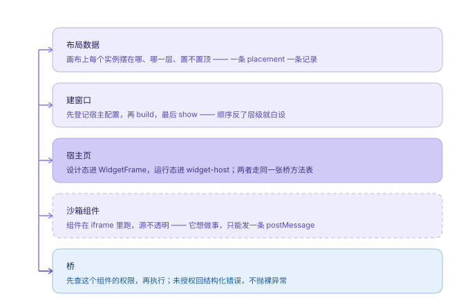

# AGENTS.md —— 接手这个仓库先读这一页

写给任何要在这个仓库里改代码的人或模型。目标：读完这一页，不用通读源码就能动手，且不会踩已经踩过的坑。

> **只读你要动的那一块。** 任何改动前必读两节：**第 4 节**（不变量，一行一条，带 `INV-n`）和**第 11 节**（怎么验证 —— 它在注入范围外，用 Read 打开）。其余按下面这张表跳，**别通读**。
>
> **这一页是入口，不是全集。** 坑在 [PITFALLS](./docs/PITFALLS.md)，组件协议在 [WIDGET_SPEC](./docs/WIDGET_SPEC.md)，取舍在 [ARCHITECTURE](./docs/ARCHITECTURE.md)，签名在 [CODE_SIGNING](./docs/CODE_SIGNING.md)，agent 在 [AGENT_ACCESS](./docs/AGENT_ACCESS.md)。新内容往哪放看 [docs/README.md](./docs/README.md) —— **文档归改代码的这一方管**：用户不读也不写 `docs/`，别拿去问他。
>
> **自动注入会截断，而且不告诉你。** 工具只带得进前约 13 KB（实测 13 334 字节），断在第 5 节开头 —— 第 6 节之后（状态 / 配方 / 缺口 / 坑 / 验证 / 协作）都不在上下文里。要用它们就 **Read 本文件**，别以为上面那份是全文。

> | 你动了什么 | 读 |
> | --- | --- |
> | 任何代码 | 第 4 节 —— 先按 [`.agents/skills/invariants`](./.agents/skills/invariants/SKILL.md) 那张"你要动的 → 哪几条"挑，不必二十四条全读 |
> | 任何代码，收尾要交出去 | 第 11 节（收尾时，**它在注入范围外，要 Read**）+ [`reference/verify.md`](./docs/reference/verify.md) 的逐区命令 |
> | `src/**` 的界面 / 一句文案 | [配方 · 界面文案](./docs/reference/recipes.md) + 第 10 节 |
> | `src/runtime/bridge.ts`、加桥方法 / 加权限 | `INV-2/3/4/7/8/20` + [配方 · 加一个桥方法](./docs/reference/recipes.md) + 第 5 节 |
> | `src/platform/*.tsx`、画布与面板 | `INV-6/9/13` + [配方 · 改三栏布局](./docs/reference/recipes.md) |
> | `src-tauri/src/{runner,desktop,visibility,occlusion}*` | `INV-9/11` + 第 5 节「容易搞错的地方」+ [配方 · 改窗口行为](./docs/reference/recipes.md) |
> | `src/platform/{assistant,agent,hands,widget-tools}.ts`、`src/runtime/assistant.ts` | [配方 · 改内置 assistant](./docs/reference/recipes.md) + [AGENT_ACCESS](./docs/AGENT_ACCESS.md) |
> | `public/widgets/**`、加官方组件 | `INV-6/10/12/17/18` + [配方 · 加一个官方组件](./docs/reference/recipes.md) + [WIDGET_SPEC](./docs/WIDGET_SPEC.md) |
> | `scripts/**`、商店、签名、发版 | `INV-1/15/16` + [配方 · 发一个版本](./docs/reference/recipes.md) + [CODE_SIGNING](./docs/CODE_SIGNING.md) |
> | `src/platform/store.ts`、落盘字段 | `INV-5/13` + [`reference/state.md`](./docs/reference/state.md)（字段 / 版本 / 谁写）+ [配方 · 加一个平台状态字段](./docs/reference/recipes.md) |
> | 找事实：文件在哪 / 某件事做到哪一步 / 这个词指什么 | [`reference/structure.md`](./docs/reference/structure.md)、[`reference/known-gaps.md`](./docs/reference/known-gaps.md)、[GLOSSARY](./GLOSSARY.md) |
> | 卡住了 / 要开一件还没拆开的活 | [PITFALLS](./docs/PITFALLS.md)（搜现象，别搜原因）/ [`.agents/skills/development-workflow`](./.agents/skills/development-workflow/SKILL.md)（唯一开发入口，L1/L2/L3） |
>
> **一次改动同时命中好几行是常态 —— 取并集，别挑一行。** 按"任务类别"只挑一行必漏（"加一条 `terminal:exec`"同时动了清单的联合类型、桥、两个宿主、Rust、i18n、能力体检和四处测试）。漏掉的症状在这个仓库里几乎全是**静默**的 —— 不报错，只是不对。

---

## 1. 这是什么

**棂 / Lattice** —— 可扩展的 Windows 桌面小组件平台。第三方用纯 HTML/CSS/JS 写组件（**纯静态目录，一个依赖都不许引，没有构建**），平台负责把它们安全地放到桌面上：能装（拖文件夹 / 拖 `.lattice` 包 / 从商店装）、能变成真的桌面窗口、能拖能缩能锁，布局与组件数据重启不丢。商店是一份签名过的静态 JSON（带更新、回滚、举报、新权限复核），目录挂在 GitHub Pages 上。平台自带一个 **assistant**（`Ctrl+K` 小窗，自备 OpenAI 兼容地址与 key，流式回答，外加六组"手"默认全关）和一个 **agent 端点**（默认关的回环 HTTP + 9 个白名单动作 + 审计日志）。**没有服务端 —— 这是设计，不是还没做**，见 [ROADMAP 的 v0.5 四个取舍](./docs/ROADMAP.md#v05-的四个取舍)。

**三个数不是一个数**：源码是 `0.4.0`，能下载到的是另一个数（在 GitHub Releases 上，写进仓库必然脱钩），`v0.x` 是里程碑标签、不会出现在安装包里。

进度与「为什么现在长这样」在 [ROADMAP](./docs/ROADMAP.md)（含「被推翻的十个决定」）。技术栈：Tauri 2 + React 19 + TS + Vite 8 + Zustand；Rust 只做窗口与文件，不碰 UI。

---
## 2. 三十秒上手

```bash
npm install
npm run dev          # 只跑前端（http://localhost:1420），不需要 Rust
npm run tauri:dev    # 完整桌面应用，改 Rust 会自动重编译重启
npm run tauri:build  # 出 NSIS 安装包
npm run typecheck    # tsc --noEmit，提交前跑一下
npm run store:index  # 打包 + 签名内置组件，写 public/store/（dev / build 会自动跑）
```

**浏览器里 `isTauri()` 为 false**，所以「投放到桌面」是灰的，其余（画布、组件沙箱、桥、权限）都能验。

工具链是 `windows-gnu`（缺 `windres` / `gcc`）。**别绕过 `scripts/tauri.mjs` 直接跑 `npx tauri`** —— 编译会在 `resource.rc` 报错；细节见 [`reference/build.md`](./docs/reference/build.md)。

---

## 3. 目录地图

**逐文件的说明在 [`docs/reference/structure.md`](./docs/reference/structure.md)**，按需查，**别通读**。这里只留五条落地前就得知道的：

```
src/             platform/ 是 React 外壳（store / 画布 / 面板 / 菜单），runtime/ 是契约与纯逻辑（桥 / 清单 / 配置 / i18n）
src/widgetHost.ts  桌面窗口的宿主页；assistant.html 是小窗入口（独立入口 = 小窗不加载 store）
src-tauri/src/   Rust：窗口、文件、Win32。*_policy.rs 是纯逻辑，其余是胶水
public/widgets/  官方组件包；packages/sdk/ 是作者用的 SDK（唯一真源）
scripts/         构建 / 签名 / 打包；scripts/guards/ 是对账（数字、桥、命令、纯逻辑单测）
tests/           浏览器断言页，跑在 dev server 上
```

1. **纯逻辑与胶水分开是硬规矩。** `*_policy.rs` **不引 crate**（要能 `rustc --test` 单跑，见 §11）；`src/runtime/` 里除 `bridge.ts`（要 `invoke` 和读 CSS 变量）外都该是能在 `tests/*.html` 里 import 的纯函数。加能力先问"哪一半是纯的"。
2. **两个宿主只有两份**：`WidgetFrame.tsx`（画布）与 `widgetHost.ts`（桌面）。要加"宿主该做的事"，两份一起加 —— 这是INV-2 的落地形状。
3. **一个能力在两侧各有一份判据时，两侧必须是同一句**（`approvalFor` / `hands_policy`、`save-file.ts` / `export_policy.rs`、`manifest.ts` / `secrets_policy`）。写在两处不是错，**写出两种说法**才是 —— 所以每对都有一页测试钉着。
4. **`docs/` 的归属由 [docs/README.md](./docs/README.md) 决定**：哪份该读、新内容该放哪、一份事实只有一个家。别新开"总览 / 说明"这类文件。
5. **加了文件就补进 `structure.md`**（它按目录排）。漏了的症状不是报错，是下一个人（或模型）找不到它。
6. **全库搜索先排除 `.scratch/`、`.workbuddy-ai/`、`.preview/`、`dist*/`、`target/`、`node_modules/`。** `.scratch/` 里躺着旧 worktree 的整份文档副本，全库 `grep` 的 Markdown 命中将近一半来自它们 —— 而那些副本说的是过去某一版。查文档别 `grep`，用 `npm run docs:query -- <词>`：它只扫 `git ls-files` 认下来的那些，所以这个排除清单不用在两处维护。

---


## 4. 二十四条不变量

**每条只留一句；边界、例外、破了会怎样，在 [`docs/INVARIANTS.md`](./docs/INVARIANTS.md) 按 `INV-n` 查。**

别通读 —— 先按 [`.agents/skills/invariants`](./.agents/skills/invariants/SKILL.md) 那张"你要动的 → 哪几条"挑。**引用写 `INV-8` 不写"第 8 条"**（ID 稳定，顺序会变）。**这张表压在截断线上，末几条可能读不到 —— 看不全就 Read。**

| ID | 一句话 |
| --- | --- |
| [INV-1](./docs/INVARIANTS.md#inv-1-零内置) | 零内置。平台本身不含任何组件。 |
| [INV-2](./docs/INVARIANTS.md#inv-2-两个宿主一套桥) | 两个宿主，一套桥。画布里的 `WidgetFrame.tsx` 和桌面上的 `widgetHost.ts` 都必须走 `runtime/bridge.ts` 的同一张方法表。 |
| [INV-3](./docs/INVARIANTS.md#inv-3-鉴权靠窗口引用不靠-origin) | 鉴权靠窗口引用，不靠 origin。沙箱 iframe 的 origin 是字符串 `"null"`，所有组件一样，`event.origin` 分不出实例。 |
| [INV-4](./docs/INVARIANTS.md#inv-4-权限按-widgetid-授予不按实例) | 权限按 `widgetId` 授予，不按实例。语义是"你信不信任这段代码"，跟桌面上摆了几份无关。 |
| [INV-5](./docs/INVARIANTS.md#inv-5-落盘不用-localstorage) | 落盘不用 localStorage。这台机器上 WebView2 把 localStorage 放内存里，进程一退就没了。 |
| [INV-6](./docs/INVARIANTS.md#inv-6-底板是平台的组件只读令牌) | 底板是平台的，组件只读令牌。颜色 / 浓度 / 磨砂由宿主页画（`wallpaper.rs` 截壁纸 + `widgetHost.ts` 三层叠），组件一行代码都不参与。 |
| [INV-7](./docs/INVARIANTS.md#inv-7-错误通道不是桥) | 错误通道不是桥。`__lattice_diag`（组件报错）和 `__lattice`（桥请求/响应）是两条独立的消息，两个宿主都必须先认错误、再认桥，而且 `isWidgetErrorRepor… |
| [INV-8](./docs/INVARIANTS.md#inv-8-权限是活的不是启动快照) | 权限是活的，不是启动快照。用户在属性面板撤掉一项，已经开着的窗口必须当场失去它。 |
| [INV-9](./docs/INVARIANTS.md#inv-9-emit_to-是广播收件人自己认领) | `emit_to` 是广播，收件人自己认领。`emit_to(label)` 听着像"只发给那个窗口"，其实不是：JS 侧 `listen()` 注册的监听器 target 是 `Any`，而 T… |
| [INV-10](./docs/INVARIANTS.md#inv-10-看不见就别跑) | 看不见就别跑。组件的心跳一律挂在 `runtime/schedule.ts` 的时间轴上，不自己 `setInterval`。 |
| [INV-11](./docs/INVARIANTS.md#inv-11-关窗口-删用户数据) | 关窗口 ≠ 删用户数据。`widget_close` 收一个 `reason`，只有 `reason == "user"`（宿主页 ✕ 按钮）才发 `lattice:widget-close` 让… |
| [INV-12](./docs/INVARIANTS.md#inv-12-组件的-csp-只在-csprs-里改) | 组件的 CSP 只在 `csp.rs` 里改。组件是不可信代码，沙箱挡"碰宿主"，CSP 挡"往外发"。 |
| [INV-13](./docs/INVARIANTS.md#inv-13-配置按实例权限按组件) | 配置按实例，权限按组件。`grants` 的键是 `widgetId`（问的是"你信不信任这段代码"），`configs` 的键是 `instanceId`（问的是"这一份要怎么显示"）。 |
| [INV-14](./docs/INVARIANTS.md#inv-14-联网是按组件的白名单不是有权限就能连) | 联网是"按组件的白名单"，不是"有权限就能连"。`network.fetch` 过三道闸，顺序不能换：`permissions` 里有 `network` → 目标主机在 `manifest.ne… |
| [INV-15](./docs/INVARIANTS.md#inv-15-分发的信任锚点是包不是目录) | 分发的信任锚点是包，不是目录。装一个包要过三道，顺序不能换：`sha256(字节)` 等于目录里写的 → ed25519 签名能被 `publisher.key` 验过 → 这把钥匙等于这个组件第… |
| [INV-16](./docs/INVARIANTS.md#inv-16-平台更新和组件更新是两套东西别混) | 平台更新和组件更新是两套东西，别混。组件走目录 JSON + `.lattice` 包 + ed25519；平台走 `latest.json` + NSIS 安装包 + minisign。 |
| [INV-17](./docs/INVARIANTS.md#inv-17-说明写在清单里改了行为就补一条-changelog) | 说明写在清单里，改了行为就补一条 changelog。组件的"怎么用"是 `manifest.json` 的 `help`，不是包里的 README —— 组件是纯静态目录，平台没有 Markdo… |
| [INV-18](./docs/INVARIANTS.md#inv-18-先画第一帧再等桥) | 先画第一帧，再等桥。组件的 `config.get` / `storage.get` 都是往返，宿主慢一点（或者根本没宿主）就是几秒钟的空白卡片 —— 而第一帧要画的通常只是默认值（`00:00.… |
| [INV-19](./docs/INVARIANTS.md#inv-19-先定名再写代码) | 先定名，再写代码。仓库里已经有名字的东西就用那个名字，没有就当场定一个写进 [`GLOSSARY.md`](./GLOSSARY.md) —— 别在代码、文档、对话里各叫一个。 |
| [INV-20](./docs/INVARIANTS.md#inv-20-流式的东西走事件不走桥的返回值活的东西要有两条收尸路) | 流式的东西走事件，不走桥的返回值；活的东西要有两条收尸路。终端组件（`lattice.term`）是第一个"一条命令的输出比一次调用活得久"的能力，四条别踩回去： - 桥是一问一答的，流只能走事件。 |
| [INV-21](./docs/INVARIANTS.md#inv-21-密钥只进密封库明文只当迁移兜底) | 密钥只进密封库，明文只当迁移兜底。模型 key 和组件要用的 token 都存在 `secrets.bin`（`CryptProtectData` 封的一个文件，见 `secrets.rs` / … |
| [INV-22](./docs/INVARIANTS.md#inv-22-组件的保存只能递给平台一个名字落点在系统对话框里不在组件的参数里) | 组件的保存只能递给平台一个名字，落点在系统对话框里，不在组件的参数里。 |
| [INV-23](./docs/INVARIANTS.md#inv-23-灰掉的东西必须说得出为什么) | 灰掉的东西必须说得出为什么。`capability_policy.rs` 的 `Verdict` 没有 `available` 字段：它由 `reason` 算（`reason.is_none()… |
| [INV-24](./docs/INVARIANTS.md#inv-24-平台页面和组件文档是两份-csp别混成一个) | 平台页面和组件文档是两份 CSP，别混成一个。组件那份在 `csp.rs`（不可信代码，`default-src 'none'`）；平台这份在 `tauri.conf.json` 的 `app.s… |

---

## 5. 渲染链路：五跳与容易搞错的地方



五跳在代码里的落点：`buildSpecs()` → `sync_widget_windows` → `runner.rs::create` → `widgetHost.ts::boot` → `handleBridgeRequest()` → `defineMethod` 的 handler。

几个容易搞错的地方：

- **建窗口必须 `show()` 在 `apply_to()` 之前**。`ShowWindow` 会把窗口提到最前，顺序反了层级就白设。
- **`sync_widget_windows` / `close_widget_windows` / `widget_close` 必须是 `async fn`**。同步命令跑在主线程，而 `build()` 要把建窗口的活投递回主线程再等结果——命令占着主线程等自己，直接死锁。
- **不要维护 `Mutex<窗口表>`**。窗口存在性交给 `app.get_webview_window`；Runner 只存极轻的 `HostConfig`，且必须在 `build()` **之前**写入，宿主页随时来问都能立刻拿到。
- **同步是增量的**。`Runner::diff` 只写变化的维度（pos / size / layer）。无条件 `set_position` 会把用户正在拖的窗口拽回去。
- **同一时刻只允许一条同步在飞**。`desktop.ts` 的 `serial()` 把 `syncDesktop` / `closeDesktop` 串成一条链。两条并发跑会各自查到 `get_webview_window(label) == None`，然后各 `build()` 一次 —— 同一个实例出现两个窗口，一个归 Tauri 管、一个是孤儿（位置尺寸完全一样，看着像只有一个，其实两份 WebView2）。并发建窗口还会把 IPC 拖到超时，界面上那颗按钮从此永久变灰。
- **关主窗口 ≠ 退出**。桌面上还有组件窗口时，`lib.rs::guard_main_close` 会 `prevent_close()` + `hide()`。真正的退出是设置菜单里的 `Quit Lattice`（`quit_app`）或托盘菜单的 `Quit`。别把 `hide()` 换成 `close()`：主窗口一旦销毁，唤回它的入口就只剩托盘和单实例事件（`Local\Lattice.Wake`），少一个就是"用户只能去任务管理器"。
- **单实例靠 Win32 命名对象**（`instance.rs`）：互斥体 `Local\Lattice.Instance` 判重，事件 `Local\Lattice.Wake` 唤回。互斥体句柄**不能** `CloseHandle` —— 关掉对象就消失，下一个进程会以为自己是第一个。
- **两套坐标**。`placement.x/y` 是画布坐标，`desktopRects[instanceId]` 是屏幕坐标。投放时优先用后者。主窗口最小化后 `screenX/screenY` 是 `-32000` 这类哨兵值，`desktop.ts` 里有缓存兜底，别删。
- **宿主页是三层，不是一层**。`canvas`（壁纸，`filter: blur`）在 z=0，`veil`（底色 rgba）在 z=1，`iframe`（组件）在 z=2，内描边在 `body::after`（z=5）。往宿主页加任何全屏元素之前先想清楚它该落在哪一层 —— 内描边当初就因为画在 `body` 上被壁纸层盖掉了。
- **外观变更走 `Appearance` 这一个字段**，有两条路，别再加第三条：`widget_set_appearance` 是拖滑杆时的即时通道（面板直接推给那个窗口），`sync_widget_windows` 是兜底（新窗口、重启、画布上还没投放的实例）。两者都经过 `Runner::set_appearance`，它只在真的变了才 `emit`，所以同一次改动被两条路各推一遍也不会把宿主页刷两遍。
- **入口地址是算好的绝对地址，下游不要再拼**。`registry.ts::resolveEntryUrl` 负责分流：`bundled` → `<应用源>/widgets/<id>/<entry>`，`user` → `http://lattice-widget.localhost/<id>/<entry>`。`buildSpecs` 原样塞进 spec，宿主页拿到什么就 `iframe.src` 什么。以前宿主页自己 `base + entry`，接上用户组件后必然拼错。
- **组件存储是"落盘 + 广播"两件事**。Rust 每次写完 `widget_store_*` 都 `emit("lattice:widget-store")`，两个宿主（`WidgetFrame.tsx` / `widgetHost.ts`）把它转成 `{ type: "store-changed", payload: { key } }` 推给 iframe，组件收到重读。少了广播，画布和桌面的两个实例就各持一份内存列表，谁后写谁把对方的新增整块抹掉 —— 用户看到的是"加了几条，回头只剩一条"。新增写存储的组件必须处理这条推送（写法见 WIDGET_SPEC）。**覆盖前一定经过 `write_atomic`**：它先留一代 `.bak` 再原子替换，所以别在别处直接 `fs::write` 这个文件 —— 绕过它就没有退路（这条是拿用户的便签和待办换来的）。

### 用户组件是怎么被加载的

```
registry.ts  entryUrl = http://lattice-widget.localhost/<id>/index.html
     │
     ├─ 画布：WidgetFrame 的 <iframe src>
     └─ 桌面：spec.entry → HostConfig.entry → widgetHost.ts 的 <iframe src>
                        │
                protocol.rs::handle()
                        │  uri.path() = "/<id>/<相对路径>"
                        ▼
        %APPDATA%\com.iron-tom.lattice\widgets\<id>\<相对路径>
```

三条硬约束：

- **Windows 上必须用 `http://<scheme>.localhost/`**，不是 `<scheme>://localhost/`。写错不会报错，只是白屏。
- **协议只认 `uri.path()`**，不看 host；`split_path` 的第一段就是组件 id，任何 `..` / 盘符 / 反斜杠都 404。别为了"支持绝对路径"放宽这条 —— 那等于让组件读整个磁盘。
- **响应带 `Access-Control-Allow-Origin: *`**。iframe 是 opaque 源，组件 `fetch` 自己的 json 在浏览器看来就是跨域，不带这个头会静默失败。

---


## 6. 状态都在哪

**每个文件的字段、版本号、谁写、旧文件怎么升，在 [`docs/reference/state.md`](./docs/reference/state.md)。** 为什么这么存（而不是为什么存这些）在 [`ARCHITECTURE` §7](./docs/ARCHITECTURE.md)。

三条先记住：

- **全在** `%APPDATA%\com.iron-tom.lattice\` 下（`state.json` / `widget-data/` / `assistant*.json` / `widgets/` / `widget-backups/` …），**没有 localStorage** —— 这台机器的 WebView2 把它放内存里，进程一退就没了。
- **临时文件替换不等于已有备份或断电耐久保证。** 当前平台状态写入未调用组件存储的 `write_atomic`，没有一代备份；准确边界与失败水合风险见 [状态参考](./docs/reference/state.md)。
- **`store.ts` 有一个 `hydrated` 闸门：水合完成前不许写盘。** 加新持久化字段要同时改 `partialize`，否则重启就丢。

---

## 7. 常见改动的配方

**正文在 [`docs/reference/recipes.md`](./docs/reference/recipes.md)** —— 按任务查，别通读。这一节只留索引，十一块各在哪：

| 你要改 | 去那一节 |
| --- | --- |
| 加一个桥方法 / 一项权限 | 「加一个桥方法」 |
| 加一项组件配置 | 「加一项组件配置」 |
| 加一个平台状态字段 | 「加一个平台状态字段」 |
| 界面文案 | 「加一句界面文案 / 改一句文案」 |
| 组件自己说的双语 | 「加一句组件自己说的双语（作者文案）」 |
| 内置 assistant / 加一项 AI 能力 | 「改内置 assistant / 加一项 AI 能力」 |
| 三栏布局 | 「改三栏布局」 |
| 加一个官方组件 | 「加一个官方组件」 |
| 试第三方组件 / 改安装链路 | 「试第三方组件 / 改安装链路」 |
| 发一个版本 / 换目录地址 | 「发一个版本 / 换目录地址」 |
| 窗口行为 | 「改窗口行为」 |

**为什么搬出去**：这一节 194 行、21 000 字，只有真要改那一块时才用得着。留在根文件里，它把"不变量"和"验证"挤到了自动注入之外 —— 见开头那段。

---

## 8. 已知缺口

**正文在 [`docs/reference/known-gaps.md`](./docs/reference/known-gaps.md)** —— 改之前先看，别把"待验"当 bug 修、把"有意取舍"当缺陷补。四类：

| 类 | 判据 | 去那一节 |
| --- | --- | --- |
| 待验 | 缺的只是一次真机或另一台机器 | 「8.1 待验」 |
| 卡在外部 | 我们这边推不动 | 「8.2 卡在外部」 |
| 有意取舍 | 看到别修 | 「8.3 有意的取舍」 |
| 已修 | 别再改回去 | 「8.4 已修」 |

补掉一条就删一条，别留着当"历史"。

---

## 9. 踩过的坑

**别在这里重复记录。** 统一写在 [docs/PITFALLS.md](./docs/PITFALLS.md)，一行一条：症状 / 真实原因 / 解法。它按**症状**分组（不按版本）—— 查坑这件事从来不按版本发生，所以补新坑时先 `Ctrl+F` 找现象，别新开一节。踩到新坑就补一行，这是这个仓库最有价值的资产之一。

动手前值得先扫一眼的三条（都是"看起来像 UI bug，其实是平台机制"）：

- 卡片永远白底 → `color-scheme` 继承进了 iframe，不是 `background` 写错
- 点了「收回」窗口愣几百毫秒才消失 → `close()` 要等 WebView2 拆渲染进程，先 `hide()`
- 投放后组件跑到屏幕外 → 主窗口最小化时 `screenX/screenY` 是哨兵值

---

## 10. 代码风格

- **注释解释"为什么"，不解释"是什么"**。这个仓库的注释密度偏高，是刻意的：每个不直观的决定旁边都写了代价。改逻辑时同步改注释，过期的注释比没有注释更糟。
- **UI 文案一律英文**：界面、按钮、提示、错误信息、组件内容都算。代码注释用中文。
  文档语言遵循下方“文档维护”和 [`docs/README.md`](./docs/README.md) 的分工：新建或大幅修改的正式文档默认英文，已有中文历史文档保留，不批量翻译。
  加新文案时别在中文里混英文，也别为了"亲切"把按钮写成中文——这条是被明确要求过的。
- 不引 Tailwind、不引 UI 库。平台 UI 用 CSS 变量 + 语义类；组件只认 `--lattice-*` 变量。
- 组件不需要构建步骤。**保持这一点**——"会写 HTML 就能写组件"是这个项目的门槛承诺。
- Rust 侧不 panic 到用户面前：命令返回 `Result<_, String>`，层级失败只 `eprintln!` 不中断同步。
- 新增交互前先问：这是平台该做的，还是组件该做的？窗饰（拖动/缩放/别针/收回）全部由宿主画，组件不参与。

### 文档维护

- 改功能时先查 `docs/README.md`、对应规范和参考文档；行为、状态格式或边界变了，就在同一改动里更新真正拥有这条事实的文档。不要复制桥签名、命令表或状态字段清单到第二个地方。
- 新增正式文档或大幅重写文档时，正文默认用英文；已有中文文档和历史记录继续保留，不做批量翻译。已有中英文成对文档以英文为准，中文版本必须与其内容一致。术语、API 名称和代码标识符按 `GLOSSARY.md` 与源码统一。
- 描述功能时明确区分 `Implemented`、`In Progress`、`Planned`，并以源码、测试和 [`reference/maturity.md`](./docs/reference/maturity.md) 为依据；尚无实现或真实数据来源的功能不得写成已实现。需要表达“代码已实现但仍待验证”时，沿用成熟度文档的 `Unverified` 状态，不把它写成 `In Progress`。
- 新的设计推理遵循 [`design/README.md`](./docs/design/README.md) 的开文档判据；结论放在 `ROADMAP.md`，约束放在 `AGENTS.md` / 对应规范，参考步骤放在 `reference/`。不新增第二份事实的家。
- 拆分开发任务或提交验收记录时，说明是否影响系统架构、是否需要更新架构图 / 流程图、是否产生新的 LAT 决策、同步了哪些文档，以及用哪条测试或源码证据核对文档。Skill 数量、职责、入口或调用关系变化时检查 Skill 架构图；开发流程阶段或授权边界变化时检查工作流图。判据与文档归属见 [`docs/README.md`](./docs/README.md)；不要把架构正文搬进本文件。
- 改完文档运行 `npm run check:docs`；若检查失败，修复或明确报告失败项，不得把失败说成通过。

---


## 11. 验证

**逐区的命令、断言页、真机验法在 [`docs/reference/verify.md`](./docs/reference/verify.md)。** 底线四条，任何改动都适用：

1. `npm run typecheck` —— 必跑，当前是干净的。
2. `npm run check:guards` —— 一串"不报错、只是不工作"的对账，pre-push 一次串完；CI 里逐条拆开跑，所以**链里加了新的、`verify.yml` 里也得加一行**（只进一处就是"一边红一边绿"，`check:gates` 拦这个）。
3. `npm run test:browser` —— 先 `npm run dev`，另一个终端跑；断言必须写成 `PASS …` / `FAIL …` 两行式，别的格式它数不到。
4. **真机**（窗口 / 焦点 / 进程 / 托盘 / 麦克风）只能在 Windows 上 `npm run tauri:dev` 看，没有第二条路。

交付时说清三件事：**跑了什么、没跑什么、哪些只能真机**。别为了让断言变绿去改行为 —— 那是把"没验过"伪装成"验过了"。

| 你改了什么 | 先跑 |
| --- | --- |
| 界面 / 样式 / 文案 | `check:tokens` + `test:browser --filter <页>` |
| 桥 / 权限 / 组件存储 | `check:bridge` + `tests/bridge-storage.html` |
| Rust 纯逻辑（`*_policy.rs`） | `rustc --edition 2021 --test <file>`；条数 `check:policy-tests` 会数 |
| 商店 / 签名 / 版本 / 发版 | `test:winget`、`sign:widget --selftest`、`check:version`、`check:csp` |
| 窗口 / 托盘 / 键鼠 / 输入法 | 只有真机 |

---

## 12. 这个仓库现在是多 agent 同时改的

一个工作区里可能同时有几个 agent（和一个人）在动同一份文件。下面这些不是礼貌，是**防止互相把活干掉**的最小规则：

1. **动代码前先 `git status`。** 有别人的未提交改动时，只 `git add <自己改的那几个文件>`；**永远不要** `git add -A` / `git stash` / `git reset --hard` / `git checkout -- .` —— 这四个命令都会静默吃掉别人还没提交的工作。
2. **改之前重读文件。** 你记忆里的那份可能已经过期。用精确的 `old_string` 替换，替换失败就重读再试，**不要整文件覆盖**（`Write` 全量写一个别人刚改过的文件 = 无声回滚）。
3. **不要杀不是自己起的进程。** `lattice.exe`、1420 端口上的 vite、`cargo` 都可能属于另一个 agent。要独占端口就换一个（`npm run dev -- --port 1421`），别 `taskkill /IM node.exe`。
4. **`cargo` 会锁 `target/`。** 别人在编的时候起第二个 build 只会排队等到超时，看起来像"卡住"。真机验界面优先用已经编好的 `src-tauri/target/debug/lattice.exe`，先比一下它的时间戳和源码谁新。
5. **生成物由脚本写，但别和别人抢。** `public/widgets/index.json` 和 `public/store/registry.json` 分别是 `widgets:index` / `store:index` 的产物；`registry.json` 是**跟踪文件**，跑完看一眼 `git diff` 是不是只多了自己那一条。别人正在发版（改了版本号、正要 `store:index`）时不要跑。
6. **`state.json` 是整份覆盖的。** 两个进程同时开着应用，谁后退出谁把内存那份盖上去（孤儿进程那条坑就是这么来的）。真机验一个人验，验完从备份还原，别两个 agent 各开一个实例。
7. **冲突高发区改完立刻复核差异。** `AGENTS.md`、`GLOSSARY.md`、`docs/ROADMAP.md`、`src/styles.css`、`src/runtime/bridge.ts`、`src-tauri/src/lib.rs` —— 这几处几乎每个改动都会碰。修改后及时检查对应文件的 `git diff`，确认范围和内容准确。Git 暂存、提交和推送必须遵循当前用户的明确授权；本条不构成执行这些操作的授权。
8. **提交粒度按"一件事"算。** 一个提交只做一件事，写清范围和理由；别把别人的改动顺手带进来（`git diff --cached` 过一眼再提交）。
9. **每次 Git 写操作前核对目标。** 明确当前 Worktree 绝对路径、分支、HEAD 和完整暂存清单，并确认它们符合当前任务授权的目标；任一项不符就停止并报告。
10. **并行 Agent 使用隔离工作区。** 不要让多个 Agent 同时在同一 Worktree 修改文件。新编码任务开始前，先为各自任务确定独立 Worktree 或其他明确隔离的工作目录。
11. **Git 写操作逐次授权。** `add`、`commit`、`push`、`merge`、`rebase` 及会覆盖或丢弃修改的操作，都必须由用户针对当前任务明确授权；授权不自动延续到下一次操作。
