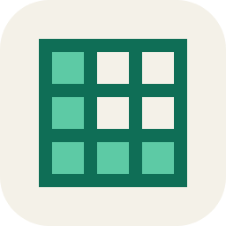
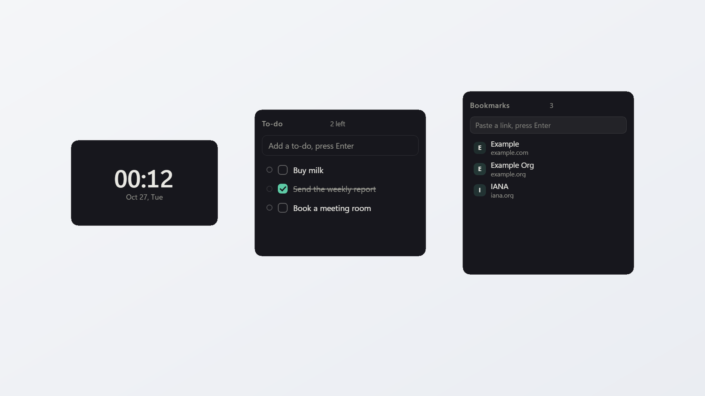
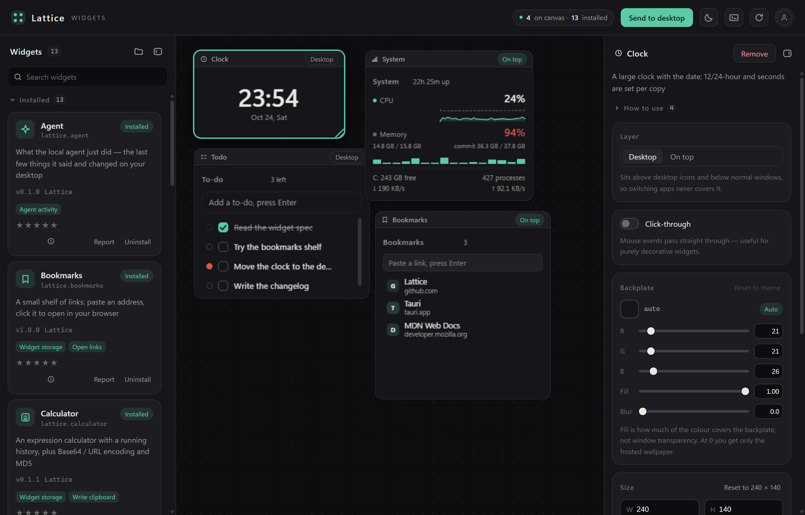
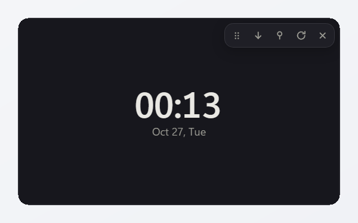
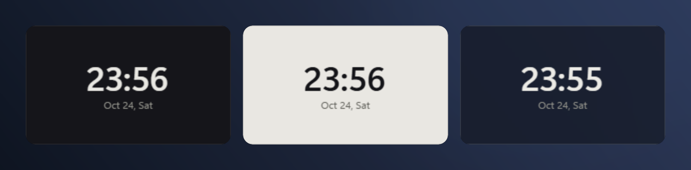

<!-- This is the authoritative README. Update README.zh-CN.md as its aligned Chinese translation. -->

<div align="center">



<h1>棂 · Lattice</h1>

<p><strong>Widgets on your Windows desktop. A widget is just a web page.</strong><br>
You write HTML, CSS and JS. Real windows, the sandbox, permissions, install and update are the platform's job.<br>
No account, no server.</p>

<p>
<a href="https://github.com/unraveltao/Lattice/actions/workflows/ci.yml"></a>
<a href="./LICENSE"></a>
<a href="#install"></a>
</p>

<p>English · <a href="./README.zh-CN.md">中文</a></p>

<p><a href="docs/screenshot-desktop.png"></a></p>

<p><sub>Clock, to-do and bookmarks, captured from a running build at 2× and placed on a plain wallpaper.<br>
Nothing from a real desktop is in the frame.</sub></p>

</div>

---

## What it is

Lattice puts small windows on your Windows desktop: a clock, a to-do list, system stats, whatever is playing. Real windows, not pictures. No frame, no taskbar entry, and clicking one never steals focus from what you are typing into. Pin them above everything, or tuck them under your ordinary windows against the wallpaper. Position is remembered per monitor, and everything is back where it was after a restart.

The difference from other desktop toys is here: **the platform ships no widgets.** All 24 official ones go through the same install path as a third-party package, and nothing is preinstalled. What widgets can exist depends on the HTML you write.

Chinese and English go all the way down: the shell, each widget's name and options, and the words drawn *inside* the cards. Switching needs no restart and no reload.

The name is 棂 (*líng*), the wooden lattice inside a window pane. Every pane is set into it.

## Start here

Five ways in. Each row is a short read; the documents behind it are the long version.

| You are | You want | Read, in this order |
| --- | --- | --- |
| **Using it** | to install it, get past the first launch, fix something that looks wrong | [Install](#install) → [FAQ](./docs/FAQ.md) → [What works](./docs/reference/maturity.md) |
| **Writing a widget** | four files, the SDK, the contract, publishing | [Write a widget](#write-a-widget) → [WIDGET_SPEC](./docs/WIDGET_SPEC.md) → [§9 publishing](./docs/WIDGET_SPEC.md#9-发布版本与签名) |
| **Working on the platform** | the shape of the code, a dev environment, what must not break | [How it works](#how-it-works) → [Work on the platform](#work-on-the-platform) → [ARCHITECTURE](./docs/ARCHITECTURE.md) → [CONTRIBUTING](./CONTRIBUTING.md) |
| **Wiring up an agent** | what it can do, what it is allowed to do, skills and MCP | [Agent](#agent) → [AGENT_ACCESS](./docs/AGENT_ACCESS.md) |
| **Judging the security** | isolation, permissions, what is signed, the threat model | [Is it safe?](#is-it-safe) → [CODE_SIGNING](./docs/CODE_SIGNING.md) |

Just curious? *What you get* below lists every official widget; *How it works* and *Where it stands* are the rest of the page, and [ROADMAP](./docs/ROADMAP.md) is the longer version, including the decisions reality overturned. The map of every document, and which one owns which fact, is [docs/README.md](./docs/README.md).

## What you get

| You want | Widgets | What it does |
| --- | --- | --- |
| The time, and how much is left | Clock · Calendar · Timetable · Countdown | Current time; a month view with your own events; this week's classes with a live now line; days left to a date |
| Nothing slipping through | Todo · Note · Bookmarks · Habit | A list on the desktop; a scratch note that saves itself; links you keep coming back to; streaks you can keep |
| To know what the machine is doing | System · Terminal | CPU, memory, GPU and battery at a glance with a one-minute trace, per-core load, VRAM, disk, network, uptime; a shell you can run commands in |
| To work for a stretch | Focus · Stopwatch | A pomodoro that is still right after you close the lid; a stopwatch |
| To not lose the words you looked up | Word Drill | One card per line pasted in, four grades, next review scheduled in days |
| A quick sum | Calculator · Convert | Arithmetic you can copy out; two-way conversion for length, mass, temperature, data, time and speed |
| To draw the shape of something | Diagram | Boxes, circles and arrows on a canvas you can pan and zoom. The assistant can draw the whole thing from a sentence |
| To get what is in your head into a tree | Mind map | An indented outline becomes a rightward tree that lays itself out. Collapse, pan, zoom, and copy the whole thing out as Markdown, Mermaid or OPML |
| Music, weather, and a fish | Music · Weather · Big Fishy | What is playing with a level that follows the sound; one city, refreshed on a timer and still readable offline; a pet that walks along the bottom of your screen |
| To let a model do the clicking | `Ctrl+K` assistant | You bring the model; the key never leaves Rust; it can drive the desktop and call the tools your widgets declare. A script can do the same over a loopback endpoint, `npm run agent` |
| To see the whole canvas at once | `Ctrl+Shift+O` overview | Every widget at its real size and place, shrunk to fit, grouped by layer on the left. Read-only: click one and you are back on that card |
| To find one widget among two dozen | `Ctrl+Shift+F` search | One list over everything installed and everything in the catalogue: names, ids, descriptions, authors, permissions. Picking a result goes to that card on your canvas, or to its row in the library |
| None of the above | Write one | Four files, no build step, [see below](#write-a-widget) |

## Install

**Just want to use it.** Take `*-setup.exe` from [Releases](https://github.com/unraveltao/Lattice/releases) and run it. The first launch is stopped by SmartScreen as an "unknown publisher"; the installer is not code-signed yet, so click **More info → Run anyway**. That is a procurement problem, not a technical one — where it stands is [CODE_SIGNING.md](./docs/CODE_SIGNING.md), and each release note carries the SHA-256 if you want to check the file before running it.

**The first launch is an empty desktop, and that is the design.** The platform ships no widgets: open the library, install one from the catalogue, arrange it on the canvas, then click **Send to desktop** — the canvas is where you edit, the desktop is where it lives. Dragging a folder or a `.lattice` package into the window is the third way in; where the files land, where your layout lives, and what *layer* means are the first two sections of [docs/FAQ.md](./docs/FAQ.md).

**Changing the code?** That is [Work on the platform](#work-on-the-platform).

## Write a widget

Four files and no build step:

```
demo.mine/
  manifest.json    id (reverse-domain), version (semver), permissions, size, config, help
  index.html       entry point, transparent background
  widget.js        your code; the SDK is a copied file, not an npm install
  style.css        tokens only, no hard-coded colours
```

```js
import { createLattice } from "./lattice.js";

const lattice = createLattice();

// First paint from defaults. Never wait for the bridge before drawing.
render({ text: "New note", size: 16 });

const note = await lattice.storage.get("note");
if (note) render(note);

lattice.storage.onChange(async () => render(await lattice.storage.get("note")));
```

Three things the platform will hold you to:

- Use `schedule.every`, never `setInterval`. A raw timer keeps ticking while the widget is invisible, which defeats the whole pause story.
- The pill floats over your content and it is clickable. Reserve `padding-right: 120px`, or your first line goes under the close button.
- Declare your options in the manifest. The inspector renders them per instance; a settings UI drawn inside the card is one nobody can reach.

```bash
npm run create:widget -- demo.mine    # scaffold, already chrome-aware
npm run pack:widget -- demo.mine      # folder → .lattice, drag straight into the window
```

[`examples/counter`](./examples/counter) is the reference implementation. [docs/WIDGET_SPEC.md](./docs/WIDGET_SPEC.md) is the contract: the method table, the config types, the manifest rules, and the traps that only show up once a widget is real.

The SDK is one file you copy into your folder, not a dependency: [packages/sdk](./packages/sdk/README.md) says what is in it and what it deliberately leaves out.

Publishing is not an upload. You pack, sign with your own key, and open a pull request against the [catalogue repo](https://github.com/unraveltao/lattice-registry); CI rebuilds the index and refuses the change if the package and the index disagree. [WIDGET_SPEC §9](./docs/WIDGET_SPEC.md#9-发布版本与签名) has the version-range rules, what the review checks, and why the private key never goes into CI.

## How it works

A widget never touches Windows. It runs in a sandboxed iframe with an opaque origin and a CSP that pins it to its own files, and every capability it has is a request over one message bridge. What that boundary is worth — and what it does not cover — is the [Is it safe?](#is-it-safe) section.

<p align="center"><a href="docs/screenshot-editor.png"></a></p>

<p align="center"><sub>The main window: library on the left, canvas in the middle, inspector on the right. Canvas previews are an approximation; there is no wallpaper to sample inside a window.</sub></p>

Three decisions keep it from looking like a desktop toy, and none of them came cheap.

The platform ships empty. Six preinstalled widgets would look better in a screenshot, and would kill the extension model on day one.

There is no server. The catalogue is a static `registry.json` on GitHub Pages, packages are signed files, updates are a release asset. So ratings never aggregate into a number, and reporting a bad widget means sending the author a file yourself.

Everything goes through one bridge. No `localStorage`, no `fetch`, no direct Win32. Every capability is a bridge method with a permission, which is why the API is small, and why it has to be enough: the official widgets use nothing else.

<p align="center">
<a href="docs/screenshot-chrome.png"></a>
<a href="docs/screenshot-backplate.png"></a>
</p>

<p align="center"><sub>Left: the chrome the host draws, drag, layer, pin, reload, close. Right: the same clock in three backplates; colour, fill and blur are per-instance.</sub></p>

The reasoning behind each, including what was tried and dropped, is in [docs/ARCHITECTURE.md](./docs/ARCHITECTURE.md), in Chinese, because that is the language the people who change this code read.

## Work on the platform

Node 22, Rust (the `windows-gnu` toolchain) and the WebView2 runtime: the standard [Tauri 2 prerequisites](https://v2.tauri.app/start/prerequisites/).

```bash
npm install
npm run dev          # front end only, http://localhost:1420, everything but "send to desktop"
npm run tauri:dev    # the real app
npm run tauri:build  # NSIS installer + updater artifacts
```

Use the wrapper scripts, not `npx tauri`: `scripts/tauri.mjs` puts the bundled `mingw64` and the `gcc` shim on `PATH`, and compiling around it fails in `resource.rc` instead of telling you why.

Before you send anything, run what CI runs: `npm run typecheck`, `npm run check:tokens`, `npm run check:docs`, `npm run check:guards`, then `npm run test:browser` against a running dev server. The full order, and what each gate catches, is in [CONTRIBUTING.md](./CONTRIBUTING.md).

**If you read only one thing before changing code, read the invariants in [AGENTS.md](./AGENTS.md).** They are not style preferences; each one is a bug that shipped. Which of them apply to what you are about to touch is the "what you are changing → which ones" table in [`.agents/skills/invariants`](./.agents/skills/invariants/SKILL.md) — one change usually hits several rows, so take the union rather than the first match.

Where a file lives: [docs/reference/structure.md](./docs/reference/structure.md). A symptom that makes no sense: [docs/PITFALLS.md](./docs/PITFALLS.md), searched by symptom, not by cause. Building and releasing: [docs/reference/build.md](./docs/reference/build.md). What each milestone added, and which decisions reality overturned: [docs/ROADMAP.md](./docs/ROADMAP.md).

## Agent

Two ways in, one executor. `Ctrl+K` opens the built-in assistant: you bring an OpenAI-compatible URL and a key, the key stays in Rust, answers stream in, and it can drive the desktop and call the tools your widgets declare. A script — or any agent that speaks HTTP — gets the same executor over a loopback endpoint that is **off by default** and does not even bind while off, behind a bearer token, with an audit log and 9 allowlisted actions; `npm run agent -- state` reads what it did.

Hands are six groups — files, commands, the web, the screen, keyboard and mouse, and MCP servers you configure yourself — and every group is off until you switch it on. Two modes: **internal** (desktop actions, widget tools, and the hands you opened) and **full access** (all six, no asking, fail-closed audit). Approval is a separate axis — `readonly`, `ask`, `auto` — and `readonly` beats full access. Skills are `skills/<id>/SKILL.md`: text that goes into the prompt and grants nothing.

A widget joins through `agent:tools`: declare the tools in the manifest, ask for that permission, and the model can call them. The threat model, and the four surfaces kept apart (control plane, data plane, agent as a widget, built-in assistant), are [docs/AGENT_ACCESS.md](./docs/AGENT_ACCESS.md).

## Is it safe?

A widget is untrusted code, and the platform treats it that way. Four things to check, in the order they matter:

- **Isolation.** `<iframe sandbox="allow-scripts allow-forms">`, with no `allow-same-origin`: an opaque origin, no access to the parent DOM, `localStorage` throws, `fetch` leaves with `Origin: null`, and the document's CSP is `default-src 'none'` plus its own files. The only way out is the bridge.
- **Permissions.** Fifteen of them, none granted by default, granted per widget rather than per copy — you are trusting the code, not the instance on your desktop — and revoking one takes effect in the windows already open. The heaviest is `terminal:exec`, and it is a real shell: the platform cannot judge a command (any blacklist is one `& $x` away), so the defence is that it is off by default and the approval screen says what it means. [WIDGET_SPEC §3](./docs/WIDGET_SPEC.md#3-权限).
- **Signatures.** Three different things in this project get called "signed", and only one of them is missing: widget packages are ed25519-signed by their publisher, update artifacts are minisign-signed by the updater key, and the installer has no Authenticode certificate — which is why SmartScreen stops the first launch. [CODE_SIGNING.md](./docs/CODE_SIGNING.md) covers why buying one would not fix it, and what would.
- **The agent surface.** Off by default, audited, and honest about what is not defended: [AGENT_ACCESS.md](./docs/AGENT_ACCESS.md).

## Where it stands

Every surface is one of four things: **shipped**, **unverified** (the code and the assertions are there; nobody has run it on a real machine yet), **experimental**, or **planned**. Which one each is, one line per surface, and what was actually run: [docs/reference/maturity.md](./docs/reference/maturity.md). Nothing is experimental today, and the next milestone adds no features — it is the one that closes the verification debt.

Three numbers, three meanings, and they are never the same number: the source tree is `0.4.0` (what the next build will call itself), the latest downloadable release is listed on [GitHub Releases](https://github.com/unraveltao/Lattice/releases), and `v0.13` is a milestone label that will never appear in an installer. The newest milestone is v0.13: the assistant gets its own window on the desktop. The code has landed and is waiting on real-machine verification, the same gap the four milestones before it are stuck on.

<details>
<summary>What each milestone added</summary>

| Version | What it added |
| --- | --- |
| v0.1 | The skeleton: Tauri + React shell, canvas, sandboxed iframes, the bridge |
| v0.2 | A real desktop: `desktop` / `top` layers, per-placement windows, chrome, data on disk |
| v0.3 | Platform behaviour: tray, start with Windows, pause-all, live reload, crash recovery, occlusion, DPI clamping, snap guides |
| v0.4 | Author experience: `@lattice/sdk`, `create:widget`, `pack:widget`, media session, the `Ctrl+Shift+D` debug drawer |
| v0.5 | Distribution: static catalogue, three signature checks, update + rollback, local ratings and reports, permission re-review |
| v0.6 | The catalogue goes public on GitHub Pages, with a disk cache, `If-None-Match` and an honest offline fallback |
| v0.7 | Delivery: NSIS installer, in-app updater, draft-first releases, the SmartScreen problem written down instead of hidden |
| v0.8 | Agent access: an opt-in loopback endpoint, a token, an audit log, 8 allowlisted actions |
| v0.9 | `lattice.music`, `audio:level`, `lattice.bookmarks`, `shell:open` |
| v0.10 | The built-in assistant: your own model behind an OpenAI-compatible URL, the key kept in Rust, `llm:chat` for widgets |
| v0.11 | Hands: six groups of capabilities, approval modes, model profiles, sessions on disk, `agent:tools` |
| v0.12 | Skill packs, the workspace exemption zone, two modes: internal / full access |
| v0.13 | The assistant on the desktop: its own window, not a panel inside the main one |

</details>

<details>
<summary>By the numbers</summary>

| Metric | Value |
| --- | --- |
| Official widgets | 24 |
| Permissions | 15 |
| Tauri commands | 128 |
| Browser assertions | 4 502 over 88 pages |
| Rust tests | 618 |
| Documented pitfalls | 133 |

These are measured: the browser assertions start a real dev server and a real Chrome in CI, and the Rust tests are counted as `#[test]` functions — the pure-logic ones run through `rustc --test`, the rest through a full `cargo test`. The pitfalls are the ones that actually bit, each written up with the reasoning that keeps it from coming back.

**Code, roughly**

| Area | Lines |
| --- | --- |
| TypeScript | 30 912 lines |
| CSS | 7 562 lines |
| Rust | 34 096 lines |
| SDK | 961 lines |
| Widgets + example | 36 734 lines |
| Scripts | 9 153 lines |

</details>

## Credits

Some of the best decisions in this repo came from people who never committed a line of it. The rule for crediting them, and the list itself (empty so far): [CREDITS.md](./CREDITS.md).

## License

MIT, see [LICENSE](./LICENSE).
