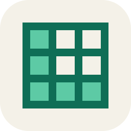

<!-- 改这一份就改 README.zh-CN.md。两份逐节对齐，check:docs 只校验数字，结构靠人守。 -->

<div align="center">



<h1>棂 · Lattice</h1>

<p><strong>Widgets on your Windows desktop — and a widget is just a web page.</strong><br>
You write HTML, CSS and JS. Real windows, the sandbox, permissions, install and update are the platform's job.<br>
No account, no server.</p>

<p>
<a href="https://github.com/unraveltao/Lattice/actions/workflows/ci.yml"></a>
<a href="./LICENSE"></a>
<a href="#install"></a>
</p>

<p>English · <a href="./README.zh-CN.md">中文</a></p>

<p><a href="docs/screenshot-desktop.png"></a></p>

<p><sub>Clock, to-do and bookmarks, captured from a running build at 2× and placed on a plain wallpaper.<br>
Nothing from a real desktop is in the frame.</sub></p>

</div>

---

## What it is

Lattice puts small windows on your Windows desktop: a clock, a to-do list, system stats, whatever is playing. They are not pictures of widgets — they are real frameless windows, absent from the taskbar, that never steal focus from what you are typing into. Pin them above everything or tuck them under your ordinary windows; position is remembered per monitor, and everything is back where it was after a restart.

The difference from other desktop toys: **widgets are not built in, they are installed.** All 20 official widgets go through the same install path as any third-party one — the platform ships empty, so the ceiling is what you can write in HTML.

It speaks Chinese and English all the way down: the shell, each widget's name and options, and the words drawn *inside* the cards. No restart, no reload.

The name is 棂 (*líng*) — the wooden lattice inside a window pane, the frame every pane is set into.

## What you get

| You want | Widgets | What it does |
| --- | --- | --- |
| The time, and how much is left | Clock · Calendar · Timetable · Countdown | Current time; a month view with your own events; this week's classes with a live now line; days left to a date |
| Nothing slipping through | Todo · Note · Bookmarks · Habit | A list on the desktop; a scratch note that saves itself; links you keep coming back to; streaks you can keep |
| To know what the machine is doing | System · Battery · Terminal | CPU and memory with a one-minute trace, per-core load, disk, network, uptime; charge and time left; a shell you can run commands in |
| To work for a stretch | Focus · Stopwatch | A pomodoro that is still right after you close the lid; a stopwatch |
| To not lose the words you looked up | Word Drill | One card per line pasted in, four grades, next review scheduled in days |
| A quick sum | Calculator · Convert | Arithmetic you can copy out; two-way conversion for length, mass, temperature, data, time and speed |
| To draw it, not describe it | Diagram | Boxes, circles and arrows on a canvas you can pan and zoom — and the assistant can draw the whole thing from a sentence |
| Music, weather, and a fish | Music · Weather · Big Fishy | What is playing with a level that follows the sound; one city, refreshed on a timer and still readable offline; a pet that walks along the bottom of your screen |
| To let a model do the clicking | `Ctrl+K` assistant | You bring the model; the key never leaves Rust; it can drive the desktop and call the tools your widgets declare. A script can do the same over a loopback endpoint — `npm run agent` |
| None of the above | Write one | Four files, no build step — [see below](#write-a-widget) |

## Install

**Just want to use it.** Take `*-setup.exe` from [Releases](https://github.com/unraveltao/Lattice/releases) and run it. The first launch is stopped by SmartScreen as an "unknown publisher" — the installer is not code-signed yet, so click **More info → Run anyway**. That is a procurement problem, not a technical one, and it sits in the known-gaps table in [AGENTS.md](./AGENTS.md) instead of being quietly ignored.

**Changing the code.** Node 22, Rust (the `windows-gnu` toolchain) and the WebView2 runtime — the standard [Tauri 2 prerequisites](https://v2.tauri.app/start/prerequisites/).

```bash
npm install
npm run dev          # front end only, http://localhost:1420 — everything but "send to desktop"
npm run tauri:dev    # the real app
npm run tauri:build  # NSIS installer + updater artifacts
```

Use the wrapper scripts, not `npx tauri`: `scripts/tauri.mjs` puts the bundled `mingw64` and the `gcc` shim on `PATH`, and compiling around it fails in `resource.rc` instead of telling you why.

Before you send anything, run what CI runs: `npm run typecheck`, `npm run check:tokens`, `npm run check:docs`, then `npm run test:browser` against a running dev server. The full order, and what each gate catches, is in [CONTRIBUTING.md](./CONTRIBUTING.md).

## Write a widget

Four files and no build step:

```
demo.mine/
  manifest.json    id (reverse-domain), version (semver), permissions, size, config, help
  index.html       entry point, transparent background
  widget.js        your code — the SDK is a copied file, not an npm install
  style.css        tokens only, no hard-coded colours
```

```js
import { createLattice } from "./lattice.js";

const lattice = createLattice();

// First paint from defaults. Never wait for the bridge before drawing.
render({ text: "New note", size: 16 });

const note = await lattice.storage.get("note");
if (note) render(note);

lattice.storage.onChange(async () => render(await lattice.storage.get("note")));
```

Three habits the platform will punish you for skipping:

- **Use `schedule.every`, never `setInterval`.** A raw timer keeps ticking while the widget is invisible, which defeats the whole pause story.
- **Respect the chrome budget.** The pill floats over your content and is clickable. Reserve `padding-right: 120px`, or your first line goes under the close button.
- **Declare your options in the manifest.** The inspector renders them per instance; a settings UI drawn inside the card is a settings UI nobody can use.

```bash
npm run create:widget -- demo.mine    # scaffold, already chrome-aware
npm run pack:widget -- demo.mine      # folder → .lattice, drag straight into the window
```

[`examples/counter`](./examples/counter) is the reference implementation; [docs/WIDGET_SPEC.md](./docs/WIDGET_SPEC.md) is the contract — the method table, the config types, the manifest rules, and the traps that only show up once a widget is real.

## How it works

A widget *becomes* a window without ever touching Windows. It runs in a sandboxed iframe with an opaque origin and a CSP that pins it to its own files, and every capability it has is a request over one message bridge. There are thirteen permissions, nothing is granted by default, and installing a widget grants it nothing: you approve each capability once per widget, and revoking one takes effect in the windows already open.

<p align="center"><a href="docs/screenshot-editor.png"></a></p>

<p align="center"><sub>The main window: library on the left, canvas in the middle, inspector on the right. Canvas previews are an approximation — there is no wallpaper to sample inside a window.</sub></p>

Three decisions make it look odd next to a desktop toy, and none of them is free:

- **The platform ships empty.** First run is an empty desktop and a library you fill yourself. Six pre-installed widgets would look better in a screenshot and would kill the extension model on day one.
- **There is no server.** The catalogue is a static `registry.json` on GitHub Pages, packages are signed files, updates are a release asset. So ratings never aggregate into a number, and reporting a bad widget is a file you send the author yourself.
- **Everything goes through one bridge.** No `localStorage`, no `fetch`, no direct Win32. Every capability is a bridge method with a permission, which is why the API is small — and why it has to be enough, since the official widgets use nothing else.

<p align="center">
<a href="docs/screenshot-chrome.png"></a>
<a href="docs/screenshot-backplate.png"></a>
</p>

<p align="center"><sub>Left: the chrome the host draws — drag, layer, pin, reload, close. Right: the same clock in three backplates; colour, fill and blur are per-instance.</sub></p>

The reasoning behind each, including what was tried and dropped, is in [docs/ARCHITECTURE.md](./docs/ARCHITECTURE.md) — in Chinese, because that is the language the people who change this code read. The invariants that must not be broken are in [AGENTS.md](./AGENTS.md).

## Where it stands

**v0.13 is the newest milestone: the assistant gets its own window on the desktop.** The code has landed and is waiting on real-machine verification — the same gap the four milestones before it are closing. What the installer reports is `0.1.2`; the `v0.x` numbers are milestone labels, not release versions.

<details>
<summary>What each milestone added</summary>

| Version | What it added |
| --- | --- |
| v0.1 | The skeleton: Tauri + React shell, canvas, sandboxed iframes, the bridge |
| v0.2 | A real desktop: `desktop` / `top` layers, per-placement windows, chrome, data on disk |
| v0.3 | Platform behaviour: tray, start with Windows, pause-all, live reload, crash recovery, occlusion, DPI clamping, snap guides |
| v0.4 | Author experience: `@lattice/sdk`, `create:widget`, `pack:widget`, media session, the `Ctrl+Shift+D` debug drawer |
| v0.5 | Distribution: static catalogue, three signature checks, update + rollback, local ratings and reports, permission re-review |
| v0.6 | The catalogue goes public on GitHub Pages, with a disk cache, `If-None-Match` and an honest offline fallback |
| v0.7 | Delivery: NSIS installer, in-app updater, draft-first releases, the SmartScreen problem written down instead of hidden |
| v0.8 | Agent access: an opt-in loopback endpoint, a token, an audit log, 8 allowlisted actions |
| v0.9 | `lattice.music`, `audio:level`, `lattice.bookmarks`, `shell:open` |
| v0.10 | The built-in assistant: your own model behind an OpenAI-compatible URL, the key kept in Rust, `llm:chat` for widgets |
| v0.11 | Hands: six groups of capabilities, approval modes, model profiles, sessions on disk, `agent:tools` |
| v0.12 | Skill packs, the workspace exemption zone, two modes — internal / full access |
| v0.13 | The assistant on the desktop: its own window, not a panel inside the main one |

</details>

<details>
<summary>By the numbers</summary>

| Metric | Value |
| --- | --- |
| Official widgets | 20 |
| Permissions | 13 |
| Tauri commands | 99 |
| Browser assertions | 2 816 over 56 pages |
| Rust tests | 439 |
| Documented pitfalls | 98 |

Every one of those is enforced by something. The browser assertions run a real dev server and a real Chrome in CI; the Rust tests split pure-logic cases from the ones that need a full `cargo test`; the pitfalls are the ones that actually bit, each with the reasoning that prevents a relapse.

**Code, roughly**

| Area | Lines |
| --- | --- |
| TypeScript | 24 180 lines |
| CSS | 6 206 lines |
| Rust | 24 353 lines |
| SDK | 961 lines |
| Widgets + example | 27 046 lines |
| Scripts | 5 614 lines |

</details>

## Read next

| Document | What it answers |
| --- | --- |
| [docs/ARCHITECTURE.md](./docs/ARCHITECTURE.md) | How the pieces fit, and why |
| [docs/WIDGET_SPEC.md](./docs/WIDGET_SPEC.md) | The widget contract |
| [docs/ROADMAP.md](./docs/ROADMAP.md) | Where the project is, what is next, and the decisions reality overturned |
| [docs/PITFALLS.md](./docs/PITFALLS.md) | Every pitfall, grouped by the symptom you are staring at |
| [docs/FAQ.md](./docs/FAQ.md) | "Nothing appeared after I installed it" and the other first-hour questions |
| [docs/reference/build.md](./docs/reference/build.md) | Toolchain, build, release — the operational manual |
| [docs/AGENT_ACCESS.md](./docs/AGENT_ACCESS.md) | The agent endpoint's threat model |
| [docs/CODE_SIGNING.md](./docs/CODE_SIGNING.md) | Keys, trust anchors, what is *not* signed |
| [AGENTS.md](./AGENTS.md) | 20 invariants, written for whoever touches this next |

If you read only one thing before changing code, read the invariants in [AGENTS.md](./AGENTS.md). They are not style preferences — each one is a bug that shipped.

## Credits

Some of the best decisions in this repo came from people who never committed a line of it.
The rule for crediting them, and the list itself (empty so far): [CREDITS.md](./CREDITS.md).

## License

MIT — see [LICENSE](./LICENSE).
