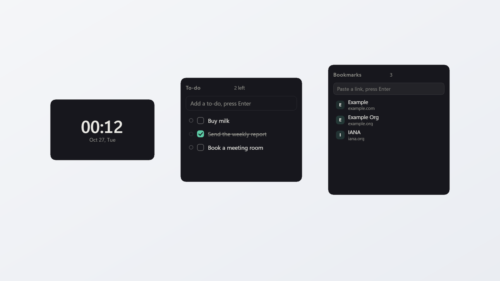
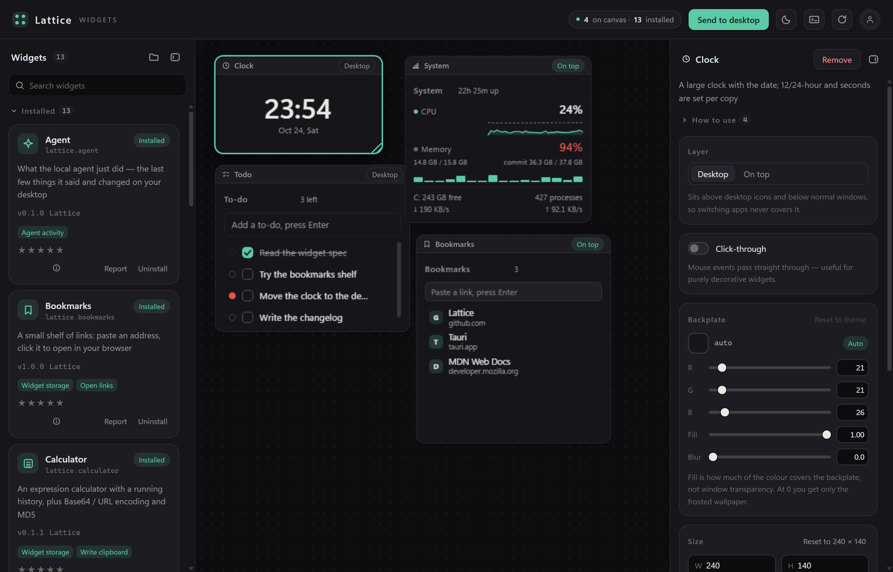
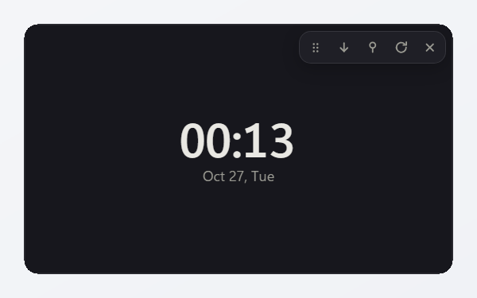
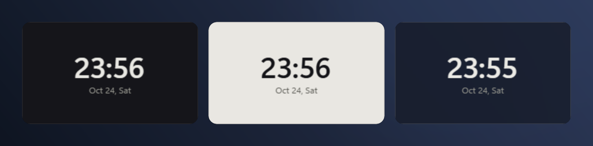

<!-- 改这一份就改 README.md。两份逐节对齐，check:docs 只校验数字，结构靠人守。 -->

<div align="center">


<h1>棂 · Lattice</h1>

<p><strong>在 Windows 桌面上摆你自己的小组件。组件就是网页。</strong><br>
写的人只写 HTML / CSS / JS；真窗口、沙箱、权限、安装与更新，平台来做。<br>
没有账号，没有服务端。</p>

<p>
<a href="https://github.com/unraveltao/Lattice/actions/workflows/ci.yml"></a>
<a href="./LICENSE"></a>
<a href="#安装"></a>
</p>

<p><a href="./README.md">English</a> · 中文</p>

<p><a href="docs/screenshot-desktop.png"></a></p>

<p><sub>时钟、待办、书签，从运行中的应用按 2× 截下来，摆在干净的壁纸上。<br>
画面里没有别人真实桌面的东西。</sub></p>

</div>

---

## 这是什么

Lattice 在你桌面上摆几扇小窗口：时钟、待办、系统监控、正在放的音乐。都是真窗口，不是贴图。没有边框，不进任务栏，点它不会把你正在打字的地方抢走。可以钉在所有窗口上面，也可以压在普通窗口底下、贴着壁纸。位置按屏幕记，重启回来还在原处。

跟别的桌面小工具比，最不一样的地方是：**平台不带组件。** 24 个官方组件和第三方的走同一条安装链路，一个都不预装。组件能有多少种，取决于你写的 HTML。

中英双语管到最后一层：平台界面、组件的名字和配置项、卡片里面画的字。切换不用重启，也不用重载组件。

名字来自棂（líng），窗户里那层木格栅。每一块玻璃都嵌在它里面。

## 从这里开始

五条路，挑一条走。每一行都只是几分钟的读；它后面那几份文档才是长的版本。

| 你是 | 你想要 | 按这个顺序读 |
| --- | --- | --- |
| **只是想用** | 装上、过第一次启动、某个地方不对劲 | [安装](#安装) → [常见问题](./docs/FAQ.md) → [现在能用什么](./docs/reference/maturity.md) |
| **写组件** | 四个文件、SDK、契约、发布 | [写一个组件](#写一个组件) → [组件规范](./docs/WIDGET_SPEC.md) → [§9 发布](./docs/WIDGET_SPEC.md#9-发布版本与签名) |
| **改平台代码** | 代码长什么样、开发环境、什么不能破 | [它是怎么做到的](#它是怎么做到的) → [参与平台开发](#参与平台开发) → [架构](./docs/ARCHITECTURE.md) → [贡献指南](./CONTRIBUTING.md) |
| **接 agent** | 它能做什么、被允许做什么、技能与 MCP | [Agent](#agent) → [Agent 接入](./docs/AGENT_ACCESS.md) |
| **看安全** | 隔离、权限、签了什么名、威胁模型 | [安全吗](#安全吗) → [代码签名](./docs/CODE_SIGNING.md) |

只是好奇？下面那张*你能用它做什么*列着所有官方组件；*它是怎么做到的*和*走到哪了*是这一页的其余部分，[ROADMAP](./docs/ROADMAP.md) 是更长的版本，包括那些被现实推翻的决定。每份文档属于哪个时态、哪份是哪个事实的家：[docs/README.md](./docs/README.md)。

## 你能用它做什么

| 你想要 | 用哪个组件 | 它给你什么 |
| --- | --- | --- |
| 抬眼就知道几点、还剩多久 | 时钟 · 日历 · 课表 · 倒计时 | 当前时间；月视图加自己的日程；本周课表带一条当前时间线；到某一天还剩几天 |
| 别让事情漏掉 | 待办 · 便签 · 书签 · 习惯 | 桌面上的清单；随手记，自动保存；常去的链接；能连着打勾的连续天数 |
| 知道机器现在怎么样 | 系统 · 终端 | CPU、内存、GPU、电池各一个数，带一分钟曲线；每核负载、显存、磁盘、网络、开机时长；一条能敲命令的 shell |
| 专心干一会儿活 | 专注 · 秒表 | 番茄钟，合上盖子再回来时间还是对的；计时 |
| 别把查过的词忘掉 | 背单词 | 一行一张卡贴进去，四档打分，下次复习按天排 |
| 顺手算一下 | 计算器 · 单位换算 | 四则运算，结果能一键复制；长度 / 质量 / 温度 / 数据 / 时间 / 速度双向换算 |
| 想画个架构图 | 架构图 | 一块能平移缩放的图面：矩形、圆、箭头；assistant 一句话就能画完一整张 |
| 脑子里的东西想理成树 | 思维导图 | 一段缩进大纲长成右向的树，位置自己排。折叠、平移、缩放，整张能复制成 Markdown / Mermaid / OPML |
| 音乐、天气，还有一条鱼 | 音乐 · 天气 · 大肥鱼 | 在放什么、跟着声音起伏；一个城市的天气，定时刷新、断网也读得出来；一条在屏幕底下走来走去的桌宠 |
| 让 AI 替你动手 | `Ctrl+K` assistant | 模型你自己配，key 不离开 Rust；它能开合桌面，也能调组件自己声明的工具。脚本也能走同一条路，一个只绑回环地址的端点，`npm run agent` |
| 一眼看全整个画布 | `Ctrl+Shift+O` 总览 | 每个组件按真实尺寸和位置缩成一张图，左边按层级分组。只读：点一张就回到那张卡上 |
| 二十四个组件里找某一个 | `Ctrl+Shift+F` 全局搜索 | 已装的、能装的、商店里的一屏搜（名称、id、说明、作者、权限）。选中之后去画布上那张卡，或者去组件库里那一行 |
| 上面这些都不够 | 自己写一个 | 四个文件、没有构建步骤，[见下](#写一个组件) |

## 安装

**只想用。** 从 [Releases](https://github.com/unraveltao/Lattice/releases) 取 `*-setup.exe` 双击装。第一次启动会被 SmartScreen 拦成「未知发布者」，安装包还没做代码签名，点 **更多信息 → 仍要运行** 就行。这是采购问题，不是技术问题 —— 走到哪一步了写在 [CODE_SIGNING.md](./docs/CODE_SIGNING.md)，每个 release 的说明里有安装包的 SHA-256，想先核对再装也可以。

**第一次启动是一个空桌面，这是设计。** 平台不带组件：打开组件库，从目录里装一个，在画布上摆好，再点**投放到桌面** —— 画布是你编辑的地方，桌面是它待的地方。把文件夹或 `.lattice` 包拖进窗口是第三条路；文件落到哪儿、布局存在哪儿、「层级」是什么意思，在 [docs/FAQ.md](./docs/FAQ.md) 的前两节。

**想改代码？** 看[参与平台开发](#参与平台开发)。

## 写一个组件

四个文件，没有构建步骤：

```
demo.mine/
  manifest.json    id（反向域名）、version（semver）、权限、尺寸、配置、说明
  index.html       入口，透明背景
  widget.js        你的代码，SDK 是复制过去的一个文件，不是 npm 安装
  style.css        只用 token，不写死颜色
```

```js
import { createLattice } from "./lattice.js";

const lattice = createLattice();

// 先用默认值画第一帧。永远不要等桥回来才画。
render({ text: "新便签", size: 16 });

const note = await lattice.storage.get("note");
if (note) render(note);

lattice.storage.onChange(async () => render(await lattice.storage.get("note")));
```

有三件事平台会跟你计较：

- 用 `schedule.every`，不要 `setInterval`。裸定时器在组件看不见时照样跑，整套"看不见就停"就废了。
- 那颗胶囊浮在你的内容上，还挡点击。留出 `padding-right: 120px`，否则第一行会被关掉按钮压住。
- 配置项写在清单里。属性面板会按实例渲染它们；在卡片里自己画一套设置界面，那套界面没人用得上。

```bash
npm run create:widget -- demo.mine    # 起个头，已经避开窗饰遮挡
npm run pack:widget -- demo.mine      # 目录 → .lattice，直接拖进窗口
```

[`examples/counter`](./examples/counter) 是能跑的最小实现。[docs/WIDGET_SPEC.md](./docs/WIDGET_SPEC.md) 是契约：方法表、配置类型、清单规则，还有"组件真跑起来之后才会撞到"的那些坑。

SDK 是复制进你目录的一个文件，不是依赖：[packages/sdk](./packages/sdk/README.md) 写了里面有什么、以及它故意不做什么。

发布不是上传。你自己打包、用自己的钥匙签名，然后向[目录仓库](https://github.com/unraveltao/lattice-registry)提一个 PR；CI 会重算索引，包和索引对不上就拒。版本范围怎么写、审的是什么、私钥为什么永远不进 CI：[WIDGET_SPEC §9](./docs/WIDGET_SPEC.md#9-发布版本与签名)。

## 它是怎么做到的

组件从头到尾碰不到 Windows。它跑在一个源不透明、CSP 钉死在自己文件上的沙箱 iframe 里，拥有的每一项能力都是一次过桥请求。这道边界值多少 —— 以及它没盖住什么 —— 在[安全吗](#安全吗)这一节。

<p align="center"><a href="docs/screenshot-editor.png"></a></p>

<p align="center"><sub>主窗口：左边组件库、中间画布、右边属性面板。画布上的预览是近似值，窗口里没有壁纸可采样。</sub></p>

下面三件事让它不太像个桌面小玩具，代价也都不小。

平台出厂是空的。预装六个组件在截图里更好看，可那样扩展模型第一天就死了。

没有服务端。目录是 GitHub Pages 上一份静态 `registry.json`，包是签过名的文件，更新是一个 release 附件。评分因此永远汇总不成一个数，举报一个坏组件也只能把文件自己发给作者。

一切都过同一座桥。没有 `localStorage`，没有 `fetch`，也不直接调 Win32。API 就这么小，所以它必须够用：官方组件用的就是它。

<p align="center">
<a href="docs/screenshot-chrome.png"></a>
<a href="docs/screenshot-backplate.png"></a>
</p>

<p align="center"><sub>左：宿主画的窗饰，拖动、层级、别针、刷新、关闭。右：同一个时钟的三种背板，颜色、填充、模糊都按实例调。</sub></p>

每个决定的推理、试过又扔掉的东西，在 [docs/ARCHITECTURE.md](./docs/ARCHITECTURE.md)。

## 参与平台开发

Node 22、Rust（`windows-gnu` 工具链）、WebView2 运行时，就是标准的 [Tauri 2 前置条件](https://v2.tauri.app/start/prerequisites/)。

```bash
npm install
npm run dev          # 只跑前端，http://localhost:1420，除了"投放到桌面"之外都有
npm run tauri:dev    # 真应用
npm run tauri:build  # NSIS 安装包 + 更新产物
```

用包装脚本，别用 `npx tauri`：`scripts/tauri.mjs` 会把自带的 `mingw64` 和 `gcc` shim 塞进 `PATH`，绕过它编译会在 `resource.rc` 里失败，而且不告诉你为什么。

提交之前，把 CI 跑的那几条自己跑一遍：`npm run typecheck`、`npm run check:tokens`、`npm run check:docs`、`npm run check:guards`，然后对着起着的 dev server 跑 `npm run test:browser`。完整顺序和每道闸拦什么，在 [CONTRIBUTING.md](./CONTRIBUTING.md)。

**改代码之前只读一样东西的话，读 [AGENTS.md](./AGENTS.md) 里那 24 条不变量。** 那不是风格偏好，每一条背后都有一个发出去过的 bug。你要动的东西该守哪几条，是 [`.agents/skills/invariants`](./.agents/skills/invariants/SKILL.md) 那张「你要动的 → 哪几条」表 —— 一次改动通常命中好几行，取并集，别挑第一行。

文件在哪：[docs/reference/structure.md](./docs/reference/structure.md)。一个说不通的症状：[docs/PITFALLS.md](./docs/PITFALLS.md)，搜现象，别搜原因。构建与发版：[docs/reference/build.md](./docs/reference/build.md)。每个版本加了什么、哪些决定被现实推翻过：[docs/ROADMAP.md](./docs/ROADMAP.md)。

## Agent

两个入口，一个执行器。`Ctrl+K` 打开内置 assistant：OpenAI 兼容地址和 key 你自己配，key 只在 Rust 里，回答是流式的，它能开合桌面、也能调组件自己声明的工具。脚本 —— 或者任何会说 HTTP 的 agent —— 走同一个执行器，只是入口换成一个回环端点：**默认关，关着的时候根本不 bind**，要 Bearer 令牌，有审计日志，9 个白名单动作；`npm run agent -- state` 看它干了什么。

手是六组 —— 文件、命令、网页、屏幕、键鼠，以及你自己配的 MCP 服务 —— 每一组都要你拨开才动。两个模式：**内部**（桌面动作、组件工具、你拨开的那几组手）和**完全访问**（六组全开、不问、审计 fail-closed）。审批是另一根轴 —— `readonly`、`ask`、`auto` —— 而 `readonly` 压得过完全访问。技能是 `skills/<id>/SKILL.md`：一段进提示词的文本，什么权限也不给。

组件从 `agent:tools` 进来：清单里声明工具、申请这条权限，模型就能调它。威胁模型，以及四个接入面为什么分开（控制平面、数据平面、agent 当组件、内置 assistant），在 [docs/AGENT_ACCESS.md](./docs/AGENT_ACCESS.md)。

## 安全吗

组件是不可信代码，平台就是这么当的。四件事，按要紧程度排：

- **隔离。** `<iframe sandbox="allow-scripts allow-forms">`，没有 `allow-same-origin`：源是不透明的，读不到父窗口 DOM，`localStorage` 直接抛，`fetch` 带着 `Origin: null` 出去，文档的 CSP 是 `default-src 'none'` 加它自己的文件。唯一出口是那座桥。
- **权限。** 十五项，默认一项都不给，按组件授而不是按实例 —— 你信的是那段代码，不是桌面上那一份 —— 撤掉一项，已经开着的窗口当场生效。最重的是 `terminal:exec`，它是一条真的 shell：平台判断不了一条命令（任何黑名单都差一行 `& $x`），所以防线只有两条 —— 默认不授、授权那一屏把后果写成正文。[WIDGET_SPEC §3](./docs/WIDGET_SPEC.md#3-权限)。
- **签名。** 这个项目里有三个东西都叫「签名」，只缺一个：组件包由发布者用 ed25519 签，更新产物由 updater 的 minisign 钥匙签，安装包没有 Authenticode 证书 —— 所以第一次启动会被 SmartScreen 拦。买一张证书为什么修不好它、什么能修：[CODE_SIGNING.md](./docs/CODE_SIGNING.md)。
- **agent 这一面。** 默认关、有审计，而且写清了什么没防：[AGENT_ACCESS.md](./docs/AGENT_ACCESS.md)。

## 走到哪了

每个面只有四种状态之一：**已实现**、**未验证**（代码和断言都在，只是没人在真机上走过）、**实验中**、**计划中**。哪个是哪个、真机上验到哪一步，一个面一行：[功能成熟度](./docs/reference/maturity.md)。今天没有"实验中"的东西；下一个里程碑不加功能，它专门用来还这笔验收债。

三个数，三种意思，永远不是同一个数：源码是 `0.3.0`（下一次构建会这么叫自己），能下载到的最新一版是 [`v0.1.3`](https://github.com/unraveltao/Lattice/releases/latest)，`v0.13` 是里程碑标签、不会出现在安装包里。最新的里程碑是 v0.13：assistant 有了自己的桌面小窗。代码已经落地，还差一次真机验收，前面那四个"进行中"也卡在同一处。

<details>
<summary>每个版本加了什么</summary>

| 版本 | 加了什么 |
| --- | --- |
| v0.1 | 骨架：Tauri + React 外壳、画布、沙箱 iframe、桥 |
| v0.2 | 真桌面：`desktop` / `top` 两层、按摆放位置的窗口、窗饰、数据落盘 |
| v0.3 | 平台行为：托盘、开机自启、全部暂停、实时重载、崩溃恢复、遮挡检测、DPI 夹紧、吸附参考线 |
| v0.4 | 作者体验：`@lattice/sdk`、`create:widget`、`pack:widget`、媒体会话、`Ctrl+Shift+D` 调试抽屉 |
| v0.5 | 分发：静态目录、三道签名检查、更新与回滚、本地评分与举报、新权限复核 |
| v0.6 | 目录上 GitHub Pages：磁盘缓存、`If-None-Match`、断网时诚实的兜底 |
| v0.7 | 交付：NSIS 安装包、应用内更新、先草稿再发布的 release、SmartScreen 问题写下来而不是藏起来 |
| v0.8 | Agent 接入：默认关的回环端点、令牌、审计日志、8 个白名单动作 |
| v0.9 | `lattice.music`、`audio:level`、`lattice.bookmarks`、`shell:open` |
| v0.10 | 内置 assistant：自备 OpenAI 兼容模型、key 只在 Rust 里、组件侧的 `llm:chat` |
| v0.11 | 手：六组能力、审批档、模型多档配置、会话落盘、`agent:tools` |
| v0.12 | 技能包、工作区免问区、两个模式：内部 / 完全访问 |
| v0.13 | assistant 上桌面：自己的窗口，不是主窗口里的一个面板 |

</details>

<details>
<summary>数字</summary>

| 项目 | 数值 |
| --- | --- |
| 官方组件 | 24 |
| 权限 | 15 |
| Tauri 命令 | 128 |
| 浏览器断言 | 87 页 4 483 条 |
| Rust 单测 | 618 |
| 记下来的坑 | 133 |

这些数是跑出来的：浏览器断言在 CI 里起真的 dev server 和真的 Chrome；Rust 单测数是 `#[test]` 的个数 —— 纯逻辑的那批走 `rustc --test` 单跑，其余走完整 `cargo test`。坑也是真咬过人的那些，每条都写着为什么不会再犯。

**代码量，大致**

| 部分 | 行数 |
| --- | --- |
| TypeScript | 30 543 行 |
| CSS | 7 479 行 |
| Rust | 34 096 行 |
| SDK | 961 行 |
| 官方组件 + 示例 | 36 734 行 |
| 脚本 | 9 153 行 |

</details>

## 致谢

这个仓库里有些最好的决定，来自一行代码都没提交过的人。记他们的规矩，以及那份名单本身（目前还是空的）：[CREDITS.md](./CREDITS.md)。

## 许可

MIT，见 [LICENSE](./LICENSE)。
