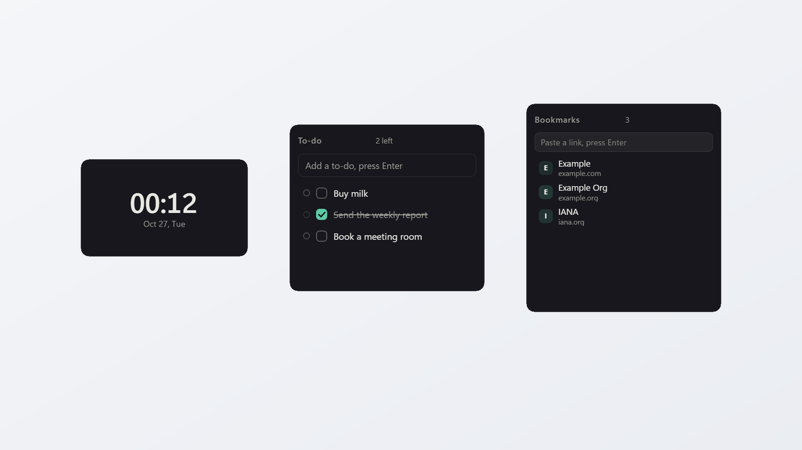
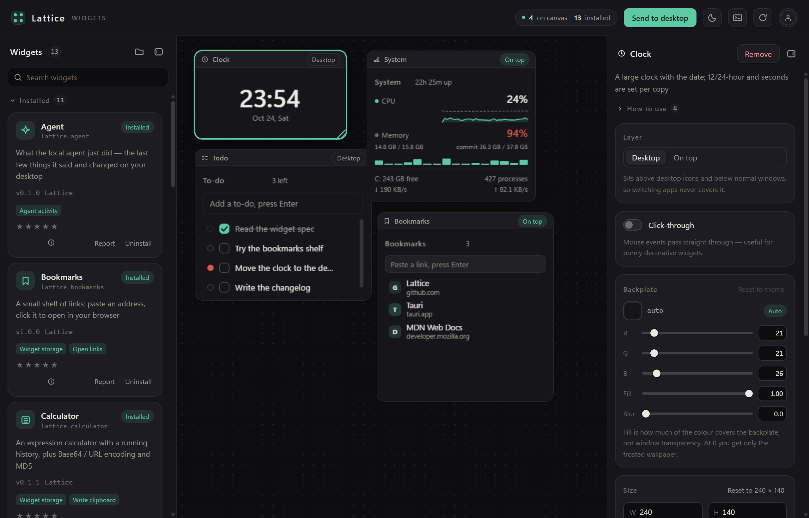
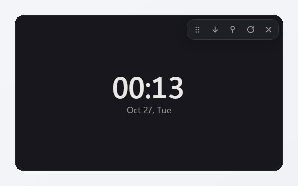
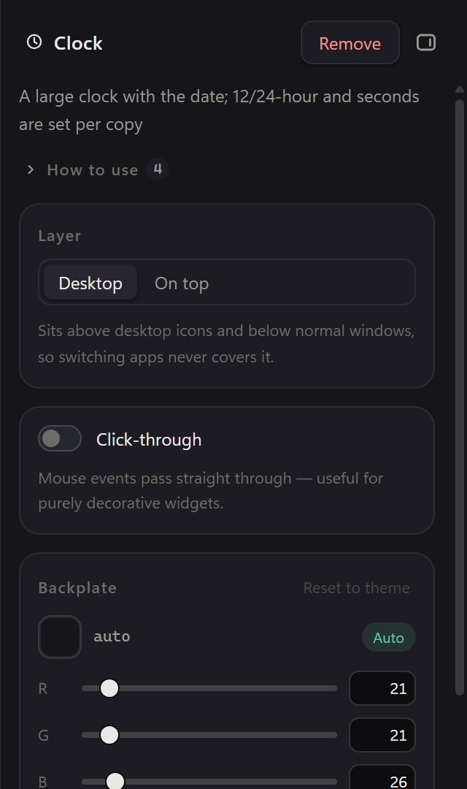
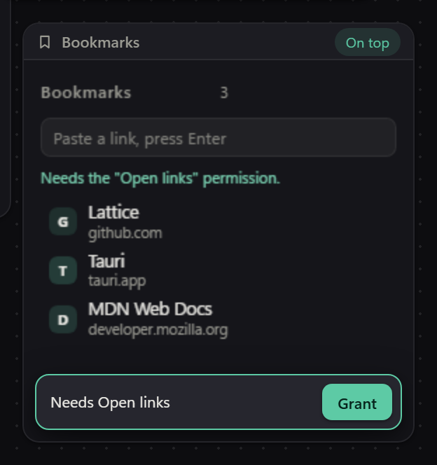

<div align="center">

<h1>棂 · Lattice</h1>

<p><strong>在 Windows 桌面上摆你自己的小组件 —— 组件就是网页。</strong><br>
写的人只写 HTML / CSS / JS；真窗口、沙箱、权限、安装与更新，平台来做。<br>
没有账号，没有服务端。</p>

<p>
<a href="https://github.com/unraveltao/lattice/actions/workflows/ci.yml"></a>
<a href="./LICENSE"></a>
<a href="#安装与构建"></a>
</p>

<p><a href="./README.md">English</a> · 中文</p>

<p><a href="docs/screenshot-desktop.png"></a></p>

<p><sub>官方组件里的三个 —— 时钟、待办、书签 —— 从运行中的应用按 2× 截下来，<br>
摆在干净的壁纸上。画面里没有任何人真实桌面的东西。</sub></p>

</div>

---

## 这是什么

**Lattice 是一个 Windows 桌面小组件平台。你桌面上摆的那些小东西 —— 时钟、待办、系统监控、正在放的音乐 —— 各自是一个小组件，它们不是贴图，是真的窗口。**

这些窗口没有边框，不进任务栏，点它不会把你正在打字的地方抢走；可以钉在所有窗口最上面，也可以压在普通窗口底下、贴着壁纸。位置按屏幕记，混着不同缩放的显示器也不会跑偏；数据存在本地，重启回来还在原处。

它和别的桌面小工具最大的区别是：**组件不是内置的，是装进去的。** 17 个官方组件和第三方组件走同一条安装链路 —— 平台本身一个组件都不带。所以"能有什么组件"没有上限：你会写 HTML，就能加一个，四个文件，没有构建步骤。

**中英双语是整条链路上的。** 平台自己的界面能切，本来不归它管的那几层也切：每个官方组件在属性面板里的名字、配置项标签、还有"怎么用"正文，都按你选的这门从清单里取；卡片**里面**那些字（星期、`还剩 2 项`、开始 / 暂停）靠一条 `language` 推送跟着变，已经开着的窗口当场换。不用重启，也不重载组件。

名字来自棂（líng）—— 窗户里那层木格栅，每一块玻璃都嵌在它里面。

## 你能用它做什么

| 你想要 | 用哪个组件 | 它给你什么 |
| --- | --- | --- |
| 抬眼就知道几点、还剩多久 | 时钟 · 日历 · 课表 · 倒计时 | 当前时间；月视图加自己的日程；本周课表带一条当前时间线；倒计时到某一天 |
| 别让事情漏掉 | 待办 · 便签 · 书签 | 桌面上的清单；随手记，自动保存；常去的链接 |
| 知道机器现在怎么样 | 系统监控 | CPU 与内存带一分钟曲线、每核负载、提交内存、磁盘、网络、开机时长 |
| 专心干一会儿活 | 专注 · 秒表 | 番茄钟 —— 合上盖子再回来，时间还是对的；计时 |
| 别把查过的词忘掉 | 背单词 | 一行一张卡贴进去，四档打分，下次复习按天排 |
| 顺手算一下 | 计算器 · 单位换算 | 四则运算，结果能一键复制；长度 / 质量 / 温度 / 数据 / 时间 / 速度双向换算 |
| 画出来，而不是描述出来 | 架构图 | 一块能平移缩放的图面：矩形、圆、菱形、文本；箭头在两个图形之间弯着走，assistant 几行字就能画完一整张 |
| 桌面跟着音乐动 | 音乐 | 在放什么、能切歌、能跟着声音起伏 |
| 出门前看一眼 | 天气 | 一个城市的当前天气，定时刷新，断网时也读得出来 |
| 让 AI 替你动手 | `Ctrl+K` assistant + `npm run agent` | 模型你自己配，key 不离开 Rust；端点是同样的 8 个白名单动作，assistant 另有六组手、一组一组拨开，CLI 让你看见它做了什么 |
| 上面这些都不够 | 自己写一个 | 见 [写一个组件](#写一个组件) |

## 它不是什么

- **不是皮肤引擎。** 没有自己的 DSL、没有要学的皮肤格式：组件就是网页，你会的 CSS 直接能用。
- **不是系统自带那个小组件面板。** 那个只有微软和合作方能发；这里你自己就能写，写完拖进窗口就装上。
- **不是"每个组件背一个 Chromium"。** 所有组件共用系统自带的 WebView2，装十几个组件不等于装十几个浏览器。

## 两种用法

**只想用** → 装[安装包](#安装与构建)，在组件库里挑几个，拖到画布上，点 **投放到桌面**。之后它们就在桌面上，重启还在原位。

**想自己写** → 看[写一个组件](#写一个组件)。一个目录、四个文件、没有构建步骤；把目录拖进窗口就算装好了。

## 它是怎么做到的

关键在于"变成一个窗口"这件事。组件从头到尾碰不到 Windows。它跑在一个 `sandbox="allow-scripts allow-forms"` 的 iframe 里，源是不透明的，CSP 把它钉在自己的文件上；它拥有的每一项能力都是一次过桥请求 —— `clock` 拿时间、`storage` 用自己那份小数据库、`network` 访问一份白名单里的主机，等等。一共十二项权限，默认一项都不给，**装一个组件也不会顺带给它任何权限**：每项能力由你按组件批一次，撤掉一项对已经开着的窗口当场生效。

**平台本身是空的。** 17 个官方组件和第三方组件一样，都是从组件库里显式装进来的普通包 —— 它们没有被编进应用，也不会自动装上。这是"扩展平台"和"桌面小工具"的分界线，也是 [AGENTS.md](./AGENTS.md) 里的第一条不变量。

没有服务端也是同一件事。目录是一份静态的 `registry.json`，包是签过名的文件，托管是 GitHub Pages，更新是一个 release 附件。一旦某个设计开始需要后端，那说明设计选错了 —— 这条约束在 [docs/ROADMAP.md](./docs/ROADMAP.md) 里论证过，不是默认前提。

## 现在到哪了

**当前里程碑是 v0.12。** 这份 README 里的 `v0.x` 是里程碑标签，不是版本号：安装包上写的是 `0.1.1`，那才是唯一发出去的数字。v0.11 还开着三处缺口，v0.13 只是"assistant 上桌面"的设计稿，还没有代码。

前面几步：v0.8 让 agent 能调控桌面（默认关的本地端点、8 个白名单动作、每一次调用都进审计日志）；v0.9 补上"声音看得见、链接出得去"；v0.10 内置 assistant —— **模型你自己带，手仍然归平台**：`Ctrl+K` 叫出一扇小窗，填一次 OpenAI 兼容的 base URL 和 key，key 落在 Rust 掌管的 `assistant.json`，前端只看得到 `sk-1…cdef` 这样的掩码。那时候模型能"做"的，还只是 agent 端点本来就有那 8 个白名单动作；组件要 `llm:chat` 只拿得到文字，永远拿不到工具。

v0.11 才是手到位的版本：六组能力，一组一组拨开 —— 读文件、跑命令、取网页、看窗口、点键鼠、调用你自己加的 MCP 服务器。六组默认全关，读自动放行，写与命令与点击先问一句，审计只记形状不记内容。也是这一版，组件学会**借**这双手：`desktop:control` 让桌宠能跑一轮 assistant，工具表里没有删除。

v0.12 把这一堆开关收成**两个模式** —— *内部*（桌面动作 + 组件声明的工具 + 你拨开的那几组手）、*完全访问*（六组全开、不问，但要过一道必须勾选的风险确认）—— 并且加了技能包：`skills/<id>/SKILL.md` 进提示词，是说明书不是权限。

每一版当时怎么想的，在 [ROADMAP](./docs/ROADMAP.md) 里。

| 版本 | 加了什么 |
| --- | --- |
| **v0.1** | 骨架：Tauri + React 外壳、画布、沙箱 iframe、桥 |
| **v0.2** | 真的桌面：`desktop` / `top` 两层、每份投放一个窗口、窗饰、数据落盘 |
| **v0.3** | 平台行为：托盘、开机自启、暂停全部、热重载、崩溃恢复、遮挡判定、DPI 夹紧、画布与桌面两套对齐参考线 |
| **v0.4** | 作者体验：`@lattice/sdk`、`create:widget`、`pack:widget`、SMTC 媒体、`Ctrl+Shift+D` 调试抽屉 |
| **v0.5** | 分发：静态目录、三道签名校验、更新与回滚、本地评分与举报、新权限复核 |
| **v0.6** | 目录上公网（GitHub Pages），带磁盘缓存、`If-None-Match`，以及一个会把话说清楚的断网兜底 |
| **v0.7** | 交付：NSIS 安装包、应用内更新、先出草稿的发布流程，以及把 SmartScreen 这件事写下来而不是藏起来 |
| **v0.8** | Agent 接入：默认关的回环 HTTP 端点、令牌、审计日志、8 个白名单动作，以及一块看板组件 |
| **v0.9** | `lattice.music`、`audio:level`、`lattice.bookmarks`、`shell:open` |
| **v0.10** | 平台自带 assistant：自备 OpenAI 兼容地址与 key，key 留在 Rust 里，工具调用只走那 8 个动作，组件那侧是 `llm:chat`，另有 `desktop:control` 让它借这双手；Agent 看板这块组件在这一版被删掉 |
| **v0.11** | 手：六组能力（文件 / 命令 / 网页 / 屏幕 / 键鼠 / MCP 服务）、审批三档、模型档、会话落盘，以及让组件声明自己工具的 `agent:tools` |
| **v0.12** | 技能包与工作区免问区；两个模式 —— 内部 / 完全访问 |

**几个数字**

| 项 | 数值 |
| --- | --- |
| 官方组件 | 17 个 |
| 权限 | 12 项 |
| Tauri 命令 | 87 条 |
| 浏览器断言 | 50 个页面、2332 条 |
| Rust 单测 | 415 条 |
| 记下来的坑 | 82 个 |

每一个数字背后都有东西盯着。浏览器断言在 CI 里起真 dev server、真 Chrome 跑；415 条 Rust 单测分成 364 条 `rustc --test` 的纯逻辑和 51 条要完整 `cargo test` 的；82 个坑全是真的踩过，每个都附了"别再踩回去"的那句话。

## 两个宿主，一套桥

同一个组件出现在两个地方，而平台不允许这两处飘开：

- 在画布上它是主窗口里的一个 iframe（`WidgetFrame.tsx`）；在桌面上它是一个加载 `widget-host.html` 的 `WebviewWindow`，里面装的是**同一种**沙箱 iframe。两边调的是同一个桥、同一张方法表、同一套权限闸门 —— 所以不存在"预览能用、桌面不能用"的分叉，那种分叉是 bug，不是特性。
- 鉴权靠**窗口引用**，不靠 origin：沙箱文档的 origin 全是 `"null"`，只有 `event.source === iframe.contentWindow` 能分出是哪一个实例。
- 权限按 `widgetId` 授予（问的是"你信不信任这段代码"），配置按 `instanceId`（问的是"这一份要怎么显示"）。两个时钟可以一个 12 小时制一个 24 小时制，而你只需要信任这个组件一次。
- 两个宿主都先按默认值画第一帧，**再**去问桥。反过来的话，宿主慢一点就是三秒钟的空白卡片 —— 这是"组件看着坏了其实没坏"最常见的一种。

<p align="center"><a href="docs/screenshot-editor.png"></a></p>

<p align="center"><sub>主窗口：左边组件库、中间画布、右边属性面板，选中的是时钟。画布上的预览只是近似 —— 窗口里没有壁纸可采样，那里的底板是算出来的合成色。</sub></p>

## 桌面是画布，不是预览

<p align="center"><a href="docs/screenshot-chrome.png"></a></p>

<p align="center"><sub>桌面上的时钟，窗饰已经露出来：拖动、层级、钉住、重载、关闭 —— 全部由宿主页画，组件自己一概不碰。</sub></p>

- **两个层级。** `layer: desktop` 的窗口挂到 WorkerW 下、压在普通窗口之下；`layer: top` 用 `HWND_TOPMOST`。两者都无边框、不进任务栏、带 `WS_EX_NOACTIVATE`，点它不会把你正在打字的地方抢走；圆角用 `SetWindowRgn` 裁，半径和画布上的卡片一致。
- **窗饰不抢卡片。** 胶囊在右上角占掉 120px，悬停淡入，每个官方组件都在 CSS 里把这笔预算花掉了 —— 清单里的卡片尺寸是预算，不是设计稿。
- **两套对齐参考线。** 拖动时吸附到邻居和容器边界，每条轴只挑一条获胜线；参考线画成一段以被拖卡片为中心的局部虚线，两端各伸出"半个卡 + 48px"，而不是整屏十字。桌面上那两条线是两个 1px 的叠层窗口，逐像素 alpha，跑在自己的消息线程上 —— **不是**透明 WebView2 窗口，那个在软件渲染的机器上根本建不出来。
- **看不见就别跑。** 心跳全挂在同一条时间轴上，窗口藏起来整条轴停摆，回来只补一拍。"藏起来"故意有两个来源：`document.visibilityState` 在这里没用 —— 窗口最小化之后它照样报 `visible` —— 所以由 Rust 观测再推 `lattice:window-visible`。还有第三个来源，管的是没人会想到的那种：每 1.5 秒在窗口里取九个点问 `WindowFromPoint`，九个点全落在别人的窗口上，浏览器最大化也算把你的组件挡住了。
- **摆哪儿就在哪儿。** 位置锚在组件所在的那块屏上、全程物理像素，混合 DPI 下既不会把卡片丢到屏幕外，也不会把它缩掉一半。

## 底板：界面归平台

<p align="center"><a href="docs/screenshot-backplate.png"></a></p>

<p align="center"><sub>同一个时钟的三种样子：<code>auto</code>、纯色浅底板、35% 浓度加模糊压在壁纸上。颜色、浓度、模糊都是属性面板里按实例的滑杆。</sub></p>

组件自己的 CSS 永远看不到壁纸。宿主窗口在 iframe 后面画三层 —— 壁纸截图加模糊、跟主题走的底色遮罩、组件本体 —— 并跟着调对比度。所以组件里只用令牌（`--lattice-text`、`--lattice-accent`、`--lattice-border`），不写死颜色：底板一变浅，平台会把这些整体翻一遍。出厂外观（`auto`）下平台**什么都不覆盖**，默认样子和没有这个功能时一像素不差。

这个取舍有看得见的代价，而且写下来了：模糊的是**壁纸**，不是组件后面的窗口，因为系统的模糊半径是写死的。想要连续滑杆和真正的透视，只能二选一。

## 一个组件，多份实例：按实例的配置

<p align="center"><a href="docs/screenshot-inspector.png"></a></p>

<p align="center"><sub>选中一张卡片后的属性面板：层级、穿透、底板、尺寸、组件自己的配置项，以及它的权限。</sub></p>

组件在清单里声明自己的配置项 —— `toggle`、`number`、`text`、`select`、`date` —— 由平台在属性面板按实例渲染。组件不自己画设置界面：卡片最大也就两三百像素宽，而且按组件存的偏好会被每一份实例共享。缺的字段补出厂值、非法值退回出厂值，只在 `resolveConfig` 一处合并，所以画布和桌面不可能显示出两套。改配置推 `config-changed`，**不重载**组件；只有权限变化才重载 —— 因为一个被拒过权限的组件很可能已经把"没有权限"写进了自己的 DOM，必须从头来过。

## 组件坏掉的时候

错误通道和桥是两条，这是故意的。`__lattice_diag` 和 `__lattice` 是两种消息；两个宿主都是**先认错误、再认桥**，而结构校验排在来源校验**之后** —— 顺序反了，组件就能靠伪造一条"错误"骗到宿主的一次回话。入口文件没了不会留一块白：给的是能读的一页 `File not found`，写着组件 id、它要的路径、找过的目录，以及 `manifest.json` 里该改的那一行。渲染进程崩了自己重载，一分钟内最多三次，之后不再试，改给一条 **Try again** 的横幅，而不是一直转圈。存一下组件的文件就原地重载（静默 300ms 去抖、上限 2s、安装期间抑制），所以改 CSS 不用删掉卡片再拖一次。

## 沙箱的边界

每一项能力都是一项权限，每一项权限都是 `runtime/bridge.ts` 里的一道闸，一个字节都到不了 Rust。

| 权限 | 换到什么 | 谁在用 |
| --- | --- | --- |
| `clock` | 系统时钟，给的是绝对时刻 | 时钟、倒计时 |
| `storage` | 一份私有的键值文件 `widget-data/<widgetId>.json` | 17 个里的 12 个 |
| `clipboard:write` | 往剪贴板写文本 | 计算器 |
| `network` | 向清单里列出的主机发 HTTP 请求 | 天气 |
| `system:monitor` | CPU、内存、磁盘、网络、开机时长 | 系统监控 |
| `media:control` | 读并驱动 Windows 媒体会话（SMTC） | 音乐 |
| `audio:level` | 一个 `0..1` 的数：输出有多响 | 音乐 |
| `shell:open` | 把 http/https 地址交给默认浏览器 | 书签 |
| `agent:activity` | 读 agent 的审计日志 | 没有内置组件用 —— 只给第三方 |
| `llm:chat` | 把一段对话交给 assistant 的模型，换回文字 | 桌宠 |
| `agent:tools` | 把组件自己的能力声明成工具，让 assistant 调用 | 架构图 |
| `desktop:control` | 借 assistant 的手跑一轮 —— 能摆组件，不能删 | 桌宠 |

<p align="center"><a href="docs/screenshot-permission.png"></a></p>

<p align="center"><sub>卡片碰到一项没被授予的能力，会当场把名字说出来；一次 <code>Grant</code> 覆盖整套，然后组件重新初始化。</sub></p>

其中六项值得单独说一段，因为"它有这个权限"从来不是全部故事。

**`network` 是白名单，不是开关。** 一次请求按固定顺序过三道闸：有 `network` 权限 → 目标主机在 `manifest.network.hosts` 里 → 请求形状合法（方法、头数量、体积）。**故意没有通配符**：`*.example.com` 会把"我允许了这一个接口"变成"我允许了整个域"，而权限面板只显示一行字 —— 用户根本没法审阅自己批准了什么。端口算主机身份的一部分；重定向一律不跟随，因为从放行的域名 302 到别的域名，等于把白名单交给第一跳的主人。请求走 IPC 而不是本地 HTTP 代理，因为一个代理端口就是第二条没人审查的出路。

**`shell:open` 只开一扇门。** `tauri-plugin-opener` 把字符串原样丢给 `ShellExecuteW`，而它**不认协议** —— `file:` 会把本地文件交给默认程序打开，`ms-settings:` 能直接翻到系统隐私页。所以协议白名单（只放 http / https）写在 `open_policy.rs` 里，卡在插件前面；组件侧把用户输入收拾干净是第二道独立的检查。这不削弱导航拦截：组件的文档仍然不能自己跳走，把数据拼进 URL 送出去。

**`audio:level` 只有一个数。** 后台线程对默认输出设备做 WASAPI 回环采集，算出 RMS → 分贝 → 带释放曲线的 `0..1` 包络；命令只读最新那个值。没有缓冲区、没有音频内容、没有能反推的东西 —— "把声音显示出来"只有这一版是可以发出去的。

**`llm:chat` 是嘴，不是手。** 组件能和你配好的模型聊一段，仅此而已：桥每次都用 `tools: null` 调 `llm.chat`，模型真回一个工具调用，就变成 `internal` 错误，不会被执行。key 从不进渲染进程 —— Rust 读它、拼进请求头、只回文字和一段掩码 —— 所以一个被攻破的组件既偷不到东西，也动不了桌面。改桌面这件事只属于平台自己的 assistant，那才是**你**在说话的那个人。

**`agent:tools` 是唯一一项「组件先开口对模型说话」的权限。** 组件在清单里声明工具，它们以 `widget.<id>.<tool>` 的形式出现在 assistant 手里 —— 摆了几份都合成一条，答话的是画布那一份实例。回话超过 4000 字符直接拒掉而不是截断，和 `say` 同一个原则。

**组件能借手，长不出自己的手。** `desktop:control` → `assistant.ask` 替组件跑一轮 assistant：同一个循环、同一个执行器、同一份审计日志，但工具表里的 `placement.remove` 被摘掉了 —— 一句听错的话永远删不掉你摆好的组件。循环本身仍然只在主窗口里跑（桌面宿主连 store 都没有），组件拿回的只有一句回话，和一份"真做了什么"的清单。一轮只许一条，超时是 180 秒：六次模型往返塞不进八秒。

## 没有服务端的分发

```bash
npm run store:index                               # 打包 + 签名所有组件，写目录
npm run sign:widget -- --gen-key --out my.key     # 生成你自己的发布者钥匙
```

目录是一份 JSON 索引，包是 `.lattice` 文件 —— 确定性的 zip。装一个包要按顺序过三道：

1. 字节的 SHA-256 等于目录里写的那个摘要；
2. ed25519 签名能被 `publisher.key` 验过；
3. 这把钥匙等于**这个组件第一次安装时钉在本地的那把**。

前两道挡传输损坏和伪造，只有第三道挡得住"另起一把钥匙、连目录一起换掉" —— 所以换钥匙必须由你点头，界面上要同时印出两把指纹。目录自己是不签名的：它只是索引，必须保持"改坏它也驱动不了行为"。

更新前先把旧版本拷进唯一一个备份位，卡片上长出 `Back to x.y.z`。回滚是**交换**两个目录而不是复制回来，所以那个按钮两个方向都能用，不会点两下就卡住。评分和举报都是本地文件：没有服务端就没有"已提交"这回事，对话框会告诉你文件在哪，由你自己发给作者。新版本多要权限，既不会静默同意，也不会停用组件 —— 它照旧能用，配一条不会自己消失、等你处理的横幅。

默认源是同一套想法：GitHub Pages 上的 `registry.json`，带 `If-None-Match`、落磁盘缓存，断网时退回上一次成功读到的那份，并在界面上说清它有多旧（"显示的是 3 小时前读到的目录"）。随应用带的那份只是最后的兜底，用上它时界面会写明 —— 因为那份里的包是另一把钥匙签的。

## Agent 接入

威胁模型在 [docs/AGENT_ACCESS.md](./docs/AGENT_ACCESS.md)，这里只说形状。

端点是**默认关的**。打开之后，Lattice 在 `127.0.0.1` 上绑一个系统分配端口的 HTTP 服务，把 `endpoint.json`（地址加令牌）写进 `%APPDATA%\com.iron-tom.lattice\agent\`，退出时删掉它。请求必须带 Bearer 令牌，比对是常量时间的，**每一次调用都进审计日志**，包括被拒的那些。

白名单是 8 个动作，而这份名单本身就是一条测试：`placement.add`、`placement.move`、`placement.resize`、`placement.remove`、`placement.pin`、`placement.front`、`theme.set`、`widgets.pause`。另外还有 `say`，它不是动作而是一句话：500 字、单行，超了**直接拒掉而不是截断**。

```bash
npm run agent -- ping
npm run agent -- state
npm run agent -- say "接下来一小时专注模式"
npm run agent -- act theme.set --args '{"theme":"dark"}'
npm run agent -- act placement.add --args '{"widgetId":"lattice.clock"}'
```

客户端是两百来行零依赖 Node：只读那个端点文件，别的不碰。`npm run agent -- state` 打印它现在能看见什么，`-- act …` 让它做一件事，`-- say "…"` 在日志里留一句 —— 不用在桌面上摆一块看板，也能看见这台机器替你做了什么。

**两个模式，不是一个倒计时。** assistant 是同一个执行器，换一副人格。*内部* 管桌面：挪组件、改主题、调组件声明的工具，加上你拨开的那些手 —— 它没有理由去读 `C:\` 上的任意文件。*完全访问* 是全部：六组全开、不问，但要过一道确认，把"现在它能干什么"讲清楚，并且必须勾选"我明白风险"。模式是一个存盘开关，不是定时授权 —— 定时授权用"每半小时打断一次"来回答"我忘了关"，代价是长任务永远做不完；替代打断的是常驻可见的标识和一份 fail-closed 的审计日志。

**技能是说明书，不是权限。** 一个技能就是一个目录里的 `SKILL.md`：文本进提示词，上限 8000 字符，一个一个开。它教模型"这件事你想怎么做"，什么也不授予。工作区正好相反 —— 它从"相对路径的默认值"变成了"免问区"，而免问只管 `file.write`：在它里面跑命令照样要问。

## 写一个组件

四个文件，没有构建步骤：

```
demo.mine/
  manifest.json    id（反向域名）、version（语义化版本）、权限、尺寸、config、help
  index.html       入口，背景透明
  widget.js        你的代码 —— SDK 是拷过来的一个文件，不是 npm install
  style.css        只用令牌，不写死颜色
```

```js
import { createLattice } from "./lattice.js";

const lattice = createLattice();

// 先按默认值画第一帧，绝不等桥。
render({ text: "新便签", size: 16 });

const note = await lattice.storage.get("note");
if (note) render(note);

lattice.storage.onChange(async () => render(await lattice.storage.get("note")));
lattice.on("theme", () => render());   // 令牌已经写到 :root 上了
```

三个习惯，不做就会被平台教训：

- **用 `schedule.every`，不要用 `setInterval`。** 自己开的定时器在组件看不见的时候照样跑，等于把"暂停"这件事废掉一半；时间轴是唯一知道可见性的那个东西。
- **给窗饰留位置。** 胶囊浮在你的内容上，而且**能点**。留出 `padding-right: 120px`（或者顶上一条 24px 状态条），否则第一行字就压在关闭按钮底下。
- **配置写进清单。** 属性面板会按实例渲染它们；画在卡片里的设置界面，是没人用得上的设置界面。

```bash
npm run create:widget -- demo.mine    # 脚手架，已经给窗饰让好位置
npm run pack:widget -- demo.mine      # 目录 → .lattice，直接拖回窗口
```

[`examples/counter`](./examples/counter) 是参考实现。[docs/WIDGET_SPEC.md](./docs/WIDGET_SPEC.md) 是契约：完整方法表、配置字段类型、清单规则，以及那些只有组件真的跑起来才会咬人的坑 —— 原生表单控件、透明背景、窗饰吃掉的那块地方。SDK 的源码和那一页说明在 [`packages/sdk`](./packages/sdk)；`examples/counter` 在自己的代码旁边放了一份 `lattice.js` 副本，由 `npm run sdk:sync` 同步、`npm run test:sdk` 校对所有副本一致。官方组件**刻意不用** SDK —— 它们是"只靠桥也能写"的证明。

## 安装与构建

**只想装上用，不用编译。** 去 [Releases](https://github.com/unraveltao/lattice/releases) 下那个 Windows 安装包（`*-setup.exe`），双击装完就能用。

第一次运行会被 SmartScreen 拦成"未知发布者" —— 安装包还没有代码签名，点 **更多信息 → 仍要运行**。这是采购问题不是技术问题，它躺在 [AGENTS.md 的已知缺口](./AGENTS.md)那张表里，不是被悄悄忽略。

下面是给要改代码的人的。

构建需要 Node 20.19+（或 22.12+）、Rust（`windows-gnu` 工具链）和 WebView2 运行时 —— 就是标准的 [Tauri 2 前置条件](https://v2.tauri.app/start/prerequisites/)。

```bash
npm install
npm run dev          # 只跑前端，http://localhost:1420 —— 除了"投放到桌面"都能验
npm run tauri:dev    # 完整桌面应用
npm run tauri:build  # NSIS 安装包 + 更新产物
```

用包装脚本，不要 `npx tauri`：`scripts/tauri.mjs` 会把自带的 `mingw64` 和 `gcc` shim 塞进 `PATH`，绕开它编译会在 `resource.rc` 上失败，而且不告诉你为什么。

自检按 CI 的顺序：

```bash
npm run typecheck        # tsc --noEmit
npm run test:injection   # 上报脚本在两条发文档的路上注入得一模一样
npm run test:sdk         # 每份内嵌 SDK 副本都和 packages/sdk 一致
npm run test:agent       # agent 客户端的请求形状与退出码
npm run test:tokens      # 三张表（字号 / 圆角 / 间距）的规则本身：半像素、豁免、font 简写
npm run check:tokens     # 仓库真的遵守了它们：字号、圆角、2px 间距网格
npm run test:browser     # 50 个页面、2332 条断言，真 Chrome、真 dev server
```

浏览器那套是里面最有意思的。每个 `tests/*.html` 都是一张真的断言页 —— 纯逻辑（semver、config、目录、参考线、关闭守卫、屏幕夹紧）、布局预算、组件行为 —— 由 dev server 伺服，Chrome 驱动。它存在的原因是"我这儿是好的"这句话反复地说错：书签第六行实测 36px，而它的注释写着 30px，就这么被 `overflow: hidden` 静默切掉，直到有人去量。

发布：推一个 `v*` 标签。Actions 在 `windows-latest` 上构建、给更新产物签名、把 SHA-256 追加到发布说明，并生成一个**草稿** release —— 手动点发布，是为了让一次坏构建不会一次性推到所有人面前。安装包还没有代码签名，所以第一次运行会被 SmartScreen 拦成"未知发布者"；这是采购问题不是技术问题，它躺在已知缺口那张表里，而不是被悄悄忽略。

## 仓库

```
src/                 React 外壳、画布、属性面板、设置、状态
  runtime/           manifest · config · bridge · schedule · catalogue · agent · guides（纯逻辑）
public/widgets/      17 个官方组件包
public/store/        内置目录（构建期生成，不进仓库）
packages/sdk/        @lattice/sdk —— 组件 API 的唯一真源
examples/counter/    一个可以直接拖进去的示例组件
scripts/             组件索引、脚手架、打包、签名、目录生成、agent CLI、tauri 包装
src-tauri/src/       40 多个模块，每个拆成"Win32 胶水 + 带单测的纯逻辑"
tests/               浏览器断言页
docs/                架构、组件规范、路线图、代码签名、agent 接入
```

**代码量，大致**

| 部分 | 行数 |
| --- | --- |
| TypeScript | 21 251 行 |
| CSS | 5 671 行 |
| Rust | 22 796 行 |
| SDK | 801 行 |
| 官方组件 + 示例 | 23 770 行 |
| 脚本 | 4 846 行 |

**接着读**

| 文档 | 它回答什么 |
| --- | --- |
| [GLOSSARY.md](./GLOSSARY.md) | 这个词到底指什么（组件 / 卡片 / 实例 / placement / 宿主…） |
| [docs/ARCHITECTURE.md](./docs/ARCHITECTURE.md) | 各块怎么拼起来，以及为什么 |
| [docs/WIDGET_SPEC.md](./docs/WIDGET_SPEC.md) | 组件契约 |
| [docs/ROADMAP.md](./docs/ROADMAP.md) | 走到了哪、被推翻的 9 个决定、下一版做什么 |
| [docs/PITFALLS.md](./docs/PITFALLS.md) | 82 个坑，按你正盯着的那个症状分组 |
| [docs/reference/build.md](./docs/reference/build.md) | 工具链、构建、发版 —— 操作手册 |
| [docs/AGENT_ACCESS.md](./docs/AGENT_ACCESS.md) | agent 端点的威胁模型 |
| [docs/CODE_SIGNING.md](./docs/CODE_SIGNING.md) | 钥匙、信任锚点、哪些东西**没有**签名 |
| [AGENTS.md](./AGENTS.md) | 19 条不变量，写给下一个动这份代码的人 |

改代码之前只读一样东西的话，读 [AGENTS.md](./AGENTS.md) 里那 19 条不变量。它们不是风格偏好 —— 每一条背后都是一个发出去过的 bug。

## 许可

MIT —— 见 [LICENSE](./LICENSE)。
