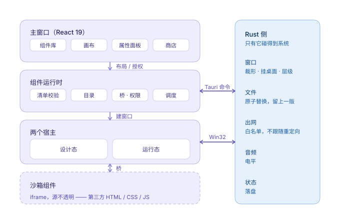

# 架构

> 这一页讲**为什么长成这样**。改代码的硬约束在 [`AGENTS.md`](../AGENTS.md)，组件要遵守的契约在 [`WIDGET_SPEC.md`](./WIDGET_SPEC.md)。三者冲突时以代码为准，并顺手回来改这一页。
>
> 词不认识先查 [`GLOSSARY.md`](../GLOSSARY.md)。

## 1. 一句话

一个 Rust 外壳负责 Windows 窗口行为，一个 React 前端负责平台界面与组件运行时，第三方组件在沙箱 iframe 里跑，只能通过一条带权限校验的桥跟平台说话。

判断一段代码该放哪，只问一句：**它需要 Win32 句柄或磁盘路径吗？** 需要就下到 Rust，不需要就留前端。布局、主题、权限界面都属于后者 —— 改它们不用重编译。

## 2. 四层，两个宿主



颜色是固定的：**紫 = 前端，蓝 = Rust 与桥，虚线 = 沙箱**。

**平台本身不带组件。** 装好、第一次打开，桌面上什么都没有 —— 就像刚装好的 VS Code 没有插件。随应用分发的那批包走的是和第三方完全相同的清单、沙箱、权限桥，它们只是"已经在硬盘上"，不是"被编译进内核"。这条不只是产品口味：**官方组件是第一用户**，只有它们和第三方走同一条路，才能保证桥上的能力真的够用。

同一个组件出现在两个地方，而平台不允许这两处飘开：

| | 设计态 | 运行态 |
| --- | --- | --- |
| 宿主 | 主窗口里的 `WidgetFrame.tsx` | 每个组件一个 `WebviewWindow`，装 `widget-host.html` |
| 用途 | 摆位置、调尺寸、配层级、授权限 | 贴在桌面上常驻 |
| 组件渲染 | 一层 iframe | 宿主页里再套一层 iframe |
| 生命周期 | 跟着主窗口 | 跟着平台进程 |

**一个 placement 就是一个实例**，画布和桌面是同一个实例的两个宿主：配置、存储、权限都是同一份。两者走同一张桥方法表，所以"预览能用、桌面不能用"是 bug，不是特性。

三个 id 别混：`widgetId` 决定**权限**（"你信不信任这段代码"），`instanceId` 决定**配置**（"这一份长什么样"），`placement` 决定**位置**（"摆在哪、哪一层"）。两个时钟分别显示 12 小时制和 24 小时制，你只需要授权一次。

## 3. 一条能力落地的五处

这一节是这一页最该记住的。加一个能力不是"写个函数"，是**同时改五处**，少一处就有一种特定的坏法。以 `audio:level` 为例：

| # | 动哪 | 文件 | 漏了会怎样 |
| --- | --- | --- | --- |
| 1 | **桥方法表** | `src/runtime/bridge.ts` 的 `defineMethod(name, permission, handler)`（现在 23 条） | 组件调不到，`unknown_method` |
| 2 | **权限清单** | `src/runtime/catalogue.ts` 的 `KNOWN_PERMISSIONS` + `src/runtime/manifest.ts` 的 `Permission` 联合类型与文案（现在 11 项） | 清单校验把它当"未知权限"只警告不拦，于是装得上、永远授权不了 |
| 3 | **Rust 命令** | `src-tauri/src/<module>.rs` + `src-tauri/src/lib.rs` 的 `generate_handler!`（现在 61 条） | 前端以为能用，一点就 `internal` |
| 4 | **落盘** | `state.json` 或 `widget-data/<widgetId>.json` | 重启后数据没了，或者旧数据读不出来（要迁移） |
| 5 | **断言与文档** | `tests/*.html`、`*_policy.rs`、`WIDGET_SPEC` 对应节、`AGENTS` 模块表 | 下一个人改坏没人拦，三个月后没人记得为什么这么写 |

第 2 处最容易漏，因为漏了**不会报错**：清单解析遇到不认识的权限只记一条 warning，照装不误。症状是"组件装好了，点授权没反应"。

**能抽成纯函数的逻辑都抽到 `*_policy.rs`。** 本机策略跑不了完整的 `cargo test`，但 `rustc --test src-tauri/src/xxx_policy.rs` 跑得动 —— 上限、白名单、归一化、措辞这些"改起来最容易手滑"的部分放那里，Rust 侧只留"必须连到真实世界才能做"的事。

## 4. 沙箱与桥

`<iframe sandbox="allow-scripts allow-forms">` —— 关键在**没有** `allow-same-origin`。于是组件拿到一个不透明源：

- 读不到父窗口 DOM，`window.parent` 上什么都取不到
- `localStorage` 直接抛 `SecurityError`
- `fetch` 带 `Origin: null`，跨源一律被拦
- Cookie、IndexedDB 全部不可用

结论：**组件什么都干不了，除非走桥。** 这是整个安全模型的地基。

`allow-forms` 是后来补的，理由不是"想开"，而是"不开就坏"：少了这一位，浏览器把表单提交整条拦掉，`submit` 事件不触发也不报错，`<form>` + 回车这种最普通的写法静默失效。它不扩大上面任何一条 —— 表单只能提交到组件自己的不透明源。

鉴权靠**窗口引用比对**，不靠 origin：

```ts
window.addEventListener("message", (event) => {
  if (event.source !== iframeRef.current.contentWindow) return;  // ① 分得清是谁
  if (!isBridgeRequest(event.data)) return;
  handleBridgeRequest(event.data, { granted });                   // ② 查权限
});
```

① 因为沙箱文档的 origin 是字符串 `"null"`，所有组件长得一样，靠它分不出实例，也就拦不住 A 冒充 B。

② 权限按 `widgetId` 授予。未授权时返回结构化错误 `{ ok: false, code: "permission_denied" }`，不抛裸异常 —— 组件要自己降级（不显示那个按钮），而不是整块崩掉。

桥本身只做三件事：**收请求、查权限、回话**。它不记日志（观察者由调用方注入），也不解释业务结果。

## 5. 窗口：层、形状、透明度

三种"看不见"要分清，它们的代价完全不同：

| 你想要 | 手段 | 代价 |
| --- | --- | --- |
| 圆角卡片 | `SetWindowRgn` 裁圆角 | 圆角外的像素是**死区**：看不见，但照样挡住下面的点击 |
| 任意形状（桌宠） | 清单写 `shape: "region"`，组件用 `window.setRegion` 上报矩形 / 椭圆 | 组件负责"画出来的形状 = 上报的区域"；边缘**没有抗锯齿**；窗饰消失，退出口得自己做 |
| 逐像素透明、投影、模糊背景 | DirectComposition | 这台机器拿不到，所以不做 |

裁完区域必须补一次 `RedrawWindow(RDW_ALLCHILDREN | RDW_UPDATENOW | RDW_ERASE)`。少了它 WebView2 会按上一次的脏区重绘，把窗口切成一行一行的横条 —— 这个症状看起来像渲染坏了，其实是没告诉系统"区域变了"。

层级只有两种：

- `desktop`：`SetParent` 到 WorkerW。向 `Progman` 发 `0x052C` 让它派生 WorkerW，再找挂着 `SHELLDLL_DefView` 的那个的兄弟，把窗口挂上去。效果是组件沉在桌面图标之上、普通窗口之下 —— 这是"桌面小组件"体感的来源。
- `top`：先 `SetParent(null)` 脱离，再 `HWND_TOPMOST`。

拿不到 WorkerW 时降级成 `HWND_BOTTOM`，至少不会浮在最上层挡住内容。

窗口属性按"这个组件要不要打字"分流，由清单的 `interactive` 决定，不按组件名硬编码：

| 需求 | 纯展示（`interactive: false`） | 可输入（`interactive: true`，默认） |
| --- | --- | --- |
| 抢不抢焦点 | `WS_EX_NOACTIVATE`，点了不打断你 | 不设，能拿键盘焦点 |
| 进不进 Alt+Tab | `WS_EX_TOOLWINDOW` 排除 | 同样排除 |
| 鼠标穿透 | `WS_EX_LAYERED \| WS_EX_TRANSPARENT`（按实例开关） | 同左 |
| 挂哪 | WorkerW（拿不到降级 `HWND_BOTTOM`） | 不挂 WorkerW，压 `HWND_BOTTOM` |
| z 序守卫 | 不需要 | 子类化拦 `WM_WINDOWPOSCHANGING`，给"往上提"补 `SWP_NOZORDER` |

z 序守卫是为了治"闪来闪去"：可激活的窗口被点中时，Windows 会顺手把它提到最前，切走又掉回底层。拦掉"往上提"不影响激活，键盘照样进得来。

## 6. 数据

| 数据 | 位置 | 说明 |
| --- | --- | --- |
| 摆放、层级、授权、主题、网格吸附、本机档案、桌面矩形、目录地址、钉住的钥匙、评分 | `%APPDATA%\com.iron-tom.lattice\state.json` | Zustand persist 的自定义 `StateStorage` → `state_write` |
| 组件私有数据 | `...\widget-data\<widgetId>.json` | 宿主代存，组件碰不到 `localStorage` |
| 用户安装的组件 | `...\widgets\<id>\` | Rust 管理，经 `lattice-widget` 协议加载 |
| 上一代组件（回滚用） | `...\widget-backups\<id>\` | 覆盖安装前整份复制，只留一代，回滚是交换 |
| 读过的目录 | `...\catalogue-cache\<sha256(url)[..16]>.json` | 地址对不上就整份作废 |
| 下载过的包 | `...\store-cache\<sha256>.lattice` | 按摘要命名，天然去重 |
| assistant 的 key | `...\assistant.json` | 前端只拿到掩码，`sk-1…cdef` |

**不用 `localStorage`**：这台机器的 WebView2 把它整个放在内存里，进程一退就没了（见 ROADMAP「被推翻的决定」第 2 条）。文件写入走"临时文件 + 原子替换"，写到一半断电不会留下半截 JSON。

组件数据放宿主而不是组件里：将来换后端（SQLite）组件不用改；组件之间互相看不到数据；同一个组件的多个实例能通过广播收敛成同一份视图。

## 7. 常驻：谁活着，谁停下

"桌面组件"意味着这东西要开几周，不是几分钟。四件事是设计问题，不是功能问题：

**入口不能只有一个。** 主窗口收起来之后（桌面上还有组件时关窗口只是 `hide()`），用户得能把平台要回来。所以有托盘，托盘和设置菜单调**同一组命令** —— 各写一套，两边状态就会飘。

**"暂停"要真的停。** 不是停调度器：组件还在画、还在跑自己的 `requestAnimationFrame`，看不见却在烧 CPU。做法是把窗口 `hide()`，`document.visibilityState` 随之变成 `hidden`，调度器那条"两个来源取与"的链路自动停 —— 一个动作同时解决"看不见"和"别跑了"。

**崩溃要能自己回来，但不能无限回来。** 每次加载都崩的组件，如果每次都重载，就变成每秒一次的循环：CPU 打满、日志刷屏、用户不知道是谁。所以按失败类型分流（`render` / `gpu` 才重载，`browser` 直接放弃）+ 一分钟三次限流 + 放弃后界面上留一个 `Try again`。三者缺一：只有分流会无限重载，只有限流会静默消失。

**出网是白名单，不是开关。** 组件是不可信代码，"允许联网"这种粒度对用户没有意义 —— 他没法审阅。所以权限之外还要清单里的主机列表，且不跟随重定向（跟随等于只检查了第一跳）。走 IPC 不走本地 HTTP 代理：本地端口会留下一条组件能直接 `fetch` 的路。

## 8. 性能预算

常驻应用，预算是硬指标：

| 指标 | 目标 |
| --- | --- |
| 空载内存 | < 80 MB |
| 空载 CPU | ≈ 0% |
| 5 个组件时 CPU | < 2% |

手段：不可见组件暂停渲染、动画只走 CSS `transform` / `opacity`、组件定时器统一由平台调度（最小 250 ms）、暂停全部时直接 `hide()` 窗口。纯显示刷新用 `requestAnimationFrame` 是允许的 —— 状态由时间戳推导时（秒表、倒计时），藏起来 rAF 自停、回来重算即可。

## 9. 已知取舍

| 决定 | 代价 | 为什么接受 |
| --- | --- | --- |
| 窗口不透明，形状靠 `SetWindowRgn` 裁 | 没有投影、没有模糊背景；裁掉的地方是死区；`region` 边缘没有抗锯齿 | 逐像素透明要求 DirectComposition，这台机器拿不到 |
| 每个组件一个 WebView | 内存随组件数线性涨 | 崩溃隔离、独立 DPI、独立输入焦点都靠它；合并 WebView 的方案留到性能告急再评估 |
| 用户组件走自定义协议，不走 `file://` | 多一层协议代码，Windows 上 URL 形式特殊 | `file://` 没有源隔离，组件能直接读整个磁盘 |
| 内置组件的文档拿不到 CSP 头 | 同一份代码装成内置和装进用户目录，出网行为不一样 | 内置组件随二进制分发、信任级别和平台本体一样；用户组件的 CSP 在 `csp.rs` 一处生成 |
| 不引入 Tailwind | 手写 CSS 更长 | 定制工作台用变量层更可控，少一个构建依赖，组件也只认 `--lattice-*` |
| 本机档案不是账号系统 | "登录"只写本地 `state.json` | 没有服务端。文案明说"只保存在这台电脑"，免得被当成云端账号 |
| 目录是一份静态 JSON，不是后端 | 目录要手工重发；评分不汇总；举报得用户自己发给作者 | 没有服务端就别做需要服务端的形状。接后端时换的只是"从哪儿取""写到哪儿" |
| 信任靠本地钉住的钥匙（TOFU），没有 PKI | 第一次安装只能信"这次看到的"；换钥匙要用户手动点头 | 真正的 PKI 需要一个平台方来签发和吊销，这个项目没有也不该假装有 |
| 备份只留一代，回滚做成交换 | 更新两次之后回不到第一版 | 用户真正需要的是"回到刚才那个"。交换让按钮按两次、两个方向都成立 |
| 组件的 `llm.chat` **不带工具** | 组件能说话，但不能顺手改桌面 | 有嘴就有手：能发请求的组件离能改布局只差一条桥方法。改桌面只有两条路 —— 用户在 assistant 面板里说，或外部 agent 端点（那条有自己的白名单） |
| 组件联网和 assistant 共用 `network::send` | 一处改动同时影响两条路 | 两个出口更难守：关重定向、限时限量、错误码统一只有一份实现 |
| agent 端点默认关，令牌明文落在 `agent\endpoint.json` | 同账户任何进程都读得到 | 防线不是密码学，是"默认关 + 白名单 + 审计"。端口取 0、只绑 `127.0.0.1`，关着根本不 bind |

## 10. 指针

| 想知道什么 | 去哪 |
| --- | --- |
| 改代码不许碰什么、常见改动的配方 | [`AGENTS.md`](../AGENTS.md) |
| 组件怎么写、清单字段、权限语义 | [`WIDGET_SPEC.md`](./WIDGET_SPEC.md) |
| 某个决定当时被什么推翻 | [`ROADMAP.md`](./ROADMAP.md)「被推翻的决定」 |
| agent 端点的协议与威胁模型 | [`AGENT_ACCESS.md`](./AGENT_ACCESS.md) |
| 签名买不买、免费路线怎么走 | [`CODE_SIGNING.md`](./CODE_SIGNING.md) |
| 还没做的事，动手前怎么想 | [`design/`](./design/README.md) |
| 一个词到底指什么 | [`GLOSSARY.md`](../GLOSSARY.md) |
