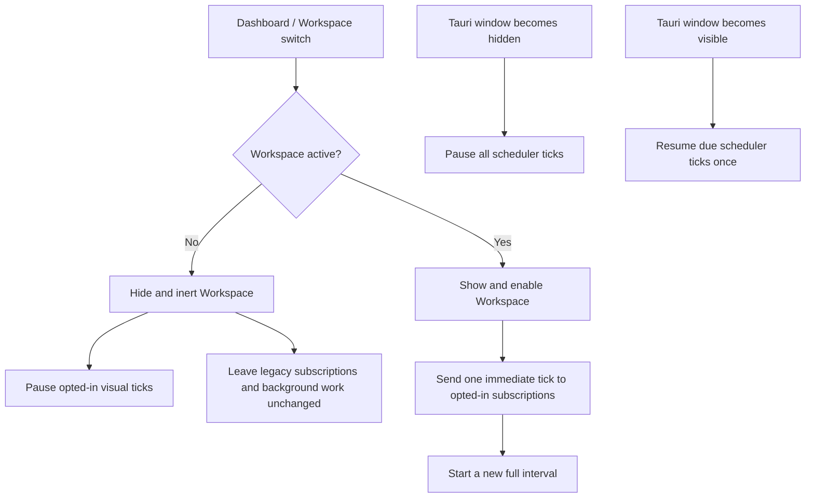

# LAT-0044 — Keep Workspace mounted and separate visual refresh from background work

## 1. Problem

Switching to Dashboard must not destroy Canvas state or stop work that is expected to continue, while hidden visual refresh should not keep consuming resources.

## 2. Candidates

| | A: Unmount the inactive page | B: Keep both page layers mounted (chosen) |
| --- | --- | --- |
| Behavior | Construct only the active page | Keep Dashboard and Workspace in the page stack; hide and make the inactive layer inert |
| Replaces | Existing Canvas and WidgetFrame instances on each return | No component instance replacement during navigation |
| Adds | Rehydration and recreation paths for selection, layout, and widget frames | Hidden DOM remains mounted; page visibility must be explicit for visual work |
| Cost | State and iframe lifecycle become navigation-dependent | Some hidden UI remains in memory |

## 3. Decision

**Decision:** Keep Workspace mounted while Dashboard is active. Track active page separately from Tauri window visibility. Pause only scheduled visual refreshes that explicitly opt into `workspaceVisibleOnly`; preserve existing behavior for calls that omit the option. On return, send one immediate refresh tick and start a new full interval. Components that display time derive it from timestamps rather than counting ticks.

This makes page navigation independent from the lifecycle of background operations and preserves compatibility for existing plugins. The cost is that inactive page UI remains mounted, and component authors must correctly classify a subscription before opting in.

**Revisit if:** Canvas can no longer remain correctly sized and inert while hidden, or profiling shows the retained Workspace consumes material resources. Any replacement must preserve component identity and background-task behavior.

## 4. Interface and data

No persisted data or new Tauri command. `AppShell` keeps both page layers in the React tree and applies visibility, `inert`, and `aria-hidden` to the inactive layer. `WidgetFrame` sends the page-level `workspace-visible` message to its iframe and calls the scheduler's page-visibility API. `schedule.every` accepts the optional `workspaceVisibleOnly` flag; omission preserves legacy semantics.

## 5. Failure modes

| Symptom | Cause | Correct behavior |
| --- | --- | --- |
| Returning to Workspace shows stale visual data until the next long interval | Resume only waits for the next scheduled deadline | Deliver one immediate tick, then restart the interval from resume time |
| A plugin's background operation stops when Dashboard opens | Legacy calls were implicitly treated as visual refresh | Only explicit opt-in subscriptions pause on page navigation |
| Hidden page controls still receive keyboard focus or clicks | Only visual opacity was changed | Make inactive page `inert`, `aria-hidden`, and non-interactive |
| A clock drifts after hiding | It accumulates scheduler ticks as elapsed time | Recompute display from current time or persisted start/end timestamps |

## 6. Verification

| File | Assertions | Verifies |
| --- | ---: | --- |
| `tests/navigation.html` | 12 | Dashboard default, Workspace DOM identity and dimensions, inactive-page interaction/accessibility, Sidebar state |
| `tests/schedule.html` | 31 | Opt-in pause/resume, one immediate resume tick, legacy subscription behavior, no hidden backlog |

**Manual:** Windows acceptance reported that Dashboard / Workspace switching retained Canvas position, selection, and drag behavior; Assistant streaming continued across the same switch. These checks do not substitute for future changes to the Tauri window-visibility path.
