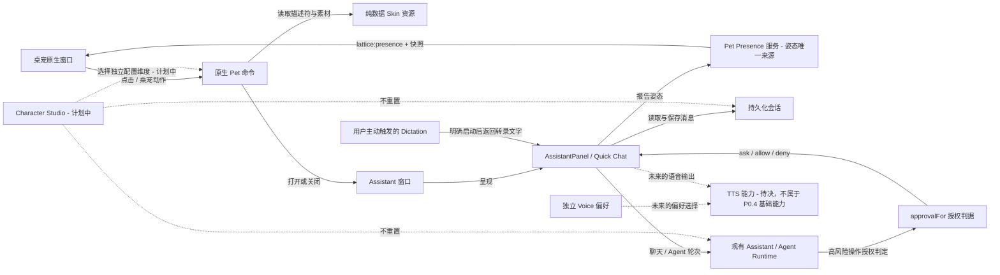
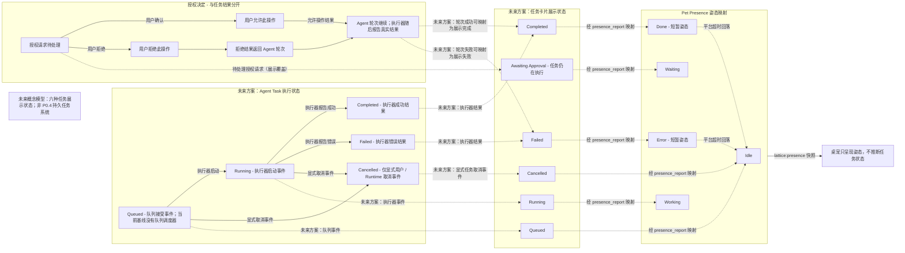
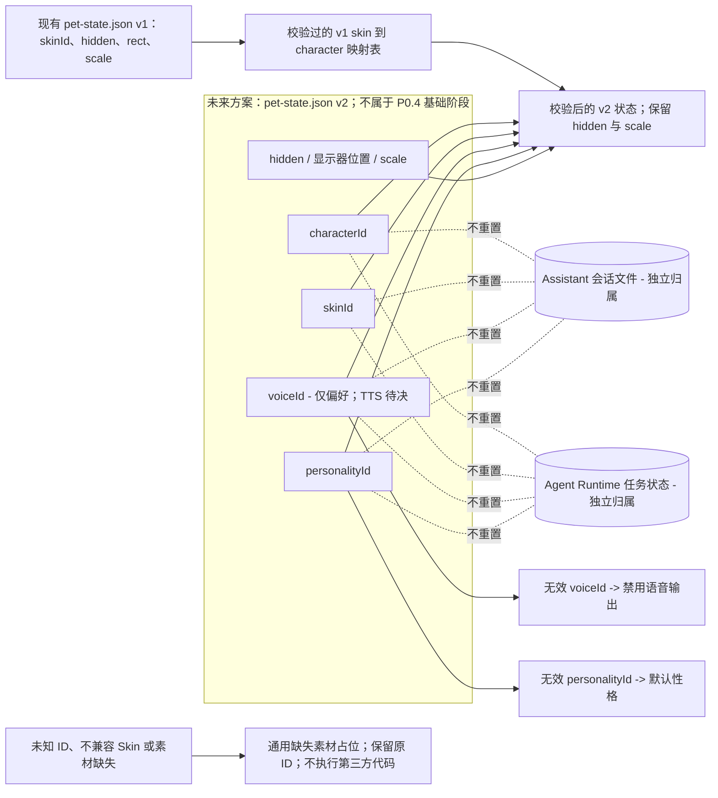

# 桌宠架构参考

本页区分 GPT A 已批准的目标方向、P0.4 当前源码事实与未来方案。批准方向不等于已实现功能；长期决策记录见 [LAT-0041](../design/LAT-0041-desktop-pet-as-platform-feature.md)，其状态仍为 `draft`。

## 状态用语

- **已实现 / 源码确认**：该能力存在于 `66d3cdd` 基线；这不代表 P0.3 的每项交互都已进入正式产品。
- **UX 已冻结**：GPT B 已批准用户可见行为，但这不等于授权修改源码或决定实现细节。
- **未来方案 — 不属于 P0.4 基础阶段**：仅供后续规划，不能作为当前实现要求。

## 系统边界

桌宠是 Lattice 原生窗口，与普通 Widget 及其沙箱分开。Assistant 窗口复用现有 `AssistantPanel`；该面板负责对话 UI，并连接现有 assistant / agent runtime 与会话命令。面板向平台 Presence 服务报告姿态；桌宠只呈现共享快照和 `lattice:presence` 事件。授权判据继续复用 `approvalFor`。

Character、Skin、Voice、Personality 相互独立是已批准的目标架构；Character Studio 与对应持久化能力尚未实现，PetState v2 及迁移属于未来方案，不纳入 P0.4 基础阶段。



源文件：[system-overview.mmd](./diagrams/desktop-pet/system-overview.mmd)。

## 窗口定位

**已批准方向：** Quick Chat 围绕 Pet 定位，优先放在左侧，空间不足时翻到右侧并夹入当前显示器工作区；定位不移动 Pet。实现时使用当前显示器的运行时信息，不依赖持久化 `Monitor.name`。

**当前实现缺口：** `pet::work_area` 读取逻辑显示器位置和完整尺寸，没有使用 Tauri Monitor 的物理 `work_area`（可排除任务栏）；`assistant_window` 还会调用 `pet::avoid_assistant` 临时移动桌宠。这些现状与已批准方向不符。

### 坐标实现参考（不新增持久化 Monitor 标识）

- 布局尺寸使用 DIP。读取目标显示器缩放比例 `s`，在原生窗口边界一次性转换：`physicalPx = round(dip × s)`。
- 根据 Pet 物理外框中心从当前可用显示器中确定目标屏；使用 Tauri Monitor 的物理坐标、`work_area` 和 `scale_factor`。该选择仅用于本次定位，不持久化 `Monitor.name`。
- 使用 Tauri Monitor 提供的 `work_area` 物理矩形；原点可以为负数。原点保持原值，不能把全局虚拟桌面坐标乘以某个显示器的缩放比例。
- 运行时使用所选 Monitor 的物理工作区原点和缩放比例 `s` 将局部 DIP 偏移转换为物理像素：`physicalOrigin = work_area.origin + round(offsetDip × s)`，再通过 Tauri 物理位置 API 定位窗口。P0.4 保持当前 PetState v1，不新增持久化显示器标识或 v2 迁移。
- Quick Chat 的目标尺寸和间距也按同一目标显示器转换。先试左侧（`pet.left - gap - panel.width`），再试右侧，最后试上方 / 下方空间较大的一侧。候选矩形夹入同一显示器的 `work_area`；保留带符号坐标，桌宠位置不变。
- 默认尺寸无法放下时，将面板限制在工作区内并滚动消息区，标题、输入框和关闭入口始终可见。若这些控件仍无法完整容纳，不显示裁切的浮动面板，改为在该显示器打开现有 Assistant 界面，并保留同一会话和草稿。如果完整界面也无法满足该约束，GPT A 需在实现前决定最小交互尺寸和回退 UX。
- PetState v1 不记录显示器标识。P0.4 不迁移该状态；定位时按 Pet 当前物理矩形匹配可用显示器，显示器变化后的长期恢复策略留待未来设计。

```mermaid
flowchart TD
  pet[Pet 当前物理矩形]
  monitor[按 Pet 中心匹配当前可用显示器]

  work[读取 Tauri Monitor.work_area：物理像素]
  scale[读取当前显示器缩放比例 s]
  convert[运行时转换：物理像素 = work_area.origin + round(DIP × s)；不持久化 Monitor.name]
  left{Quick Chat 能放在桌宠左侧？}
  right{左侧不够时，右侧能放下？}
  vertical{两侧都不够时，上方或下方能放下？}
  clamp[夹入同一工作区；桌宠位置保持不变]
  compact[缩小面板并滚动消息区；标题、输入框、关闭入口保持可见]
  full[紧凑面板仍放不下控件时，打开完整 Assistant；保留会话与桌宠位置]
  show[显示窗口，不裁切必要控件]

  pet --> monitor

  monitor --> work
  work --> scale --> convert --> left
  left -->|是 - 左侧优先| clamp
  left -->|否| right
  right -->|是 - 翻转到右侧| clamp
  right -->|否| vertical
  vertical -->|是 - 选择空间较大的一侧| clamp
  vertical -->|否| compact
  clamp --> show
  compact -->|可容纳| show
  compact -->|仍无法容纳交互控件| full --> show
```

源文件：[window-placement.mmd](./diagrams/desktop-pet/window-placement.mmd)。

## Agent 生命周期与 Pet Presence

当前 `AssistantPanel` 根据活动轮次和待授权请求推导 `idle`、`working`、`waiting`、`done` 或 `error`，然后调用 `presence_report`。原生桌宠呈现共享 Presence 快照，不从流式文本推断任务状态。`done` 和 `error` 是短暂姿态，平台超时后会回到 `idle`。

GPT A 已决定 P0.4 不建设六状态持久化 Agent Task 系统。下图是未来的展示概念模型，不代表当前 Runtime 已实现任务实体或这些状态转换。当前授权拒绝会把拒绝结果返回 Agent 轮次；它不等于取消。显式停止 Assistant 轮次是现有独立能力。

下图中的队列接受、任务启动、任务完成、任务失败和任务取消边均为未来方案；当前没有对应的持久化任务状态机或队列事件契约。授权拒绝沿现有 Agent 轮次返回拒绝工具结果，而停止 Assistant 轮次走现有取消通道。

Presence 仍是桌宠姿态的唯一来源：一个适配器根据展示状态调用 `presence_report`，桌宠只呈现该服务产生的快照 / 事件。



源文件：[agent-lifecycle.mmd](./diagrams/desktop-pet/agent-lifecycle.mmd)。

## 角色配置与状态归属

**已冻结 UX：** Character、Skin、Voice、Personality 可分别选择。切换任一维度都不能重置会话、记忆或 Agent 任务。

**当前实现：** `%APPDATA%\com.iron-tom.lattice\pet-state.json` 为版本 1，拥有 `skinId`、`hidden`、`rect`、`scale`。Assistant 会话有独立文件；Agent 执行状态归 Runtime 所有。当前基线未实现 Character Studio 或 Voice / Personality 持久化。

### 未来方案：配置归属与迁移（不属于 P0.4）

- 未来若引入独立配置持久化，可评估由 `pet-state.json` 持有彼此独立的 `characterId`、`skinId`、`voiceId`、`personalityId` 字段；可见性、缩放和位置仍属于 Pet 配置。此方案不是 P0.4 实施要求，也不预设必须升级 schema。ID 只引用经平台校验的数据，不代表可执行行为。
- 若未来批准并实施 v1 迁移，应使用显式、受版本控制的旧 `skinId` 到 `characterId` 映射；保留匹配的 Skin、`hidden`、`scale` 和转换后的位置，将 `voiceId` 初始化为 `null`，Personality 初始化为默认预设。不得从文件名猜 Character，也不能借用其他角色原画。
- 未来迁移遇到无映射或缺失素材的 v1 Skin 时，可保留其 ID 并标记不可用，显示通用缺失素材占位，提示用户选择有效 Character / Skin；不得用 Lumi 或其他角色原画顶替。Skin 应声明与所选 Character 兼容。
- 未来配置加载器可按维度回退：缺失 Character / Skin 使用通用占位；无效 Voice 禁用语音输出；无效 Personality 使用默认预设。保留原始未知 ID 并显示不可用状态；只有用户明确选择后才替换。
- 若未来实施迁移，应先在内存解析并验证完整 v1→v2 状态，再原子写入；解析、校验或持久化失败时保留原 v1 文件字节，以安全内存默认值运行并显示恢复提示，禁止静默覆盖原文件。
- Assistant 会话文件继续唯一拥有对话历史；Agent Runtime 继续拥有活动任务状态。保存或迁移 Pet 配置不得写入上述状态，也不得取消或重置会话 / 任务。
- TTS 是未来独立能力，不是 P0.4 依赖。GPT A 单独批准 TTS API、后续实现提供能力之前，`voiceId` 只代表偏好引用；Dictation 仍是用户主动触发的语音转文字。

v2 结构、迁移映射和恢复行为仅为未来设计备选，不属于 P0.4，也不是已批准的 schema 变更。



源文件：[character-system.mmd](./diagrams/desktop-pet/character-system.mmd)。

## 能力与决策状态

| 事项 | 状态 | 证据或待决内容 |
| --- | --- | --- |
| 桌宠是原生平台窗口，不是 Widget | 已实现 / 源码确认 | [`pet.rs`](../../src-tauri/src/pet.rs) 在 Widget 沙箱之外创建桌宠窗口。 |
| Assistant 窗口复用 `AssistantPanel` | 已实现 / 源码确认 | [`AssistantWindow.tsx`](../../src/platform/AssistantWindow.tsx) 渲染共用面板。 |
| Agent 任务复用现有 Assistant Runtime | 已实现 / 源码确认 | [`AssistantPanel.tsx`](../../src/platform/AssistantPanel.tsx) 调用现有流程；[`assistant.ts`](../../src/runtime/assistant.ts) 定义策略与运行时辅助逻辑。 |
| Approval 复用现有授权判据 | 已实现 / 源码确认 | [`approvalFor`](../../src/runtime/assistant.ts) 仍是判据来源。 |
| Pet 姿态由唯一 Presence 来源提供 | 已实现 / 源码确认 | [`presence.rs`](../../src-tauri/src/presence.rs) 拥有快照与广播，AssistantPanel 报告姿态。 |
| Skin 资源只有数据 | 已确认的设计边界 | LAT-0041 §3；原生加载器校验描述符和资源。 |
| Dictation 可用；TTS 是独立待决能力 | Dictation 已实现；TTS 未实现且不是 P0.4 基础功能 | [`dictation.rs`](../../src-tauri/src/dictation.rs) 提供语音转文字。GPT A 需决定未来 TTS 能力的归属与接口。 |
| Quick Chat 围绕 Pet 定位 | 方向已批准；坐标实现尚未落地 | 按当前显示器运行时工作区定位，不移动 Pet、不持久化 `Monitor.name`；当前代码仍移动 Pet 让位。 |
| 六状态 Agent Task 系统 | 未来方案；P0.4 不建设持久任务系统 | 仅概念展示；当前没有任务实体、队列事件或任务取消状态。 |
| Character / Skin / Voice / Personality 独立配置 | 目标架构已批准；当前尚未实现 | 四个维度相互独立；Character Studio 与持久化后续规划。PetState v2 迁移不属于 P0.4。 |

## 已批准方向与 P0.4 边界

本参考记录的已批准方向不构成功能编码授权。P0.4 基础阶段沿用 PetState v1 和现有 Assistant Runtime、Session、Approval、Presence；不实施 PetState v2 迁移、不建设持久化六状态任务系统。TTS 仍为独立待决能力。

相关资料：[项目架构](../ARCHITECTURE.md)、[LAT-0041 决策草案](../design/LAT-0041-desktop-pet-as-platform-feature.md)、[Assistant 授权与安全](../AGENT_ACCESS.md)。
