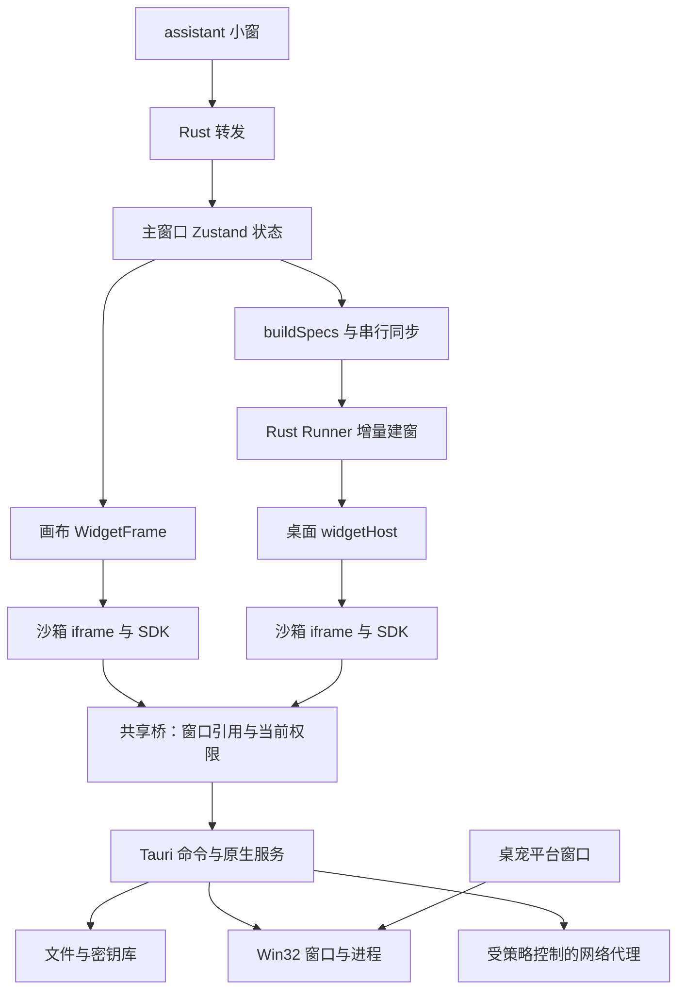
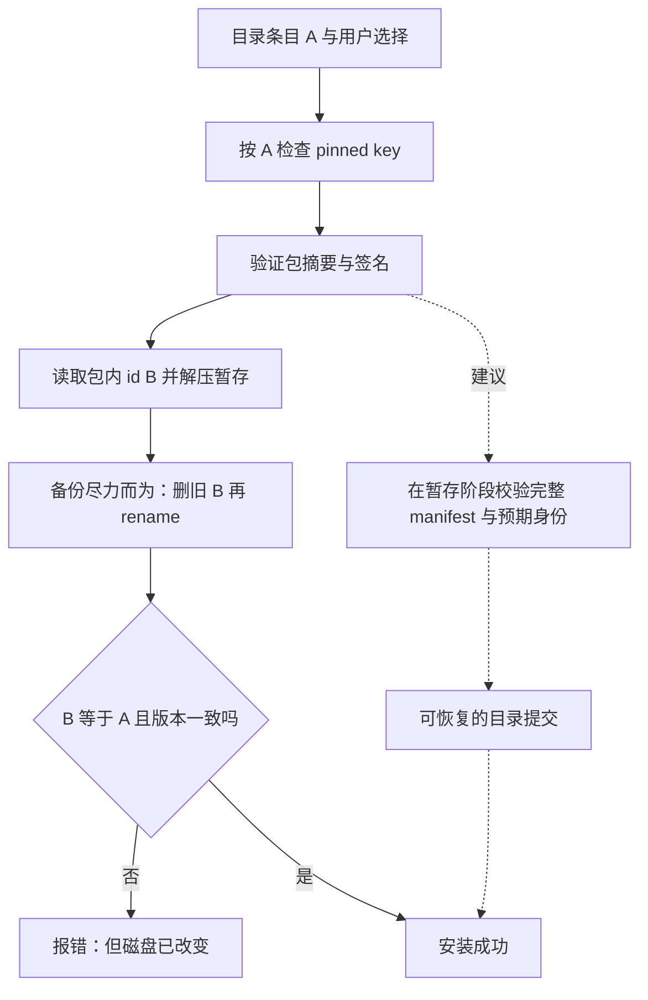
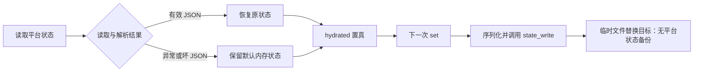
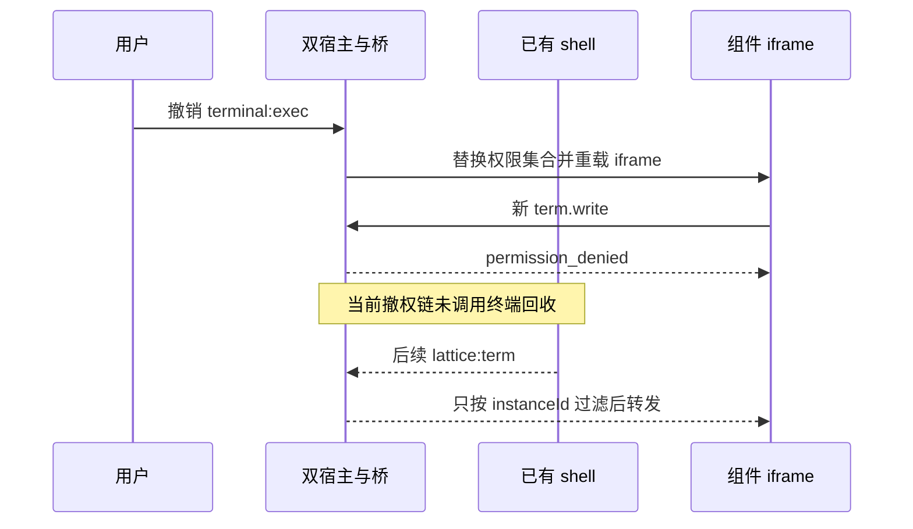

# 2026-11-02 源码审查记录

> 历史快照：审查基线 `bcf0368644a3a523bc31c1e9a1bc6c3c174e3892`，源码版本 `0.3.0`。
> 范围：能力实现链、安全与数据完整性、文档可信度；不是完整渗透测试或已发布安装包验收。
> 本次只改文档与文档检查脚本，不修产品逻辑、不提交、不推送。

## 结论与证据等级

平台已有完整的组件开发、双宿主运行、分发、桌面窗口和 assistant 执行链，不是只有界面的原型。
优势是共享桥、策略纯函数、窗口增量同步、签名包与权限分层，以及可执行的文档对账。
主要风险在**操作中途失败与能力撤销**：成功路径的检查和单测不能证明失败后仍保住数据、撤权后仍收得回能力。

| 编号 | 建议优先级 | 问题 | 本次证据 |
| --- | --- | --- | --- |
| F1 | 高 | 安装身份与版本核验晚于目录覆盖 | 完整源码调用链；未执行破坏性安装 |
| F2 | 高 | 失败水合后可写回默认状态，平台状态无一代备份 | 实际前端源码内存复现，正常输入对照通过；Rust 写盘后果静态确认 |
| F3 | 高 | 终端撤权未回收已有 shell 与输出流 | 撤权、转发、全部收尸触发点的源码核对；Windows 待验 |
| F4 | 中 | 同文档多个 SDK 客户端响应串线 | 源码核对与内存模拟宿主复现；真实浏览器待验 |

优先级按潜在数据损失与权限承诺受损排序，不是 CVSS 评分，也不是已观察到用户受害。
本报告的「已确认」指相应证据等级；不代表 Windows 运行时全部复现。
后续安排只在 [路线图](../ROADMAP.md) 维护；已发布产物的标签仍以 [成熟度](./maturity.md) 为准。

## 能力与实现边界

| 面 | 已有实现与源码入口 | 不能据此声称的事 |
| --- | --- | --- |
| 组件与 SDK | 静态 HTML/CSS/JS、请求超时、ready、配置/主题/语言/存储事件：[SDK](../../packages/sdk/lattice.js) | 单客户端测试通过不代表多客户端隔离正确（F4） |
| 双宿主与桥 | 画布和桌面共用 [桥方法表](../../src/runtime/bridge.ts)，按窗口引用认请求，按当前 grant 鉴权 | 请求被拒不等于旧资源已回收（F3） |
| 窗口 | [buildSpecs 与串行同步](../../src/platform/desktop.ts)、[Runner](../../src-tauri/src/runner.rs)、[层级实现](../../src-tauri/src/desktop.rs) | Linux 构建不能验 WorkerW、焦点、IME、DPI、托盘与重启 |
| 持久化 | [平台状态](../../src/platform/store.ts) 的迁移和 partialize；[组件存储](../../src-tauri/src/widget_store.rs) 的锁、键级更新、备份与广播 | 平台状态与组件数据不是同一写入实现；不能共用「有备份」结论 |
| 分发 | [前端目录安装](../../src/platform/catalogue.ts)、[Rust 验签与安装](../../src-tauri/src/store.rs)、[包提取](../../src-tauri/src/package.rs) | 字节验签成功不等于包身份正确，也不等于更新有事务性（F1） |
| assistant | [工具循环与审批](../../src/runtime/assistant.ts)、[模型面](../../src-tauri/src/llm.rs)、[工具执行](../../src-tauri/src/hands.rs)、[密钥库](../../src-tauri/src/secrets.rs) | 完全访问是主动放大的能力；DPAPI 不防同账户进程，成功密封仍需真机 |
| 外部 agent | [HTTP 端点](../../src-tauri/src/agent.rs) 默认关闭、回环监听、令牌、桌面动作白名单与审计 | HTTP `op=tool` 仍返回 `unsupported`；不能与内置 assistant 的组件工具调用混为一谈 |
| 维护与交付 | [共享 CI](../../.github/workflows/verify.yml)、[文档检查](../../scripts/check-docs.mjs)、[对账脚本](../../scripts/guards/stats.mjs) | 规则检查只覆盖已登记形状；绿灯不等于所有散文和失败路径正确 |

截至本次基线，`check:stats` 实测：官方组件 24、权限 15、桥方法 31、Tauri 命令声明 128、agent 动作 9。
Rust `#[test]` 计数为 618，**是代码统计，不是本次执行通过数**。
这些数字只记录此次快照，不新增另一套当前统计表。

## 链路图

下图使用 Mermaid 围栏，供支持 Mermaid 的仓库阅读器查看。
应用自带的 [Markdown 渲染器](../../src/runtime/markdown.ts) 只显示代码围栏，不会执行 Mermaid；本次未添加运行时渲染器。
原有 [架构 SVG](../architecture.svg) 与 [渲染链 SVG](../render-chain.svg) 保留，避免破坏离线帮助。
图中的代码名仅作节点标签，实际入口见上表与各问题证据。

### 双宿主、运行时与原生边界



桌宠是独立平台窗口，不是 placement，也不走组件桥；assistant 小窗通过转发访问主窗口状态，不维护第二份布局 store。

### 安装的现状与建议事务边界



实线是当前顺序，虚线是修复建议，不能当作已实现。

### 水合失败与写入闸门



### 撤权的两条寿命



## F1 安装前未核对身份，失败时磁盘已改变

**触发条件：** 用户发起安装，目录条目与包内 manifest 的 id 或版本不一致；摘要和签名本身有效。
目录配置错误就足以触发，不要求攻破签名算法。

证据链：

1. [App.tsx:881–915](../../src/App.tsx#L881-L915) 取 `entry.publisher.key`，校验 `trustedKeys[entry.id]`，成功后才为该条目记住钥匙。
2. [catalogue.ts:353–371](../../src/platform/catalogue.ts#L353-L371) 将目录的 id、version、sha256、signature、publicKey 传给 `store_install`。
3. [store.rs:334–357](../../src-tauri/src/store.rs#L334-L357) 先验签，再调用 `package::extract`，最后才检查实际 id 与版本。
4. [package.rs:48–79](../../src-tauri/src/package.rs#L48-L79) 用包内 id 决定目标目录，暂存完成后 `remove_dir_all(&target)`，然后 `rename`。
5. 若目录是 A、包内是已安装 B，B 被覆盖后又在 ID 不匹配分支删除；B 的 pinned key 没有进入这条校验链。
   若只有版本不一致，安装返回错误，但替换后的内容留在磁盘。

**影响：** 可破坏另一个已安装组件的代码目录，或出现「报失败但已经更新」。
这里不声称直接删除了独立的组件私有数据目录，也不声称攻击者能无交互触发安装。
一代备份可能帮助人工恢复，但备份是尽力而为，不能证明失败时旧版本仍在目标路径。
删旧目录与 rename 之间也有失败窗口，因此「原子换目录」注释强于实际实现。

**建议：** 在任何目标目录变更之前核验 expected id/version、manifest 结构和实际发布者绑定；暂存与提交分离，提交失败恢复旧目录。
不要只把 ID 比较提前到返回成功之前——必须提前到第一次破坏性写入之前。

**验收：** 在隔离临时目录准备已安装 B；分别测试 id 不符、版本不符、坏 manifest、解压失败、rename 失败。
每次失败都要求原目标和无关组件的内容哈希不变，且不产生可被扫描为已安装的新版本；正常更新与回滚仍可用。
本次未执行真实安装或故障注入。

## F2 失败水合后默认状态可以覆盖原文件

[store.ts:47–65](../../src/platform/store.ts#L47-L65) 把 `state_read` 的异常捕获为 `null`。
[store.ts:992–994](../../src/platform/store.ts#L992-L994) 无论是否有水合错误，都执行 `hydrated = true`。
随后普通 `set` 可将默认布局序列化，经 [state.rs:43–48](../../src-tauri/src/state.rs#L43-L48) 替换原文件；该函数没有一代备份。
这不等于启动后立刻覆盖——**还需要一次状态更新与成功写盘**。

实际前端源码内存探针结果：

| 输入 | 操作前写入次数 | `setState({theme:'dark'})` 后 | 写入布局 |
| --- | --- | --- | --- |
| `state_read` 抛错 | 0 | 1 | 空数组 |
| 损坏 JSON | 0 | 1 | 空数组 |
| 有效 v3 状态，含 prior 实例 | 0 | 1 | prior 保留 |

**建议：** 区分「文件不存在」与「读取/解析失败」；失败进入禁止持久化的恢复状态，保留原文，显式恢复或用户确认重置后才允许写入。
另补平台状态的一代健康备份、写入串行化与故障注入；备份不是失败水合写保护的替代品。

**验收：** 首次启动正常可写；读错误与坏 JSON 后任意 UI 更新都不得写原文件；恢复成功后才可写；重启、迁移、并发更新不丢布局。

## F3 终端撤权没有回收已有执行与输出

新调用确实会被 [共享桥鉴权](../../src/runtime/bridge.ts#L191-L207) 拒绝；这里不是「撤权后仍可新发命令」。
但撤权只更新权限并重载子 iframe：

- 画布：[WidgetFrame.tsx:132–165](../../src/platform/WidgetFrame.tsx#L132-L165)。
- 桌面：[runner.rs:768–777](../../src-tauri/src/runner.rs#L768-L777) → [widgetHost.ts:1424–1430](../../src/widgetHost.ts#L1424-L1430)。
- 两侧流转发只看 instanceId：[WidgetFrame.tsx:412–424](../../src/platform/WidgetFrame.tsx#L412-L424)、[widgetHost.ts:1665–1668](../../src/widgetHost.ts#L1665-L1668)。

现有回收点是画布卸载、桌面宿主页 pagehide、窗口 Destroyed、应用 Exit，以及显式 stop。
[画布 cleanup](../../src/platform/WidgetFrame.tsx#L433-L441) 只依赖 instanceId；子 iframe 重载不触发宿主卸载。
[Rust 终止函数](../../src-tauri/src/term.rs#L448-L473) 已存在，缺的是单独撤权时调用它的路径。
显式 `term.stop` 自身也需要 `terminal:exec`，不能依靠已撤权组件自行收尾。

**建议：** 撤销该权限时回收该 widgetId 的所有实例终端；双宿主在转发输出前复查权限，并考虑撤权与事件在途的竞态。
不可只隐藏终端 UI，或只阻断后续请求。

**Windows 验收：** 画布与桌面分别启动有限时长输出探针，数秒后只撤权，不删实例、不关窗口：

```powershell
1..30 | ForEach-Object { Write-Output "REVOKE-PROBE $_"; Start-Sleep -Seconds 1 }
```

要求新请求拒绝、旧 shell 停止、重载后的测试 iframe 不再收到撤权后产生的输出。
观察原始事件，不只看官方终端 UI；同时测重新授权、撤销无关权限及其他组件不受影响。
本次仅完成源码链验证，未运行 PowerShell/WebView2。

## F4 SDK 同文档多客户端的请求 ID 冲突

[SDK:130–224](../../packages/sdk/lattice.js#L130-L224) 每次 `createLattice` 都从 `sequence = 0` 开始，响应只用 `pending.get(data.id)` 关联。
同一 iframe 中两个客户端都收到宿主响应，相同序号可能各自命中 pending。
内存模拟宿主中，两个客户端 ready 后同时调用 alpha、beta，都发出 id 4；先返回 alpha，两个 Promise 都解析为 alpha。
这是同文档客户端串线，不是跨组件越权的证明。

**建议与验收：** 同文档客户端共享唯一请求序号或增加客户端命名空间，并保持桥协议一致。
测试两客户端并发不同方法、乱序返回、相同方法不同参数、超时和 dispose；结果必须分别对应调用方。
现有 SDK 单测通过不能覆盖此多客户端场景。

## 不当作新缺陷的边界

- 沙箱、组件 CSP、平台 CSP、WebView2 出网闸门各管不同层；CORS 不等于禁止发送请求。
- 随应用分发的组件不套第三方协议 CSP 是明确的信任取舍，不据此宣布第三方可任意出网。
- DPAPI 不抵御同账户进程，外部 agent 令牌也不是同账户进程隔离；这是威胁模型边界。
- 不做服务端、代码签名证书尚未采购、备份失败不阻塞安装、组件工具不自动唤醒缺失实例，不单列为新 bug。
- 常驻性能预算仍是目标；未测每个 WebView 的增量内存，不能先下池化或合并窗口的结论。

## 验证记录与限制

执行环境为 Linux、Node 22，未安装 Rust/Cargo 或 Chrome/Chromium；没有 Windows 用户会话。

| 检查 | 本次结果 |
| --- | --- |
| `npm ci --ignore-scripts` | 成功；未触发仓库 hooks 安装 |
| `npm run typecheck` | 通过 |
| 六组 Node 测试：injection、SDK、agent、tokens、llm-proxy、winget | 合计 72 通过、0 失败 |
| docs、stats、version、gates、bridge、commands、tokens 对账 | 基线通过；改动后 docs 与 check:guards 再次通过（Rust policy 测试跳过）；文档终检覆盖 73 份文档、531 条链接、72 条锚点 |
| `vite build` + `check:csp` | 前端四入口构建通过，CSP 检查通过 |
| `check:policy-tests` | 脚本报告无 rustc 并跳过；不计为 Rust 测试通过 |
| `test:browser` | 退出 1：找不到 Chrome；没有执行浏览器断言 |
| Windows / WebView2 / DPAPI / 进程清理 / 真实旧状态迁移 | 未执行，必须真机验收 |
| Mermaid | 提供围栏源码；未验证图形渲染 |

为避免重新生成受跟踪的签名目录，未运行会触发 `store:index` 的完整 `npm run build`，使用单独 typecheck 和 Vite 构建。
本次没有重新签包、重建 NSIS 或验证发布下载；也没有启动替代 GUI 服务器。

### F2 可复制的纯内存探针

在仓库根目录安装已有依赖后执行。
真实加载前端状态源码及 Zustand，只模拟 Tauri 的 invoke，`state_write` 仅记录内存，不接触用户状态。
成功返回表示**重现了问题**，不是修复通过；修复后应替换为拒绝失败水合写入的回归断言。

```bash
node --input-type=module <<'NODE'
import fs from 'node:fs';
import path from 'node:path';
import vm from 'node:vm';
import { createRequire } from 'node:module';
import ts from 'typescript';
const require = createRequire(import.meta.url);
globalThis.window = {__TAURI_INTERNALS__:{}};
for (const mode of ['read-error', 'invalid-json', 'valid-json']) {
  const calls = [], errors = [], cache = new Map();
  const invoke = async (cmd, args) => {
    calls.push({cmd,args});
    if (cmd === 'state_read') {
      if (mode === 'read-error') throw new Error('simulated unreadable state');
      if (mode === 'invalid-json') return '{bad json';
      return JSON.stringify({version:3,state:{placements:[{instanceId:'prior',widgetId:'demo'}]}});
    }
  };
  function load(filename) {
    filename = path.resolve(filename);
    if (cache.has(filename)) return cache.get(filename).exports;
    const module = {exports:{}};
    cache.set(filename,module);
    const js = ts.transpileModule(fs.readFileSync(filename,'utf8'),{
      compilerOptions:{module:ts.ModuleKind.CommonJS,target:ts.ScriptTarget.ES2022}
    }).outputText;
    const localRequire = (id) => id === '@tauri-apps/api/core' ? {invoke}
      : id.startsWith('.') ? load(path.resolve(path.dirname(filename),id+'.ts')) : require(id);
    vm.runInThisContext('(function(require,module,exports,console){'+js+'\n})',{filename})(
      localRequire,module,module.exports,
      {...console,error:(...x)=>errors.push(x.map(String).join(' '))}
    );
    return module.exports;
  }
  const {useLattice} = load('src/platform/store.ts');
  await new Promise(setImmediate);
  const before = calls.filter(x=>x.cmd==='state_write').length;
  useLattice.setState({theme:'dark'});
  await new Promise(setImmediate);
  const writes = calls.filter(x=>x.cmd==='state_write');
  const output = JSON.parse(writes.at(-1).args.json);
  console.log(JSON.stringify({mode,hydrationErrors:errors,writesBeforeAction:before,
    writesAfterAction:writes.length,persistedPlacements:output.state.placements}));
  if (writes.length !== 1 || output.state.placements.length !== (mode==='valid-json'?1:0)) {
    throw new Error('probe unexpected result');
  }
}
NODE
```

## 本次文档整理

只修正会误导实现判断的内容：沙箱与 CORS、三档层级、平台状态备份、失败水合边界、实例配置动作，以及过期的重复计数。
未升级 [成熟度结论](./maturity.md)，未把未修问题写成已解决的踩坑经验，未批量重排历史文档。
新报告归「过去」，已接入 [文档地图](../README.md)、[机器目录](../catalog.json)、[结构参考](./structure.md) 和现有缺口入口。
本次新增链接使用普通括号目标，兼容现有应用渲染器；文档检查显式拒绝尖括号目标，避免文件可达但应用内不可达；源码行号仍不属于自动语义验证。
