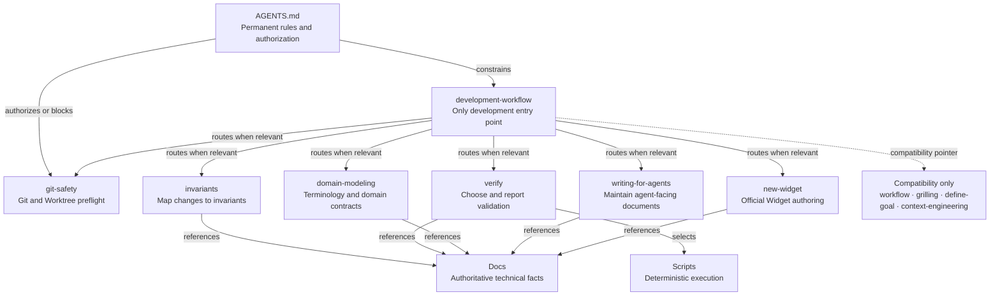
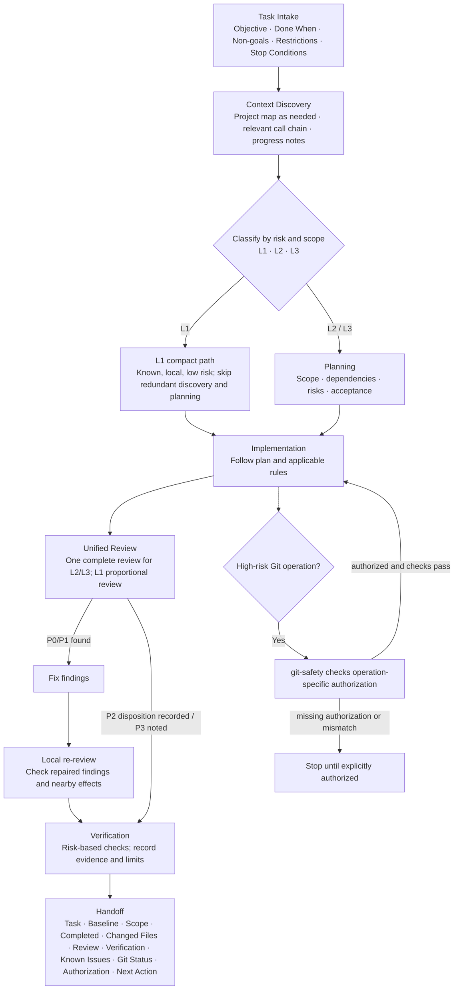

# Lattice Skill System

This page describes the current agent workflow and its supporting Skills. The diagrams are maintained as Mermaid source in this document; update them when the system or workflow changes.

## Goals

The Skill system gives agents one development entry point, routes specialized work only when needed, and keeps durable rules and technical facts in their authoritative homes. It should reduce repeated process steps without weakening project safety.

## Skill architecture

The solid arrows show constraints, conditional routing, authoritative references, or script selection as labeled. Dashed arrows identify compatibility-only references. A specialized Skill is called only when its subject is part of the task; none replaces the main workflow.

### Seven active Skills

| Skill | Responsibility | Trigger |
| --- | --- | --- |
| `development-workflow` | Intake, context discovery, task level, planning, implementation coordination, unified review, verification selection, and handoff. | Every development task; short L1 tasks use the compact path. |
| `git-safety` | Verify repository/worktree identity, branch, state, diffs, and operation-specific authorization. | Before any Git or Worktree operation. |
| `invariants` | Map the change to relevant invariant IDs and affected modules. | Before code changes that may touch a project invariant. |
| `verify` | Select evidence-based checks and report their outcomes accurately. | When choosing or reporting validation for a change. |
| `domain-modeling` | Align domain terms and contracts across code and documentation. | When introducing/changing domain concepts, names, fields, commands, or events. |
| `writing-for-agents` | Maintain `AGENTS.md`, Skills, and formal project documents without duplicating facts. | When creating or substantially editing these documents. |
| `new-widget` | Apply the repository's official Widget creation and release preparation method. | When creating an official Widget or changing its authoring/release integration. |

### Compatibility Skills

`workflow`, `grilling`, `define-goal`, and `context-engineering` are retained as short compatibility entries. They are not active workflow entry points and must not initiate a second full review. Their useful methods are incorporated into `development-workflow`; new development work starts there.

## Development workflow

L1 means simple, local, and low risk; it may use a short path when the objective and affected files are already clear. L2 is ordinary feature or maintenance work. L3 is architecture-level, high-risk, or crosses a sensitive boundary. Crossing modules alone does not make a task L3.

L2 and L3 receive one complete review, followed by fixes and a local re-review. P0 and P1 findings block acceptance. P2 findings require correction or an explicitly authorized, documented disposition; P3 items may be recorded as suggestions. Verification asks whether the change works and what evidence supports that claim; Review asks whether the change is correct, safe, and within scope. They are related but distinct.

High-risk Git operations follow `git-safety` and the authorization rules in `AGENTS.md`. A Skill can explain checks but cannot grant permission. Stop when authorization is missing or repository state differs from the expected baseline.

## Ownership boundaries

| Layer | Owns | Does not own |
| --- | --- | --- |
| `AGENTS.md` | Permanent repository rules, safety constraints, and authorization boundaries. | Full task-by-task development instructions or duplicated technical facts. |
| Skills | Context-sensitive routing, workflow, and specialist methods. | Permission grants or authoritative implementation facts. |
| `docs/` | Authoritative technical facts, contracts, architecture, and verification references. | A second copy of the development process. |
| Scripts and npm scripts | Deterministic, repeatable checks and transformations. | Contextual decisions about whether a task needs a check. |

## Diagram maintenance

These diagrams are part of the formal architecture reference. `development-workflow` and `writing-for-agents` maintainers must review them whenever active Skill count, responsibilities, the development entry point, routing relationships, workflow stages, task levels, review behavior, or authorization boundaries change. Update the diagrams in the same change as the rules or Skills they describe, and check them against the actual files and project documentation. Mermaid source in this document is the editable source of truth; do not create a separately maintained rendering unless the repository adopts a repeatable Mermaid renderer. Keep this page in `docs/README.md` navigation and `docs/catalog.json`.

The product architecture diagram is maintained separately in [`../ARCHITECTURE.md`](../ARCHITECTURE.md) and [`../architecture.svg`](../architecture.svg); changes to product module boundaries belong there, not in this Skill architecture page.
